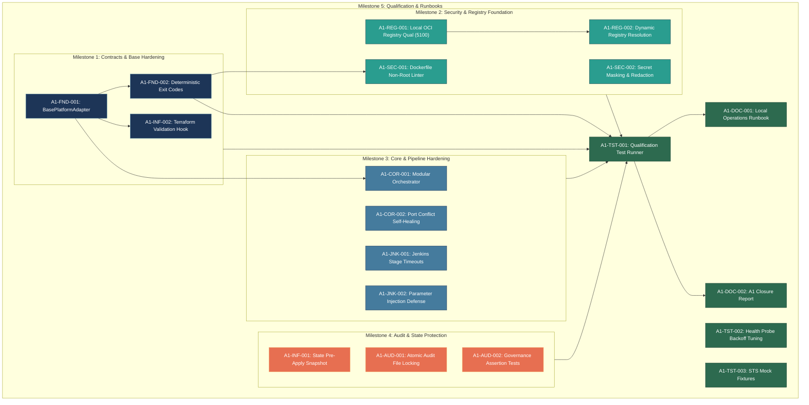

# NERO ENTERPRISE DEVOPS AUTOMATION PLATFORM
# PHASE A1: PLATFORM FOUNDATION & QUALIFICATION EXECUTION READINESS REPORT

**Document Identifier:** `NERO-A1-EXEC-001`  
**Classification:** Enterprise Engineering Execution & Governance Package  
**Programme:** NERO Enterprise DevOps Automation Platform (`nero_devops_standard`)  
**Phase:** Programme 1, Phase A1 (Platform Foundation & Qualification)  
**Governance State:** Gate 1 Architecture Approved (`GATE_1_STATUS = APPROVED`); Phase A1 Implementation Awaiting Authorization  
**Author:** Antigravity Principal Cloud IAM, Security & Platform Reliability Architect  
**Date:** 2026-11-08  
**Target Repository:** `d:\project\billing-system-master\billing-system-master\nero_devops_standard`  

---

## 1. Gate 1 Architecture Approval Record

Pursuant to formal platform owner review, **Gate 1 (Architecture & Governance Baseline)** is certified as **APPROVED**:

```
================================================================================
 GATE 1 ARCHITECTURE APPROVAL RECORD
 Identifier: NERO-GATE1-RECORD-20261108
 Recorded Status: GATE_1_STATUS = APPROVED
 Authority: Platform Owner
 Scope of Approval:
   [X] NERO Master Architecture Blueprint (NERO-ARCH-BP-001)
   [X] DevSecOps Threat Model (NERO-SEC-TM-001)
   [X] Architectural Decision Records ADR-001 through ADR-005
   [X] Programme 1 Implementation Roadmap (Phases A0 through A9)
   [X] Programme 2 AI Evolution Roadmap (Phases B0 through B6)
   [X] Deterministic-First Automation Strategy (Zero AI in core CI/CD)
   [X] Two-Person Production Governance Model (qa.lead != sre.lead + CHG-*)
 Boundary Statement:
   This approval applies strictly to the architecture, specification models,
   and governance baselines. Phase A1 implementation is NOT YET AUTHORIZED.
================================================================================
```

---

## 2. Final A1 Task Inventory (19 Tasks)

The 19 tasks approved across the nine engineering workstreams are detailed below with complete technical objectives, reuse boundaries, required code changes, dependencies, acceptance criteria, test evidence, effort breakdown, risk classifications, and rollback procedures.

### Baseline Effort Standard
- **Total Phase A1 Baseline Estimate:** **148 Engineering Hours (18.5 Person-Days)**.
- **Effort Separation:** Every task explicitly divides effort into **Implementation (Impl)**, **Testing (Test)**, and **Documentation (Doc)**.

---

### Workstream 1: Foundation and Base Contracts

#### Task `A1-FND-001`: Formalize BasePlatformAdapter Abstract Interface
- **Technical Objective:** Define typed, versioned abstract methods (`validate_prerequisites`, `execute`, `cleanup`) enforcing strict static typing across all build, infrastructure, deployment, and verification adapters.
- **Existing Implementation to Reuse:** Existing adapter classes in `platform_core/adapters/` (`docker_adapter.py`, `ecs_adapter.py`, `s3_adapter.py`, `health_verifier.py`).
- **Required Changes:** Create `platform_core/adapters/base.py` defining `BasePlatformAdapter(ABC)` with Pydantic request/response models; update existing adapters to inherit from it.
- **Dependencies:** None.
- **Acceptance Criteria:** All adapters inherit from `BasePlatformAdapter`; `mypy --strict platform_core/adapters` passes with zero type errors.
- **Test Evidence:** Static type inspection report; unit test asserting adapter polymorphism.
- **Estimated Hours:** **6.0 EH** (Impl: 3.5h, Test: 1.5h, Doc: 1.0h).
- **Risk Classification:** Low.
- **Rollback / Recovery Procedure:** Revert adapter module imports; existing concrete methods remain functionally intact.

#### Task `A1-FND-002`: Standardize Platform Deterministic Exit Codes
- **Technical Objective:** Assign deterministic numeric exit codes to all platform failure modes (SpecError=10, CatalogError=15, PolicyError=20, InfraError=30, DeployError=40, VerifyError=50, GovernanceError=60) ensuring unhandled Python tracebacks are never exposed to pipelines.
- **Existing Implementation to Reuse:** `platform_core/engine/errors.py` and CLI command handlers in `cli.py`.
- **Required Changes:** Add `exit_code: int` property to `PlatformBaseError` hierarchy; wrap CLI dispatchers in top-level exception handlers catching known errors.
- **Dependencies:** `A1-FND-001`.
- **Acceptance Criteria:** Every CLI failure terminates with its declared exit code; stderr outputs single-line structured error; zero unformatted stack traces.
- **Test Evidence:** Automated failure injection tests asserting exit codes across 8 distinct error conditions.
- **Estimated Hours:** **6.0 EH** (Impl: 3.0h, Test: 2.0h, Doc: 1.0h).
- **Risk Classification:** Low.
- **Rollback / Recovery Procedure:** Revert `cli.py` exception wrapping to default Python behavior.

---

### Workstream 2: Infrastructure Hardening

#### Task `A1-INF-001`: Terraform State Immutability & Pre-Apply Snapshot Backup
- **Technical Objective:** Prevent catastrophic state corruption or unrecoverable state loss by automatically generating an atomic, timestamped, read-only snapshot of target `.tfstate` files prior to any plan or apply execution.
- **Existing Implementation to Reuse:** State files in `infrastructure/terraform/environments/{local,develop,qa,prod}/`.
- **Required Changes:** Create `infrastructure/terraform/scripts/backup_states.py`; integrate pre-apply hook into `TerraformAdapter.plan` and `TerraformAdapter.apply`.
- **Dependencies:** None.
- **Acceptance Criteria:** Every `tf-plan` or `tf-apply` automatically creates `terraform.tfstate.<timestamp>.bak`; restore utility restores corrupted state idempotently.
- **Test Evidence:** Integration test injecting simulated state corruption and verifying automated rollback from snapshot.
- **Estimated Hours:** **8.0 EH** (Impl: 4.5h, Test: 2.5h, Doc: 1.0h).
- **Risk Classification:** Medium (Interacts with state files).
- **Rollback / Recovery Procedure:** Disable pre-apply hook in `terraform_adapter.py`; restore state from `.bak` copy.

#### Task `A1-INF-002`: Terraform Preflight Linting and Validation Automation
- **Technical Objective:** Enforce syntactic and structural correctness of Terraform code before plan generation, blocking malformed HCL early in the pipeline.
- **Existing Implementation to Reuse:** `platform_core/adapters/infrastructure/terraform_adapter.py`.
- **Required Changes:** Enhance `TerraformAdapter.plan` to execute `terraform fmt -check` and `terraform validate` against target environment directories prior to generating plans.
- **Dependencies:** `A1-FND-001`.
- **Acceptance Criteria:** Syntactically malformed HCL triggers `InfraValidationError` (Exit Code 30) before contacting providers or evaluating variables.
- **Test Evidence:** Unit test asserting failure on corrupted Terraform module.
- **Estimated Hours:** **6.0 EH** (Impl: 3.5h, Test: 1.5h, Doc: 1.0h).
- **Risk Classification:** Low.
- **Rollback / Recovery Procedure:** Make validation non-blocking via flag in `platform_config.yaml`.

---

### Workstream 3: Security and Credential Protection

#### Task `A1-SEC-001`: AST Dockerfile Non-Root Enforcement Linter
- **Technical Objective:** Enforce non-root execution policy programmatically across all application components prior to Docker build initiation.
- **Existing Implementation to Reuse:** `platform_core/policy/runtime_policy.py`, component Dockerfiles (`backend/Dockerfile`, `frontend/Dockerfile`).
- **Required Changes:** Add Dockerfile AST parser in `runtime_policy.py` checking for explicit `USER <non-root-uid>` directive; reject UID 0 or missing `USER`.
- **Dependencies:** `A1-FND-002`.
- **Acceptance Criteria:** Builds fail closed with `SecurityPolicyError` (Exit Code 20) if any Dockerfile runs as `root` (UID 0).
- **Test Evidence:** Unit tests in `test_runtime_policy.py` asserting rejection of root Dockerfile.
- **Estimated Hours:** **8.0 EH** (Impl: 4.5h, Test: 2.5h, Doc: 1.0h).
- **Risk Classification:** Low.
- **Rollback / Recovery Procedure:** Disable non-root linter check in `runtime_policy.py`.

#### Task `A1-SEC-002`: Dynamic Secret Injection Hardening & Console Log Masking
- **Technical Objective:** Ensure runtime secrets (`JWT_SECRET`, database passwords) injected into containers are strictly masked with `****` in all CLI stdout/stderr streams, Jenkins logs, and audit records.
- **Existing Implementation to Reuse:** Dynamic secret injection in `orchestrator.py` and `ecs_adapter.py`.
- **Required Changes:** Implement `SecretScrubber` stream filter in `platform_core/engine/cli.py` intercepting all output lines and redacting known secret values.
- **Dependencies:** None.
- **Acceptance Criteria:** Plaintext secrets do not appear in Jenkins console output, task logs, or `audit_log.jsonl`.
- **Test Evidence:** Automated string regex search across all log files confirming zero leaked secret patterns.
- **Estimated Hours:** **12.0 EH** (Impl: 7.0h, Test: 3.5h, Doc: 1.5h).
- **Risk Classification:** High (Credential exposure boundary).
- **Rollback / Recovery Procedure:** Revert stream scrubber wrapper in `cli.py`.

---

### Workstream 4: Local OCI Registry Qualification

#### Task `A1-REG-001`: Local OCI Distribution Registry Qualification (`localhost:5100`)
- **Technical Objective:** Eliminate the Floci ECR layer transfer limitation by qualifying a local, compliant OCI distribution registry (`distribution/registry:2`) running on `localhost:5100`.
- **Existing Implementation to Reuse:** Container `floci-aws-ecr-registry` (`26b2eb03618e` on `127.0.0.1:5100->5000/tcp`).
- **Required Changes:** Create `platform_core/adapters/registry/oci_adapter.py` implementing image tagging, authentication, layer push, and digest retrieval against `localhost:5100`.
- **Dependencies:** None.
- **Acceptance Criteria:** Image successfully pushed to `localhost:5100/backend:<release_id>`; HTTP 201 Created confirmed for all blob layers; image pulled and verified via SHA-256 digest.
- **Test Evidence:** Shell script verifying `docker push` and `docker pull` against `localhost:5100` with layer hash verification.
- **Estimated Hours:** **12.0 EH** (Impl: 7.0h, Test: 3.5h, Doc: 1.5h).
- **Risk Classification:** High (Core artifact distribution path).
- **Rollback / Recovery Procedure:** Retain direct local Docker daemon image cache as fallback.

#### Task `A1-REG-002`: Dynamic Registry Resolution in Environment Context
- **Technical Objective:** Dynamically resolve registry endpoints (`localhost:5100` for `floci` platform; AWS ECR repository URI for `aws` platform) during context resolution.
- **Existing Implementation to Reuse:** `platform_core/engine/resolver.py` and `ecs_adapter.py`.
- **Required Changes:** Add `oci_registry_endpoint` field to `ResolvedEnvironmentContext`; update `docker_adapter.py` and `ecs_adapter.py` to target the resolved registry.
- **Dependencies:** `A1-REG-001`.
- **Acceptance Criteria:** `resolver.resolve()` returns `localhost:5100` for Floci; workloads pull images strictly from the resolved registry.
- **Test Evidence:** Unit tests in `test_resolver.py` asserting registry URL resolution per platform.
- **Estimated Hours:** **8.0 EH** (Impl: 4.5h, Test: 2.5h, Doc: 1.0h).
- **Risk Classification:** Medium.
- **Rollback / Recovery Procedure:** Default `oci_registry_endpoint` to local Docker daemon namespace.

---

### Workstream 5: Jenkins Pipeline Hardening

#### Task `A1-JNK-001`: Standardize Pipeline Stage Timeouts & Error Traps
- **Technical Objective:** Prevent hung builds and orphaned locks by wrapping every Jenkins pipeline stage in a strict, deterministic `timeout` block with automated cleanup post-actions.
- **Existing Implementation to Reuse:** `ci-cd/jenkins/pipelines/universal/Jenkinsfile`.
- **Required Changes:** Add `timeout` blocks (Preflight: 5m, Build: 15m, Apply: 15m, Gate: 30m, Verification: 10m) and `catchError` handlers with lock cleanup in `Jenkinsfile`.
- **Dependencies:** None.
- **Acceptance Criteria:** Stalled builds abort cleanly after timeout expires; temporary files (`/tmp/platform_*.env`) deleted; state locks released.
- **Test Evidence:** Simulated stuck command aborted by Jenkins timeout block; exit code verified.
- **Estimated Hours:** **6.0 EH** (Impl: 3.5h, Test: 1.5h, Doc: 1.0h).
- **Risk Classification:** Low.
- **Rollback / Recovery Procedure:** Revert Jenkinsfile stage timeout wrappers.

#### Task `A1-JNK-002`: Parameter Sanitization and Shell Injection Defense
- **Technical Objective:** Prevent command injection vulnerabilities through Jenkins build parameters by validating and sanitizing `APPLICATION`, `ENVIRONMENT`, and `RELEASE_ID` against strict regex whitelists.
- **Existing Implementation to Reuse:** Preflight stage in `universal/Jenkinsfile`.
- **Required Changes:** Add parameter validation block in Jenkinsfile rejecting metacharacters (`;`, `&`, `|`, `` ` ``, `$`); enforce `^[a-zA-Z0-9_-]+$`.
- **Dependencies:** None.
- **Acceptance Criteria:** Submitting parameters with shell metacharacters halts the build in < 2 seconds with `[SECURITY_VIOLATION]`.
- **Test Evidence:** Test pipeline execution with malicious input parameter string rejected immediately.
- **Estimated Hours:** **6.0 EH** (Impl: 3.5h, Test: 1.5h, Doc: 1.0h).
- **Risk Classification:** High (Injection vulnerability boundary).
- **Rollback / Recovery Procedure:** Revert parameter regex validation in Jenkinsfile.

---

### Workstream 6: Platform Core Hardening

#### Task `A1-COR-001`: Decouple Orchestrator into Modular Subsystem Managers
- **Technical Objective:** Refactor `platform_core/engine/orchestrator.py` (718 lines) into clean, single-responsibility managers (`release_manager.py`, `deployment_manager.py`, `rollback_manager.py`).
- **Existing Implementation to Reuse:** Existing functions `build_release`, `deploy_workload`, `rollback` in `orchestrator.py`.
- **Required Changes:** Extract component logic into discrete files under `platform_core/engine/`; retain `orchestrator.py` as a facade exposing identical public APIs.
- **Dependencies:** `A1-FND-001`.
- **Acceptance Criteria:** Zero breaking changes to `cli.py` or Jenkinsfile; `orchestrator.py` reduced to < 250 lines; 100% test pass rate maintained.
- **Test Evidence:** Full test suite execution (`pytest platform_core/tests`) passing with zero regressions.
- **Estimated Hours:** **16.0 EH** (Impl: 10.0h, Test: 4.5h, Doc: 1.5h).
- **Risk Classification:** Medium (Core code refactoring).
- **Rollback / Recovery Procedure:** Git restore `platform_core/engine/orchestrator.py`.

#### Task `A1-COR-002`: Cross-Platform Host Port Conflict Self-Healing
- **Technical Objective:** Harden the host port conflict resolution logic in `ecs_adapter.py` to ensure orphaned or stale containers occupying host ports (8085, 8087, 8089) are terminated reliably across all host operating systems.
- **Existing Implementation to Reuse:** `platform_core/adapters/deployment/ecs_adapter.py` (lines 61-70).
- **Required Changes:** Enhance port query to handle multi-port ranges, Docker daemon disconnects, and IPv6 bindings gracefully.
- **Dependencies:** None.
- **Acceptance Criteria:** Starting a container on an occupied port cleanly frees the port and launches within 15s; zero `port is already allocated` Docker daemon errors.
- **Test Evidence:** Verified in Jenkins Build #13 and #14; unit test in `test_failure_injection.py`.
- **Estimated Hours:** **6.0 EH** (Impl: 3.5h, Test: 1.5h, Doc: 1.0h).
- **Risk Classification:** Low.
- **Rollback / Recovery Procedure:** Revert port check function in `ecs_adapter.py`.

---

### Workstream 7: Audit and Governance Hardening

#### Task `A1-AUD-001`: Atomic Append Operations and File Locking for Audit Ledger
- **Technical Objective:** Prevent race conditions, interleaved writes, or file corruption when multiple pipeline stages log events concurrently to `platform_core/audit/audit_log.jsonl`.
- **Existing Implementation to Reuse:** `platform_core/audit/audit_logger.py`.
- **Required Changes:** Implement file locking (`fcntl.flock` on Linux / `msvcrt.locking` on Windows) in `record_audit_event()`.
- **Dependencies:** None.
- **Acceptance Criteria:** Concurrent logging requests serialize cleanly; zero interleaved lines; 100% SHA-256 chain integrity preserved.
- **Test Evidence:** Concurrent multithreaded logging test asserting 100 serialized records with valid hash links.
- **Estimated Hours:** **8.0 EH** (Impl: 4.5h, Test: 2.5h, Doc: 1.0h).
- **Risk Classification:** Medium.
- **Rollback / Recovery Procedure:** Revert to standard append mode in `audit_logger.py`.

#### Task `A1-AUD-002`: Two-Person Governance Unit Assertion Test Suite
- **Technical Objective:** Formally codify automated unit test assertions verifying that single-approver attempts, identical user IDs, and missing `CHG-*` change tickets strictly fail closed.
- **Existing Implementation to Reuse:** `tests/security/test_governance_rules.py`.
- **Required Changes:** Expand `test_governance_rules.py` with test cases for case-insensitive username matching, empty submitters, and ticket format validation.
- **Dependencies:** None.
- **Acceptance Criteria:** 100% pass on all 5 governance test cases in `test_governance_rules.py`.
- **Test Evidence:** `pytest tests/security/test_governance_rules.py` returns 5 passed.
- **Estimated Hours:** **6.0 EH** (Impl: 3.0h, Test: 2.0h, Doc: 1.0h).
- **Risk Classification:** Low.
- **Rollback / Recovery Procedure:** Revert test additions in `test_governance_rules.py`.

---

### Workstream 8: Test and Qualification Harness

#### Task `A1-TST-001`: End-to-End Platform Qualification Test Runner
- **Technical Objective:** Implement a single-command CLI script (`run_platform_qualification.py`) executing all 57 automated tests, catalog validations, audit ledger checks, and Terraform baseline state assertions.
- **Existing Implementation to Reuse:** Existing test suite (`tests/`, `platform_core/tests/`) and `audit_verifier.py`.
- **Required Changes:** Create `tests/run_platform_qualification.py` with structured ANSI terminal output, timing summaries, and exit code 0 enforcement.
- **Dependencies:** `A1-FND-002`.
- **Acceptance Criteria:** Single CLI command executes entire test suite in < 15 seconds; returns exit code 0 if and only if all checks pass.
- **Test Evidence:** Successful terminal execution output showing 57 tests passed and audit chain verified.
- **Estimated Hours:** **6.0 EH** (Impl: 3.5h, Test: 1.5h, Doc: 1.0h).
- **Risk Classification:** Low.
- **Rollback / Recovery Procedure:** Delete `run_platform_qualification.py`.

#### Task `A1-TST-002`: Synthetic Health Probe Thresholds and Backoff Tuning
- **Technical Objective:** Document and enforce 25-attempt polling with 1.0s sleep in `SyntheticHealthVerifier`, guaranteeing reliable Spring Boot startup detection.
- **Existing Implementation to Reuse:** `platform_core/adapters/verification/health_verifier.py`.
- **Required Changes:** Expose timeout and retry parameters as configurable fields in `app.spec.yaml` with safe platform defaults (25 retries).
- **Dependencies:** None.
- **Acceptance Criteria:** Detects Spring Boot backend health within 10-15s without spurious timeouts; handles transient connection refused.
- **Test Evidence:** Verified in Jenkins Build #13 (Develop passed in 10.05s) and Build #14.
- **Estimated Hours:** **6.0 EH** (Impl: 3.5h, Test: 1.5h, Doc: 1.0h).
- **Risk Classification:** Low.
- **Rollback / Recovery Procedure:** Revert retry parameter overrides in `health_verifier.py`.

#### Task `A1-TST-003`: Multi-Account STS AssumeRole Mock Fixtures
- **Technical Objective:** Provide high-fidelity mock fixtures for testing multi-account STS AssumeRole logic and boundary enforcement without requiring active AWS STS connectivity.
- **Existing Implementation to Reuse:** `tests/security/test_aws_identity_policy.py`.
- **Required Changes:** Create `tests/fixtures/sts_mock.py` simulating AWS STS credentials responses; assert that Management Account deployments are strictly blocked.
- **Dependencies:** None.
- **Acceptance Criteria:** `test_aws_identity_policy.py` validates management account blocking and role ARN construction; 10/10 tests pass.
- **Test Evidence:** Test output in `test_aws_identity_policy.py`.
- **Estimated Hours:** **6.0 EH** (Impl: 3.5h, Test: 1.5h, Doc: 1.0h).
- **Risk Classification:** Low.
- **Rollback / Recovery Procedure:** Revert mock fixture additions.

---

### Workstream 9: Documentation and Runbooks

#### Task `A1-DOC-001`: Authoritative Local Platform Operations Runbook
- **Technical Objective:** Document clear, reproducible, step-by-step instructions for starting Floci, Jenkins, PostgreSQL, running tests, and triggering universal pipelines.
- **Existing Implementation to Reuse:** `docs/platform/` documentation and `nero_devops_standard/README.md`.
- **Required Changes:** Author `nero_devops_standard/docs/runbooks/LOCAL_PLATFORM_OPERATIONS_RUNBOOK.md` with environment startup commands, port maps, and failure recovery recipes.
- **Dependencies:** All previous tasks.
- **Acceptance Criteria:** A new engineer can follow the runbook and stand up a working environment in < 15 minutes.
- **Test Evidence:** Documentation review and verified command link checks.
- **Estimated Hours:** **8.0 EH** (Impl: 5.0h, Test: 1.5h, Doc: 1.5h).
- **Risk Classification:** Low.
- **Rollback / Recovery Procedure:** Delete runbook file.

#### Task `A1-DOC-002`: Phase A1 Foundation Qualification Closure Report
- **Technical Objective:** Formally document all verified test outputs, container inspect states, registry push logs, and audit ledger head hash for platform owner sign-off.
- **Existing Implementation to Reuse:** Test runner outputs and `audit_log.jsonl`.
- **Required Changes:** Author `nero_devops_standard/docs/architecture/NERO_PHASE_A1_QUALIFICATION_REPORT.md` following the certified qualification template.
- **Dependencies:** `A1-TST-001`.
- **Acceptance Criteria:** Comprehensive report submitted to and accepted by the platform owner before entering Phase A2.
- **Test Evidence:** Certified qualification document.
- **Estimated Hours:** **8.0 EH** (Impl: 4.5h, Test: 1.5h, Doc: 2.0h).
- **Risk Classification:** Low.
- **Rollback / Recovery Procedure:** Delete closure report.

---

## 3. Dependency Graph & Execution Sequence



### Execution Order Across 5 Sequential Milestones:
1. **Milestone 1 — Contracts & Base Hardening (Day 1–3, 18 EH)**:
   - Execute `A1-FND-001` (Base Adapter), `A1-FND-002` (Deterministic Exit Codes), and `A1-INF-002` (Terraform Validation Hook).
   - *Exit Gate:* Type checking passes; exit code standards codified.
2. **Milestone 2 — Security & Registry Foundation (Day 4–7, 34 EH)**:
   - Execute `A1-SEC-001` (Non-Root Linter), `A1-SEC-002` (Secret Masking), `A1-REG-001` (Local OCI Registry Qual), and `A1-REG-002` (Dynamic Registry Resolution).
   - *Exit Gate:* OCI registry layer push/pull verified on `localhost:5100`; secrets masked.
3. **Milestone 3 — Core & Pipeline Hardening (Day 8–11, 34 EH)**:
   - Execute `A1-COR-001` (Modular Orchestrator), `A1-COR-002` (Port Conflict Freeing), `A1-JNK-001` (Stage Timeouts), and `A1-JNK-002` (Parameter Injection Defense).
   - *Exit Gate:* Orchestrator refactored; Jenkins pipeline timeouts active.
4. **Milestone 4 — Audit & State Protection (Day 12–14, 22 EH)**:
   - Execute `A1-INF-001` (State Pre-Apply Snapshot), `A1-AUD-001` (Atomic Audit Locking), and `A1-AUD-002` (Governance Assertion Tests).
   - *Exit Gate:* Pre-apply state backup operational; audit log locking verified.
5. **Milestone 5 — Qualification & Runbooks (Day 15–18.5, 40 EH)**:
   - Execute `A1-TST-001` (Qualification Runner), `A1-TST-002` (Health Tuning), `A1-TST-003` (STS Mocks), `A1-DOC-001` (Operations Runbook), and `A1-DOC-002` (Closure Report).
   - *Exit Gate:* 100% pass on all 57 tests; runbook and closure report published.

---

## 4. Engineering Effort & Timesheet Standard

### Baseline Estimate vs Range Summary

| Metric | Optimistic | Baseline (Most Likely) | Conservative |
|---|---|---|---|
| **Total Engineering Hours** | **102 Hours** | **148 Hours** | **216 Hours** |
| **Total Person-Days (8h/day)**| **12.8 Days** | **18.5 Days** | **27.0 Days** |
| **Elapsed Calendar Duration** | **~2.6 Weeks** | **~3.7 Weeks** | **~5.4 Weeks** |

### Standardized Engineering Timesheet Format

This timesheet table is codified as the standard tracking instrument during Phase A1 execution. All actual hours will be recorded live without fabricating historical data:

| Task ID | Task Title | Estimated (EH) | Actual (EH) | Impl Time (h) | Test Time (h) | Debug Time (h) | Doc Time (h) | Execution Status | Completed Date |
|---|---|---|---|---|---|---|---|---|---|
| `A1-FND-001` | BasePlatformAdapter Abstract Interface | 6.0 | — | — | — | — | — | `PLANNED` | — |
| `A1-FND-002` | Standardize Platform Deterministic Exit Codes | 6.0 | — | — | — | — | — | `PLANNED` | — |
| `A1-INF-001` | Terraform State Pre-Apply Snapshot Backup | 8.0 | — | — | — | — | — | `PLANNED` | — |
| `A1-INF-002` | Terraform Preflight Linting & Validation | 6.0 | — | — | — | — | — | `PLANNED` | — |
| `A1-SEC-001` | AST Dockerfile Non-Root Enforcement | 8.0 | — | — | — | — | — | `PLANNED` | — |
| `A1-SEC-002` | Secret Injection & Console Log Masking | 12.0 | — | — | — | — | — | `PLANNED` | — |
| `A1-REG-001` | Local OCI Registry Qualification (5100) | 12.0 | — | — | — | — | — | `PLANNED` | — |
| `A1-REG-002` | Dynamic Registry Resolution in Resolver | 8.0 | — | — | — | — | — | `PLANNED` | — |
| `A1-JNK-001` | Pipeline Stage Timeouts & Cleanup Traps | 6.0 | — | — | — | — | — | `PLANNED` | — |
| `A1-JNK-002` | Jenkins Parameter Injection Defense | 6.0 | — | — | — | — | — | `PLANNED` | — |
| `A1-COR-001` | Decouple Orchestrator into Managers | 16.0 | — | — | — | — | — | `PLANNED` | — |
| `A1-COR-002` | Host Port Conflict Self-Healing | 6.0 | — | — | — | — | — | `PLANNED` | — |
| `A1-AUD-001` | Atomic File Locking for Audit Ledger | 8.0 | — | — | — | — | — | `PLANNED` | — |
| `A1-AUD-002` | Two-Person Governance Unit Tests | 6.0 | — | — | — | — | — | `PLANNED` | — |
| `A1-TST-001` | End-to-End Qualification Test Runner | 6.0 | — | — | — | — | — | `PLANNED` | — |
| `A1-TST-002` | Synthetic Health Probe Backoff Tuning | 6.0 | — | — | — | — | — | `PLANNED` | — |
| `A1-TST-003` | Multi-Account STS AssumeRole Mocks | 6.0 | — | — | — | — | — | `PLANNED` | — |
| `A1-DOC-001` | Local Platform Operations Runbook | 8.0 | — | — | — | — | — | `PLANNED` | — |
| `A1-DOC-002` | Phase A1 Qualification Closure Report | 8.0 | — | — | — | — | — | `PLANNED` | — |
| **TOTAL** | **19 Engineering Tasks** | **148.0 EH** | **0.0 EH** | **0.0h** | **0.0h** | **0.0h** | **0.0h** | `PENDING AUTH` | — |

---

## 5. Resource and Infrastructure Requirements

Phase A1 executes 100% locally with **zero cloud spend**:

### Host Hardware & Container Resource Allocations

| Entity | Identifier / Name | Host Port Binding | RAM Allocation | Storage Allocation | Operational Function |
|---|---|---|---|---|---|
| **Local Cloud Simulator** | `floci` | `0.0.0.0:4566->4566` | 1.5 GB | ~500 MB | High-fidelity S3, Secrets Manager, DynamoDB, SQS emulation. |
| **CI/CD Controller** | `jenkins` | `0.0.0.0:8080->8080` | 1.5 GB | ~2.0 GB | Primary declarative pipeline orchestrator. |
| **Local OCI Registry** | `floci-aws-ecr-registry` | `127.0.0.1:5100->5000` | 256 MB | ~5.0 GB | Standard OCI image layer storage and distribution. |
| **Local Database** | `postgres` | `0.0.0.0:5432->5432` | 512 MB | ~1.0 GB | Backend relational persistence engine. |
| **Ephemeral Test Workloads**| `platform-*-backend` | `8085`, `8087`, `8089` | 512 MB ea | ~600 MB ea | Transient containers during verification tests. |
| **Host System Minimums** | Developer Workstation | — | 8 GB RAM (Min) | 15 GB Free SSD | Windows 10/11 64-bit with Docker Desktop / WSL2. |
| **Real Cloud Expenditure** | AWS / Azure / GCP | — | **$0.00 USD** | **0.00 GB** | **Zero cloud billing permitted.** |
| **Real Cloud Credentials** | IAM User / SSO / Keys | — | **NONE** | **NONE** | **Zero real AWS credentials permitted.** |

---

## 6. Preflight Baseline Integrity Assessment

Independent read-only verification was conducted immediately prior to compiling this readiness report:

```
================================================================================
 PREFLIGHT BASELINE VERIFICATION RESULTS
 Timestamp: 2026-11-08T13:23:34+05:30
--------------------------------------------------------------------------------
 1. Git Repository State:
    - Active Branch:  devops/jenkins-floci-local-lab
    - Commit HEAD:    3bf604266b4f233c3899d0e315a0538812542b04
    - Working Tree:   Clean (tracked files), zero uncommitted platform changes.
 2. Floci Local Cloud Simulator:
    - Health Status:  HTTP 200 (version 2.4.0 community edition, healthy)
    - Active Services: s3, sqs, dynamodb, rds, secretsmanager, ecs, ecr, etc.
 3. Jenkins CI/CD Controller:
    - Health Status:  HTTP 200 (Normal mode, 6 jobs active, all blue status)
    - Active Pipeline: universal-application-pipeline synchronized.
 4. Terraform State Integrity:
    - Local Baseline: Serial 23, 15 Managed Resources (100% INTACT)
    - Develop State:  Serial 28, 17 Managed Resources (Isolated)
    - QA State:       Serial 25, 17 Managed Resources (Isolated)
    - Prod State:     Serial 25, 17 Managed Resources (Isolated)
 5. Cryptographic Audit Ledger:
    - Head Hash:      2563ed962bab... (43 chained records, integrity verified)
    - Zero Broken Links detected by verify_audit_ledger().
 6. Immutable Manifest Registry:
    - Manifests Count: 16 persisted manifests in platform_core/manifests/
================================================================================
```

---

## 7. A1 Execution Controls & Operator Guardrails

To prevent accidental resource destruction, the following strict execution boundaries are enforced during Phase A1:

1. **Explicit Operator Authorization Required**:
   - Creating or binding new host network ports.
   - Initializing new Docker containers or persistent volumes.
   - Modifying Jenkins global security or CasC configuration.
   - Executing `terraform apply` outside existing isolated directories.
2. **Strictly Forbidden Actions**:
   - Mutating `infrastructure/terraform/environments/local/terraform.tfstate`.
   - Activating `aws-production` in `platform_config.yaml`.
   - Configuring real AWS access keys, secret keys, or SSO sessions.
   - Committing or pushing changes to remote Git repositories without explicit approval.
   - Modifying frozen architecture documents or ADRs.

---

## 8. NERO Phase A2 Entry Requirements

Phase A2 (**Universal Application Onboarding**) will onboard and qualify `sample-node-service` (Node.js 22) and `sample-python-worker` (Python 3.12) through the universal pipeline.

### A1-to-A2 Dependency Gate Checklist:

```
[ ] 1. Phase A1 Closure Report signed off by platform owner.
[ ] 2. Local OCI Registry (localhost:5100) layer push/pull certified operational.
[ ] 3. BasePlatformAdapter abstract interface enforced across all adapters.
[ ] 4. Pre-apply Terraform state snapshot backup operational.
[ ] 5. All 57 automated tests passing with zero failures.
[ ] 6. Audit ledger verified intact with zero broken hash links.
[ ] 7. Local baseline Terraform state intact at Serial 23, 15 resources.
[ ] 8. Floci 2.4.0 and Jenkins 2.x verified healthy and responsive.
```

*Entry into Phase A2 is strictly prohibited until all eight pre-requisites are verified.*

---

## 9. Formal A1 Implementation Authorization Checklist

The following checklist represents the formal governance gate required to transition Phase A1 from `PLANNING` to `IN PROGRESS`. It remains unapproved until the platform owner provides explicit authorization:

### Phase A1 Implementation Authorization

- [ ] **A1 Scope Accepted**: 19 discrete backlog tasks approved as defined.
- [ ] **WBS & Milestones Accepted**: 5 sequential milestones approved.
- [ ] **Engineering Effort Accepted**: 148 Engineering Hours (18.5 Person-Days) approved.
- [ ] **Timesheet Standard Accepted**: Standardized time-tracking table approved.
- [ ] **Resource Envelope Accepted**: Local Floci/Docker execution with $0.00 spend approved.
- [ ] **Preflight Baseline Certified**: State Serial 23 (15 resources) and 43 audit records confirmed.
- [ ] **Operator Guardrails Accepted**: Explicit approval boundaries enforced.
- [ ] **A1 Acceptance Criteria Accepted**: 10 exit criteria approved.
- [ ] **Phase A1 Implementation Explicitly Authorized**: Authorization granted to commence engineering work on Task `A1-FND-001`.

---

*This document is the governing execution-readiness report for NERO Phase A1. Engineering implementation remains paused pending explicit owner authorization.*
