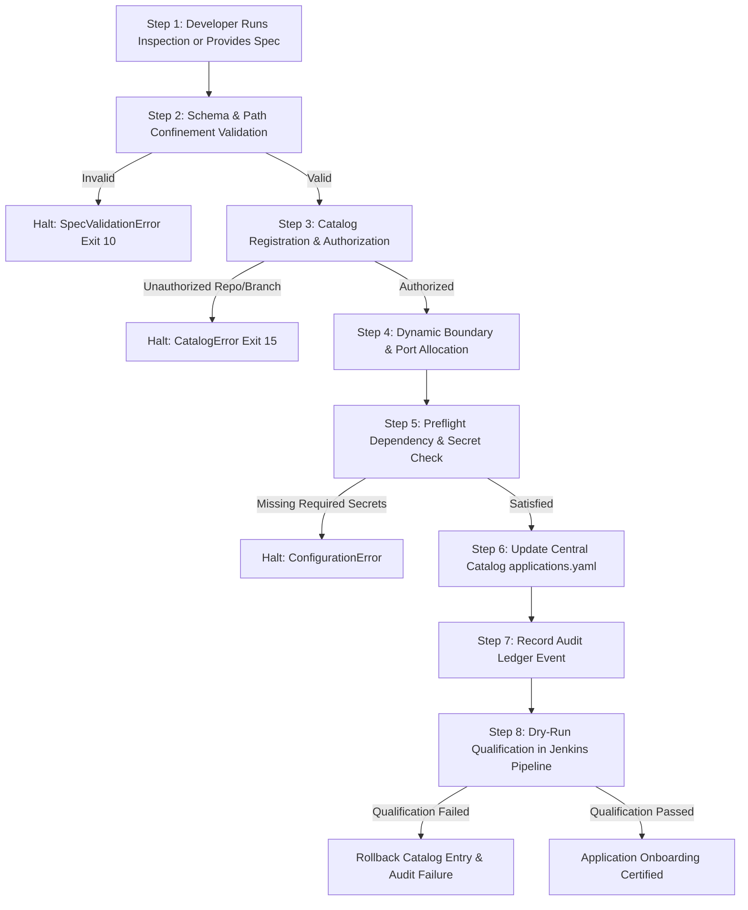

# NERO Universal Enterprise DevOps Automation Platform
## Programme 1 — Phase A2: Universal Application Onboarding & Catalog Expansion
### Requirements, Architecture & Implementation Planning Report

**Document Type:** Product Requirements, Architecture Specification & Engineering Implementation Plan  
**Document ID:** NERO-A2-PLAN-001  
**Programme:** NERO Programme 1 — Deterministic DevOps Automation  
**Phase:** Phase A2 (Universal Application Onboarding & Catalog Expansion)  
**Status:** PROPOSED & PENDING OWNER APPROVAL (Implementation Not Authorized)  
**Governance Baseline:** Gate 1 Approved | Phase A1 Qualified  
**Effective Date:** 2026-11-08  
**Author:** NERO Lead DevOps Automation Architect  

---

## 1. Executive Summary

Phase A1 (Platform Foundation & Qualification) established a deterministic, hardened, and verified continuous delivery foundation across Floci local simulation and Docker. 

The primary mission of **Phase A2: Universal Application Onboarding & Catalog Expansion** is:

> **A developer should be able to register a supported application through a validated declarative specification (`app.spec.yaml`), and the NERO platform should automatically identify its requirements, select approved build and deployment adapters, allocate execution boundaries, and onboard it through the existing Jenkins universal pipeline without requiring application-specific pipeline code or bespoke deployment scripts.**

This report establishes the complete requirements, architectural specifications, compatibility matrix, security boundaries, and engineering work breakdown for Phase A2.

### Strict Governance & Implementation Boundary
- **A2 Implementation Status**: **NOT AUTHORIZED**. This document constitutes an architectural design and planning package only.
- **Zero Real Cloud Spend**: All onboarding qualifications remain 100% confined to local simulation (Floci / Docker / Local OCI Registry) with **$0.00** expenditure.
- **Deterministic-First Principle**: Zero LLM, AI agent, or machine-learning dependencies. All discovery, validation, and adapter selections are governed by deterministic schemas, regex, AST inspection, and typed policies.

---

## 2. Product Vision & Scope for Phase A2

### 2.1 The Golden Path for Application Onboarding
Historically, onboarding a new service required writing and maintaining bespoke Jenkinsfiles or deployment scripts for each repository. This led to fragmented practices, security drift, hardcoded configurations, and high maintenance overhead.

Under Phase A2, the Golden Path onboarding lifecycle operates as follows:

```
+---------------------------------------------------------------------------------------------------+
|                                 NERO Phase A2 Golden Path                                         |
+---------------------------------------------------------------------------------------------------+
|  1. Author Declarative Specification: Developer creates/generates app.spec.yaml                    |
|  2. Multi-Layer Validation: File size -> Safe YAML -> JSON Schema -> Pydantic Models -> Path Guard |
|  3. Catalog Authorization: Matches repository origin, branch patterns, and permitted adapters     |
|  4. Dynamic Boundary Allocation: Deterministic port allocation, S3 prefixing, and secret schemas  |
|  5. Universal Pipeline Dispatch: Single Jenkinsfile executes build & deploy driven by spec models |
|  6. Tamper-Evident Ledger: Immutable audit record logged to SHA-256 chained audit_log.jsonl       |
+---------------------------------------------------------------------------------------------------+
```

### 2.2 Scope Boundaries (In-Scope vs. Out-of-Scope)

| In-Scope for Phase A2 | Out-of-Scope (Deferred to Phase A3–A9) | Strictly Prohibited |
|---|---|---|
| Universal `app.spec.yaml` v2 schema & Pydantic models | Automated SCM webhook listeners & PR triggers (A3) | Introducing LLMs, generative AI, or heuristic guesswork |
| Deterministic repository inspection CLI (`nero inspect-repo`) | Static code analysis & SAST gates (SonarQube/SpotBugs) (A3) | Writing bespoke Jenkinsfiles per application |
| Automated application registration CLI (`nero onboard-app`) | CycloneDX SBOM generation & Cosign image signing (A4) | Bypassing catalog allowlists or branch policies |
| Dynamic port allocation & environment boundary resolution | Automated Terraform module synthesis from spec (A5) | Deploying to AWS Organizations Management Account |
| Refactoring Jenkins universal pipeline to remove hardcoded app names | Multi-cluster Kubernetes Helm/Kustomize deployment (A6) | Incurring real AWS cloud spend ($0.00 limit) |
| Onboarding qualification of Node.js, Python, and Hotel Billing | Canary/Blue-Green progressive traffic shifting (A6) | Executing arbitrary untrusted shell/Groovy scripts |
| Architecture specification for Go microservice onboarding | Full Prometheus/Grafana metric telemetry stack (A8) | Silent auto-approval of unreviewed specifications |

---

## 3. Existing Platform Assessment & Technical Debt Audit

A thorough empirical inspection of the Phase A1 codebase reveals both robust foundations and critical technical debt that must be remediated in Phase A2:

### 3.1 Existing Codebase Inventory
- **Catalog Engine** (`platform_core/engine/catalog.py` & `applications.yaml`): Authoritative registry containing 3 pre-registered applications (`hotel-billing`, `sample-node-service`, `sample-python-worker`).
- **Specification Engine** (`platform_core/engine/models.py` & `parser.py`): Pydantic models and JSON Schema validating `app.spec.yaml`.
- **Environment Resolver** (`platform_core/engine/resolver.py`): Maps `(app_id, env, platform, topology)` into `ResolvedEnvironmentContext`.
- **Modular Orchestrator** (`release_manager.py`, `deployment_manager.py`, `rollback_manager.py`): Modularized subsystems handling builds, deploys, and rollbacks.
- **Universal Jenkins Pipeline** (`ci-cd/jenkins/pipelines/universal/Jenkinsfile`): 612-line declarative pipeline.

### 3.2 Critical Technical Debt & Hardcoded Application Logic Identified

Our empirical audit identified four major areas of hardcoded coupling that prevent true universal onboarding:

#### 1. Hardcoded Application Conditionals in Jenkinsfile
In `ci-cd/jenkins/pipelines/universal/Jenkinsfile`:
- Parameter definition explicitly hardcodes: `choices: ['hotel-billing', 'sample-node-service', 'sample-python-worker']`.
- Line 173: `if [ "$TARGET_APP" = "hotel-billing" ]; then python3 -m platform_core.engine.cli tf-plan ...`
- Line 189: `expression { return params.APPLICATION == 'hotel-billing' }` for Terraform apply.
- Line 223: `if [ "$TARGET_APP" = "hotel-billing" ]; then python3 -m platform_core.engine.cli deploy-frontend ...`
*Impact:* Any newly registered application that requires infrastructure or has a frontend static site will be skipped by the pipeline unless the Jenkinsfile is manually modified.

#### 2. Hardcoded Port Map in Environment Resolver
In `platform_core/engine/resolver.py` (lines 176–194):
```python
if app_id == "sample-node-service":
    port_map = {"develop": 8091, "qa": 8092, "prod": 8093}
elif app_id == "sample-python-worker":
    port_map = {"develop": 8095, "qa": 8096, "prod": 8097}
else:
    port_map = {"develop": 8085, "qa": 8087, "prod": 8089}
```
*Impact:* Any 4th application onboarded automatically falls into `else`, colliding with `hotel-billing` ports (8085, 8087, 8089). Local port allocations must be dynamic and driven by the catalog.

#### 3. Hardcoded Component Resolution in Deployment Manager
In `platform_core/engine/deployment_manager.py` (lines 122–126 & 236):
- `if app_id == "hotel-billing": bucket_name = get_frontend_bucket(...)`
- `component_name = "api" if "node" in app_id else ("worker" if "worker" in app_id else "backend")`
*Impact:* Component names and bucket discovery are guessed based on application name string substrings rather than reading the validated `app.spec.yaml` component hierarchy.

#### 4. Discrepancy in `sample-python-worker` Architecture
- In `applications.yaml` line 65: `display_name: "Reference Background Worker - Python FastAPI & Celery"`.
- In `applications/sample-python-worker/requirements.txt`: Only `fastapi==0.110.0` and `uvicorn==0.28.0`.
- In `applications/sample-python-worker/worker.py`: Uses standard library `queue.Queue()`, `threading.Thread()`, and `http.server.HTTPServer`. No Celery, Redis, or SQS library exists.
*Impact:* Documentation claimed Celery & FastAPI, but runtime is an in-memory queue with raw HTTP probes. A2 must formalize worker runtime taxonomy cleanly.

---

## 4. Supported Application Matrix & Qualification Portfolio

### 4.1 Qualification Applications

| Application ID | Technology Stack | Component Types | Build Adapter | Deployment Adapter | Role in Phase A2 |
|---|---|---|---|---|---|
| **`hotel-billing`** | Java 17 (Spring Boot 3.2), React 19, TypeScript, PostgreSQL | `container-service` (backend), `static-site` (frontend) | `dockerfile` (backend), `node` (frontend) | `ecs` (backend), `s3-static` (frontend) | **Primary Regression Baseline** (Verifies A2 changes do not regress multi-tier deployments) |
| **`sample-node-service`** | Node.js 22, Express, OCI container | `container-service` (api) | `dockerfile` (or `node`) | `ecs` | **Microservice Onboarding Verification** (Proves single-component API onboarding) |
| **`sample-python-worker`** | Python 3.12, Async Worker, SQS integration | `container-service` (worker) | `dockerfile` (or `python`) | `ecs` (or `ecs-worker`) | **Background Worker Verification** (Proves queue-driven worker onboarding) |
| **`sample-go-service`** | Go 1.22, Gin/Standard HTTP, Distroless/Scratch | `container-service` (api) | `dockerfile` (or `go`) | `ecs` | **New Reference Target Architecture** (Spec and adapter architecture designed in A2; implementation planned for execution) |

### 4.2 Technology & Framework Capability Matrix

| Technology | Candidate Frameworks | Build Adapter | Runtime Classification | Current Platform Status | Proposed A2 Scope |
|---|---|---|---|---|---|
| **Java** | Spring Boot 3.x | `dockerfile`, `java-maven` | JVM (JRE 17/21) | Qualified via Dockerfile | Add native Maven adapter contract |
| **Java** | Quarkus | `dockerfile`, `java-maven` | Native / JVM | Unsupported | Deferred to Phase A4 |
| **Node.js** | Express / Native HTTP | `dockerfile`, `node` | Node.js 20/22 | Qualified via Dockerfile & Node | Add native Node API build adapter |
| **Node.js** | NestJS | `dockerfile`, `node` | Node.js 20/22 | Partially supported | Qualified via generic Node build |
| **Frontend** | React (Vite / CRA) | `node` | Static HTML/JS/CSS | Qualified via `node` + S3 | Full multi-SPA support in A2 |
| **Frontend** | Vue / Angular | `node` | Static HTML/JS/CSS | Partially supported | Formalize `dist_dir` conventions |
| **Frontend** | Next.js / Nuxt | `dockerfile` | SSR Container | Unsupported | Deferred to Phase A4 |
| **Python** | FastAPI / Uvicorn | `dockerfile`, `python` | Python 3.11/3.12 | Qualified via Dockerfile | Add native virtualenv/wheel build |
| **Python** | Flask | `dockerfile`, `python` | Python 3.11/3.12 | Partially supported | Qualified via generic Python |
| **Python** | Django | `dockerfile`, `python` | WSGI / ASGI | Unsupported | Deferred to Phase A4 |
| **Go** | Gin / Fiber / `net/http` | `dockerfile`, `go` | Compiled binary | Architecture Defined in A2 | Formalize Go build contract & spec |
| **Worker** | SQS / In-Memory Worker | `dockerfile`, `ecs-worker` | Container Worker | Qualified | Formalize `worker` component schema |
| **Worker** | Celery / Redis | `dockerfile`, `ecs-worker` | Distributed Task Worker | Unsupported | Deferred to Phase A4 |
| **Database** | PostgreSQL | Terraform RDS module | Relational DB | Qualified on Floci & Local | Declarative dependency support |
| **Database** | DynamoDB | Terraform Dynamo module | NoSQL Key-Value | Qualified on Floci | Declarative dependency support |

---

## 5. Universal Application Specification Design (`app.spec.yaml` v2)

Phase A2 standardizes the declarative application specification schema (`apiVersion: platform.enterprise.com/v2`), while retaining 100% backward compatibility with existing `v1` specifications.

### 5.1 Specification Contract Structure

```yaml
apiVersion: platform.enterprise.com/v2
kind: Application

metadata:
  name: sample-go-service
  version: "1.0.0"
  description: "Enterprise High-Performance Payment Gateway Service"
  owner: "team-payments@enterprise.com"
  team: "core-banking"
  repository: "https://github.com/enterprise/sample-go-service.git"
  labels:
    tier: "tier-1-business-critical"
    compliance: "pci-dss"

source:
  context: "."
  branch_restrictions:
    - "main"
    - "release/*"
    - "devops/*"

components:
  - name: api
    type: container-service             # container-service | static-site | worker | scheduled-task
    source:
      context: "cmd/server"
      dockerfile: "Dockerfile"
    build:
      adapter: "dockerfile"             # dockerfile | go | node | python | java-maven
      target_stage: "runtime"
      command: "go build -v -o /app/server"
    runtime:
      name: "go"
      version: "1.22"
      base_image: "gcr.io/distroless/static-debian12:nonroot"
      port: 8080
      cpu_units: 256
      memory_mb: 512
      health_check:
        path: "/health"
        interval_seconds: 15
        timeout_seconds: 5
        healthy_threshold: 2
    deployment:
      adapter: "ecs"                    # ecs | s3-static | ecs-worker
      desired_count: 2
      local_port: 8101                  # Deterministic Floci local port allocation

dependencies:
  - name: primary-database
    type: "rds-postgres"                # rds-postgres | dynamodb | sqs | redis
    engine_version: "16"
    allocated_storage_gb: 20
  - name: transaction-events
    type: "sqs"

secrets:
  schema:
    - name: "database.password"
      description: "Master password for PostgreSQL database"
      required: true
    - name: "payment.gateway.api-key"
      description: "Payment gateway cryptographic token"
      required: true

observability:
  metrics_path: "/metrics"
  logging_format: "json"
```

### 5.2 Deep Schema Section Requirements

1. **`metadata`**: Application ID (`^[a-z0-9][a-z0-9-]{1,62}[a-z0-9]$`), SemVer version, owner email, team identity, and business-criticality classification.
2. **`source`**: Relative context paths, branch access policies, and subpath containment constraints.
3. **`components`**: List of deployable components. Allows polyglot topologies (e.g. backend + frontend + worker in a single application).
4. **`build`**: Approved build adapter name, build arguments, multi-stage targets, and output distribution directories.
5. **`runtime`**: Language, runtime version, non-root base image, internal container port, CPU units, memory limits, and HTTP health check probe path.
6. **`deployment`**: Deployment adapter, replica count, SPA routing flag, and Floci host port override.
7. **`dependencies`**: Declarative backing services (PostgreSQL, DynamoDB, SQS, Redis). Informs the pipeline whether Terraform infrastructure stages are required.
8. **`secrets`**: Strongly-typed secret schema defining required secret keys. Enables preflight validation in Secrets Manager before container deployment.
9. **`observability`**: Standardized metrics path (`/metrics`), health check path (`/health`), and JSON log formatting.

---

## 6. Specification Validation Architecture

Validation is performed in a multi-stage defense-in-depth pipeline:

```
[Raw YAML on Disk]
       |
       v
[Stage 1: File Size Guard]  ----(> 512 KB)----> [SpecError: File Exceeds Limit]
       |
       v
[Stage 2: Safe YAML Parser] ----(Syntax Error)-> [SpecError: Invalid YAML]
       |
       v
[Stage 3: JSON Schema]      ----(Type/Enum)----> [SpecError: Schema Validation Failure]
       |
       v
[Stage 4: Pydantic v2]      ----(Constraints)--> [SpecError: Constraint Violation]
       |
       v
[Stage 5: Path Confinement] ----(Traversal/..)-> [SpecError: Workspace Escape Attempt]
       |
       v
[Stage 6: Catalog Match]    ----(Unallowlisted)->[CatalogError: Adapter Not Permitted]
       |
       v
[Validated & Authorized ApplicationSpec]
```

### 6.1 Validation Rules & Guardrails
- **Unknown Field Rejection**: Configured with `extra="forbid"` in Pydantic models. Typographical errors in specifications immediately fail closed.
- **Filesystem Confinement Guard**: All relative paths (`source.context`, `dockerfile`, `dist_dir`) are strictly validated against `Path.resolve()`. Absolute paths, Windows drive letters (`C:`), and directory traversal sequences (`..`) raise immediate `SpecValidationError`.
- **Component Port Collision Guard**: A single application specification cannot define duplicate ports across multiple container components.
- **Component Consistency Checks**: A `container-service` must define a `runtime.port` and use `ecs` deployment adapter; a `static-site` must define `build.dist_dir` and use `s3-static` adapter.
- **Backward Compatibility**: The parser inspects `apiVersion`. If `v1` is provided, it validates against the `v1` Pydantic model and upgrades the in-memory representation seamlessly to `v2`.

---

## 7. Declarative Adapter Selection Architecture

The platform selects adapters purely through deterministic matching against typed metadata. Application specifications cannot introduce arbitrary shell scripts or unverified execution paths.

### 7.1 Build Adapter Selection Algorithm

```
                             [Component in app.spec.yaml]
                                          |
                                          v
                      Is comp.build.adapter explicitly set?
                                   /              \
                                (Yes)             (No - Auto-Detect)
                                 /                  \
             Validate against Catalog Allowlist       Inspect Source Context:
                        |                             - pom.xml      -> java-maven
           Supported & Allowed Adapter?               - package.json -> node
                  /          \                        - requirements -> python
               (Yes)         (No)                     - go.mod       -> go
                /              \                      - Dockerfile   -> dockerfile
       Instantiate Adapter   CatalogError                   |
                                                      Validate against Catalog Allowlist
                                                            |
                                                      Instantiate Adapter
```

### 7.2 Adapter Allowlisting & Security Tiers
Each application in `applications.yaml` has a `permitted_build_adapters` and `permitted_deployment_adapters` list governed by its `security_tier`:
- `tier-1-business-critical`: Only pre-audited base images, locked Dockerfiles, and signed adapters allowed.
- `tier-2-standard`: Standard container and static site build adapters allowed.
- `unregistered / unlisted`: Rejected immediately at Preflight (`CatalogError`, Exit Code 15).

---

## 8. Deterministic Repository Inspection Engine

Phase A2 introduces a non-intrusive, read-only repository inspection engine (`platform_core/engine/inspector.py`).

### 8.1 Inspection Signals & Detection Heuristics

The inspector analyzes repository root files and directories to identify candidate architectures without executing repository code:

| Detection File | Inferred Technology | Inferred Language | Inferred Build Adapter | Inferred Component Type | Default Health Path |
|---|---|---|---|---|---|
| `go.mod` | Go Microservice | Go (`1.21`+) | `go` or `dockerfile` | `container-service` | `/health` |
| `package.json` + `server.js` / `src/index.ts` | Node.js Backend API | Node.js (`20`/`22`) | `node` or `dockerfile` | `container-service` | `/health` |
| `package.json` + `vite.config.ts` / `public/` | Frontend Web App | Node.js / React / Vue | `node` | `static-site` | S3 `/index.html` |
| `requirements.txt` / `pyproject.toml` | Python Service | Python (`3.11`/`3.12`) | `python` or `dockerfile` | `container-service` / `worker` | `/health` |
| `pom.xml` | Java Spring Boot / Maven | Java (`17`/`21`) | `java-maven` or `dockerfile` | `container-service` | `/actuator/health` |
| `Dockerfile` | Custom OCI Container | Polyglot | `dockerfile` | `container-service` | Expose/Inspect |

### 8.2 Security Guardrail: Non-Authoritative Inspection
> **CRITICAL RULE:** Repository inspection generates a *proposed* candidate specification (`app.spec.candidate.yaml`). It **NEVER** silently writes an active specification or grants catalog deployment rights. A human operator or pipeline administrator must review, approve, and register the specification in the central catalog before trusted execution is permitted.

---

## 9. Automated Onboarding Lifecycle & State Machine

The complete lifecycle for registering an application into NERO is modeled as a deterministic state machine:



### 9.1 Registration Modes
1. **CLI Registration Mode**:
   ```bash
   python -m platform_core.engine.cli onboard-app \
     --spec applications/sample-go-service/app.spec.yaml \
     --repo https://github.com/enterprise/sample-go-service.git \
     --security-tier tier-2-standard
   ```
2. **GitOps Registration Mode**:
   Submit a pull request to `platform_core/catalog/applications.yaml` containing the approved registration block along with the application's `app.spec.yaml`.
3. **Automated Jenkins Onboarding Job**:
   An onboarding pipeline verifies repository credentials, validates the specification, appends the entry to the catalog, and triggers the first-run dry-run qualification.

### 9.2 Idempotency & Safe Retry Semantics
- Registering an existing application updates its metadata without altering its historical releases or corrupting audit logs.
- Re-running onboarding on an already qualified application is a safe no-op that reports current qualification status.
- Failed onboardings leave zero unmanaged infrastructure resources or orphaned containers.

---

## 10. Universal Jenkins Pipeline Refactoring for A2

To support multi-application onboarding dynamically without pipeline changes, `ci-cd/jenkins/pipelines/universal/Jenkinsfile` will be refactored across three key dimensions:

### 10.1 Parameter Decoupling
Replace the static `choice` list for `APPLICATION` with a dynamically validated parameter:
```groovy
parameters {
    string(
        name: 'APPLICATION',
        defaultValue: 'hotel-billing',
        description: 'Application ID registered in the Enterprise Catalog. Checked dynamically during preflight.'
    )
    choice(
        name: 'ENVIRONMENT',
        choices: ['all', 'develop', 'qa', 'prod'],
        description: 'Target deployment environment.'
    )
    // ...
}
```
During the `Preflight & Security Sanitization` stage, the platform CLI queries `platform_core.engine.catalog` to verify the application ID, allowed environments, allowed branches, and target repository. If not registered, the pipeline fails closed in under 3 seconds.

### 10.2 Component-Driven Stage Execution
Eliminate all `if [ "$TARGET_APP" = "hotel-billing" ]` conditionals. Replace with declarative component discovery:

```groovy
stage('Deploy: Dynamic Workload Dispatch') {
    steps {
        sh '''
            set -eu
            cd "$WORKSPACE_ROOT"
            
            # 1. Query application spec for components via CLI
            HAS_CONTAINER=$(python3 -m platform_core.engine.cli inspect-spec --spec "$SPEC_FILE" --has-container)
            HAS_FRONTEND=$(python3 -m platform_core.engine.cli inspect-spec --spec "$SPEC_FILE" --has-frontend)
            HAS_INFRA=$(python3 -m platform_core.engine.cli inspect-spec --spec "$SPEC_FILE" --has-infra)

            # 2. Conditionally apply infrastructure if declared in dependencies
            if [ "$HAS_INFRA" = "true" ]; then
                echo ">> Dispatching infrastructure apply for dependencies..."
                python3 -m platform_core.engine.cli tf-apply --app "$TARGET_APP" --env "$TARGET_ENV" --platform "$TARGET_PLATFORM"
            fi

            # 3. Dispatch container workloads (backend / api / worker)
            if [ "$HAS_CONTAINER" = "true" ]; then
                echo ">> Dispatching container workloads..."
                python3 -m platform_core.engine.cli deploy-container --app "$TARGET_APP" --env "$TARGET_ENV" --platform "$TARGET_PLATFORM"
            fi

            # 4. Dispatch frontend static web assets (if present)
            if [ "$HAS_FRONTEND" = "true" ]; then
                echo ">> Dispatching frontend static site..."
                python3 -m platform_core.engine.cli deploy-frontend --app "$TARGET_APP" --env "$TARGET_ENV" --platform "$TARGET_PLATFORM"
            fi
        '''
    }
}
```

---

## 11. Security, Threat Modeling & Governance

Phase A2 adheres strictly to the NERO DevSecOps Threat Model (`THREAT_MODEL.md`):

| Threat ID | Threat Description | Phase A2 Defense Mechanism | Verification Test |
|---|---|---|---|
| **THREAT-A2-001** | Malicious YAML payload (Billion Laughs / YAML bomb) | `yaml.safe_load()` with `MAX_SPEC_FILE_BYTES = 512KB` preflight size check | `test_spec_file_size_limit` |
| **THREAT-A2-002** | Path traversal in source context or Dockerfile (`../../etc/shadow`) | AST path resolution enforcing strict containment within `workspace_root` | `test_path_traversal_rejection` |
| **THREAT-A2-003** | Rogue repository claiming unauthorized application ID | Exact repository URL and branch pattern enforcement against central catalog | `test_catalog_reject_rogue_repository` |
| **THREAT-A2-004** | Unauthorized build adapter escalation (e.g. executing shell adapter) | Catalog `permitted_build_adapters` allowlist strictly enforced per tier | `test_unpermitted_adapter_rejection` |
| **THREAT-A2-005** | Local port hijacking & container collision | Centralized deterministic port allocation managed by the catalog engine | `test_port_collision_prevention` |
| **THREAT-A2-006** | Console credential leak during onboarding inspection | `SecretScrubber` stream filter active across all onboarding CLI tools | `test_secret_scrubber` |

---

## 12. Audit Trail & Non-Repudiation Architecture

Every application onboarding event produces a tamper-evident audit record appended to `platform_core/audit/audit_log.jsonl`:

```json
{
  "timestamp": "2026-11-08T15:30:00.123456Z",
  "app_id": "sample-go-service",
  "environment": "develop",
  "target_platform": "floci",
  "account_topology": "multi_account",
  "action": "APPLICATION_ONBOARDING_REGISTER",
  "status": "SUCCESS",
  "details": {
    "spec_version": "2.0.0",
    "components": ["api"],
    "allocated_ports": {"develop": 8101, "qa": 8102, "prod": 8103},
    "registered_by": "onboarding-automation",
    "repository_url": "https://github.com/enterprise/sample-go-service.git",
    "source_commit": "7a8b9c0d1e2f3a4b5c6d7e8f9a0b1c2d3e4f5a6b"
  },
  "prev_hash": "2563ed962bab417bc0bb48206d7ec2664ff4b09ecb78ad04ef6bb9622d1fe219",
  "record_hash": "a1b2c3d4e5f6...7890"
}
```

The cryptographic chain is immediately verifiable via `python platform_core/audit/audit_verifier.py`.

---

## 13. Phase A2 Work Breakdown Structure (12 Workstreams / 22 Tasks)

The following 22 engineering tasks constitute the implementation backlog for Phase A2:

```
+---------------------------------------------------------------------------------------------------------+
| Milestone 1: Specification Schema & Validation Engine (32 EH)                                           |
|   - A2-SCH-001: Pydantic v2 ApplicationSpec Schema Model Expansion                                      |
|   - A2-SCH-002: JSON Schema Draft 2020-12 Generator & Synchronizer                                      |
|   - A2-SCH-003: Backward Compatibility Engine (v1 -> v2 Migration Adapter)                              |
|   - A2-SCH-004: Filesystem Confinement & Strict Path Traversal Linter                                   |
+---------------------------------------------------------------------------------------------------------+
| Milestone 2: Catalog Engine Expansion & Port Management (28 EH)                                         |
|   - A2-CAT-001: Catalog Dynamic Registration API & CLI (`onboard-app`)                                  |
|   - A2-CAT-002: Dynamic Port Allocator & Local Floci Collision Shield                                   |
|   - A2-CAT-003: Multi-Tier Security Policy Allowlisting                                                 |
|   - A2-CAT-004: Central Catalog Schema Validation & Self-Test Suite                                     |
+---------------------------------------------------------------------------------------------------------+
| Milestone 3: Repository Inspector & Heuristic Discovery (24 EH)                                         |
|   - A2-INS-001: Repository Metadata Inspector Engine (`inspector.py`)                                   |
|   - A2-INS-002: Candidate Specification Generator (`app.spec.candidate.yaml`)                           |
|   - A2-INS-003: Lockfile & Runtime Dependency Classifier                                                |
+---------------------------------------------------------------------------------------------------------+
| Milestone 4: Typed Adapter Extensions & Dispatcher (34 EH)                                              |
|   - A2-ADP-001: Universal Component Dispatcher in Release & Deployment Managers                         |
|   - A2-ADP-002: Go Microservice Build Adapter Contract Specification                                   |
|   - A2-ADP-003: Standalone Python Worker Lifecycle Adapter                                              |
|   - A2-ADP-004: Static Site Adapter Multi-Framework Generalization                                      |
+---------------------------------------------------------------------------------------------------------+
| Milestone 5: Jenkins Pipeline Generalization & Decoupling (22 EH)                                       |
|   - A2-JNK-001: Pipeline Dynamic Application Parameter Resolution                                       |
|   - A2-JNK-002: Component-Driven Stage Execution Refactoring                                            |
|   - A2-JNK-003: Pipeline Preflight Catalog Authorization Gate Hardening                                 |
+---------------------------------------------------------------------------------------------------------+
| Milestone 6: Qualification, Runbooks & Acceptance Sign-off (28 EH)                                       |
|   - A2-TST-001: Multi-Application End-to-End Onboarding Test Suite                                      |
|   - A2-TST-002: Hotel Billing Regression Suite Verification                                             |
|   - A2-DOC-001: Authoritative Application Developer Onboarding Guide                                    |
|   - A2-DOC-002: Phase A2 Completion & Handover Report                                                   |
+---------------------------------------------------------------------------------------------------------+
```

### Detailed Task Inventory Table

| Task ID | Description | Existing Code to Reuse | Required Changes | Complexity | Risk | Est. EH |
|---|---|---|---|---|---|---|
| `A2-SCH-001` | Pydantic v2 Spec Expansion | `platform_core/engine/models.py` | Add `v2` models, observability, teams | Medium | Low | 8 EH |
| `A2-SCH-002` | JSON Schema Synchronizer | `catalog/schema/app_spec_schema.json` | Generate updated JSON Schema | Low | Low | 6 EH |
| `A2-SCH-003` | v1->v2 Migration Adapter | `platform_core/engine/parser.py` | Auto-translate v1 specs to v2 | Medium | Low | 10 EH |
| `A2-SCH-004` | Strict Path Confinement | `platform_core/engine/parser.py` | AST traversal & symlink check | Medium | Med | 8 EH |
| `A2-CAT-001` | Catalog Registration API | `platform_core/engine/catalog.py` | Programmatic registration & CLI | Medium | Low | 10 EH |
| `A2-CAT-002` | Dynamic Port Allocator | `platform_core/engine/resolver.py` | Replace hardcoded port maps | Medium | Med | 8 EH |
| `A2-CAT-003` | Multi-Tier Policy Engine | `platform_core/engine/catalog.py` | Tier-1 / Tier-2 enforcement | Low | Low | 4 EH |
| `A2-CAT-004` | Catalog Self-Test Suite | `platform_core/tests/test_catalog.py` | Validate catalog integrity | Low | Low | 6 EH |
| `A2-INS-001` | Repository Inspector | New `platform_core/engine/inspector.py` | Heuristic file detectors | Medium | Low | 10 EH |
| `A2-INS-002` | Candidate Spec Generator | New `platform_core/engine/inspector.py` | Emit `app.spec.candidate.yaml` | Medium | Low | 8 EH |
| `A2-INS-003` | Lockfile Classifier | `platform_core/policy/runtime_policy.py` | Validate lockfile integrity | Low | Low | 6 EH |
| `A2-ADP-001` | Component Dispatcher | `release_manager.py`, `deployment_manager.py` | Loop over spec components | High | Med | 12 EH |
| `A2-ADP-002` | Go Build Adapter Contract | `platform_core/adapters/build/` | Define Go build adapter | Medium | Low | 8 EH |
| `A2-ADP-003` | Python Worker Adapter | `applications/sample-python-worker` | Refactor worker execution | Medium | Low | 8 EH |
| `A2-ADP-004` | Multi-Framework Static Site | `platform_core/adapters/deployment/s3_adapter.py` | Generic static deployment | Low | Low | 6 EH |
| `A2-JNK-001` | Dynamic App Parameter | `ci-cd/jenkins/pipelines/universal/Jenkinsfile` | Decouple choice parameter | Medium | Med | 6 EH |
| `A2-JNK-002` | Component-Driven Stages | `ci-cd/jenkins/pipelines/universal/Jenkinsfile` | Remove hardcoded `hotel-billing` | High | High | 10 EH |
| `A2-JNK-003` | Preflight Catalog Gate | `ci-cd/jenkins/pipelines/universal/Jenkinsfile` | Fast fail-closed preflight | Low | Low | 6 EH |
| `A2-TST-001` | Multi-App Onboarding Tests | New `tests/integration/test_onboarding.py` | Test Node, Python, Go onboard | High | Med | 12 EH |
| `A2-TST-002` | Hotel Billing Regression | `tests/run_platform_qualification.py` | Ensure 100% regression pass | Medium | Low | 6 EH |
| `A2-DOC-001` | Developer Onboarding Guide | New `docs/runbooks/` | Author step-by-step developer guide | Medium | Low | 6 EH |
| `A2-DOC-002` | A2 Completion Report | New `docs/architecture/` | Author formal completion report | Low | Low | 4 EH |

---

## 14. Engineering Effort Estimates

Engineering hours are estimated across three scenarios:

| Category | Optimistic (P10) | Most Likely (P50) | Conservative (P90) |
|---|---|---|---|
| **Architecture & Schema Refinement** | 20 EH | 26 EH | 34 EH |
| **Catalog & Resolver Implementation** | 22 EH | 28 EH | 38 EH |
| **Inspector & Adapter Implementation** | 28 EH | 38 EH | 50 EH |
| **Jenkins Pipeline Decoupling** | 16 EH | 22 EH | 32 EH |
| **Testing & Regression Qualification** | 22 EH | 30 EH | 40 EH |
| **Documentation & Developer Runbooks** | 12 EH | 16 EH | 22 EH |
| **Total Engineering Hours (EH)** | **120 EH** | **160 EH** | **216 EH** |

- **Reused A1 Capabilities**: 100% of the A1 foundation (abstract base adapters, deterministic exit codes, secret scrubber, OCI registry, Terraform state snapshots, concurrent audit locking, and synthetic health verifier) is directly reused.
- **Budget Baseline**: The **Most Likely estimate (160 EH)** is recommended as the engineering baseline budget for Phase A2.

---

## 15. A1-to-A2 Dependency Checklist

Before Phase A2 implementation can be authorized, verify that the following prerequisites are met:

- [x] **A1 Completion Verified**: All 19 A1 tasks complete and 91 automated tests passing.
- [x] **State Baseline Intact**: `infrastructure/terraform/environments/local/terraform.tfstate` at Serial 23, 15 resources.
- [x] **OCI Registry Operational**: `floci-aws-ecr-registry` active on `localhost:5100`.
- [x] **Audit Ledger Verified**: 43 chained records, valid SHA-256 chain, HMAC-signed checkpoint.
- [x] **Dual Mirroring Synchronized**: All assets in `platform_core/`, `tests/`, `infrastructure/`, `ci-cd/` mirrored to `nero_devops_standard/`.
- [x] **Zero Cloud Spend Verified**: Exactly $0.00 spent.

---

## 16. Future A3 Compatibility & Forward Integration

Phase A2 establishes clean interfaces that directly enable **Phase A3: Complete CI Automation**:
- **SCM Webhook Listeners**: The onboarding catalog provides trusted repository and branch mappings required for GitHub/GitLab webhook validation.
- **Pull-Request Dry-Runs**: The `VALIDATE_ONLY` and `PLAN_ONLY` actions can be triggered by PR validation jobs without modifying the catalog.
- **Code Quality Gates**: The build adapter contracts define lifecycle hooks (`pre_build`, `test`, `post_build`) where SonarQube, SpotBugs, and ESLint will attach in Phase A3.
- **Lockfile Enforcement**: A2's inspector and runtime policy validate lockfiles, establishing the foundation for A3 dependency verification.

---

## 17. Acceptance Criteria for Phase A2 Sign-Off

Phase A2 will be deemed complete and qualified only when all 13 acceptance criteria are satisfied:

1. **Declarative Onboarding**: A new application can be registered and onboarded solely through `app.spec.yaml` without editing pipeline scripts.
2. **Dynamic Pipeline Decoupling**: The Jenkins universal pipeline executes for any registered application without hardcoded `if [ "$TARGET_APP" = ... ]` conditionals.
3. **Pydantic v2 Schema Compliance**: All specifications pass strict schema validation, rejecting unknown fields and path traversal attempts.
4. **Backward Compatibility**: Existing `hotel-billing`, `sample-node-service`, and `sample-python-worker` specifications validate without changes.
5. **Dynamic Port Allocation**: Local Floci simulation ports are dynamically allocated without host port collisions.
6. **Repository Inspector**: The `inspect-repo` tool reliably detects language, frameworks, and lockfiles across Node.js, Python, Java, and Go projects.
7. **Catalog Authorization Enforcement**: Unauthorized repositories, unpermitted adapters, or unlisted branches fail closed with standardized exit codes (`CatalogError`, Exit Code 15).
8. **Multi-Component Dispatch**: Polyglot applications (e.g. backend + frontend) have each component built and deployed via its designated typed adapter.
9. **Tamper-Evident Audit Logging**: Every onboarding event appends a valid SHA-256 chained record to `platform_core/audit/audit_log.jsonl`.
10. **Zero Cloud Expenditure**: 100% of qualification runs execute on Floci/Docker with exactly **$0.00** real AWS cloud spend.
11. **Regression Certification**: `hotel-billing` deploys and passes 100% of synthetic health checks across `develop`, `qa`, and `prod`.
12. **Automated Test Coverage**: All new A2 modules achieve 100% automated test pass rate with zero test regressions.
13. **Authoritative Runbooks**: The Developer Onboarding Guide is authored and published in `nero_devops_standard/docs/runbooks/`.

---

## 18. Formal Approval Checklist

### A2 Architecture and Scope Approval
- [ ] Application onboarding scope accepted.
- [ ] Supported application matrix accepted.
- [ ] Universal specification design (`app.spec.yaml` v2) accepted.
- [ ] Adapter contract design accepted.
- [ ] Jenkins integration refactoring accepted.
- [ ] Security architecture and threat model accepted.
- [ ] Acceptance criteria accepted.
- [ ] Engineering estimates accepted (160 EH Most Likely baseline).

### A2 Implementation Authorization
- [ ] A2 task backlog (22 tasks across 6 milestones) approved.
- [ ] Resource requirements approved.
- [ ] Test and qualification plan approved.
- [ ] Implementation explicitly authorized.

---
*Notice: All checkboxes remain unchecked until explicitly approved and authorized by the platform owner.*
