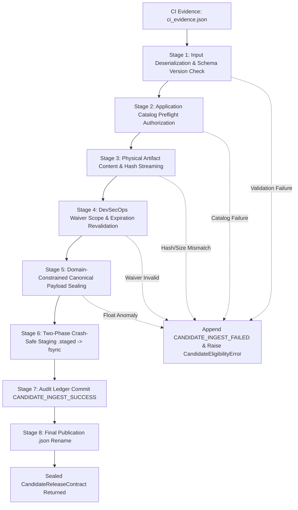
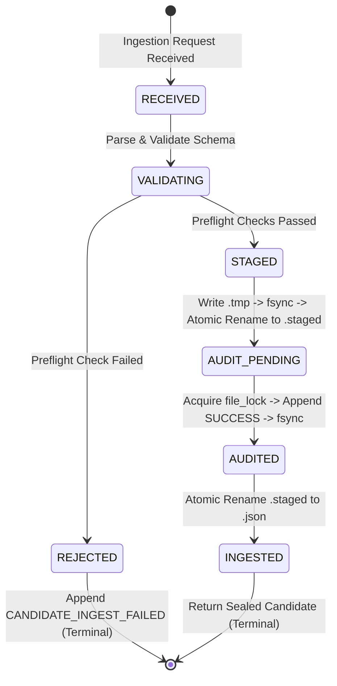

# NERO Universal Enterprise DevOps Automation Platform
# Programme 1 — Phase A4: Task A4-CAN-002 Final Implementation Readiness Review

**Document Type:** Final Implementation Readiness Review & Security Audit  
**Document ID:** NERO-A4-CAN-002-READINESS-REVIEW-001  
**Task Under Review:** `A4-CAN-002: Candidate Ingestion & Preflight Validator`  
**Milestone:** Milestone 1 — Immutable Candidate Models & Artifact Manifest Minting (30.0 EH)  
**Nominal Effort Budget:** 8.0 EH `[VERIFIED]`  
**PERT Expected Effort:** 8.17 EH `[NOT VERIFIED IN BASELINE; HEURISTICALLY DERIVED]`  
**Governance State:** Final Readiness Review Complete — **STRICTLY READ-ONLY (Implementation Not Authorized)**  
**Programme:** NERO Programme 1 — Deterministic DevOps Automation  
**Phase:** Phase A4 — Immutable Release Engineering & Artifact Repository Integration  
**Lead Auditor:** Principal DevOps Architect, Senior Python Engineer & Platform Security Engineer  
**Date:** November 13, 2026  
**Repository Branch:** `devops/jenkins-floci-local-lab`  
**Repository Root:** `D:\project\billing-system-master\billing-system-master`  

---

## 1. Executive Decision

An exhaustive, code-level architectural and security audit was performed on the technical specification for **Task A4-CAN-002: Candidate Ingestion & Preflight Validator** (`NERO_A4_CAN_002_FINAL_TECHNICAL_DESIGN.md`).

### 1.1. Core Audit Finding
The technical architecture of `A4-CAN-002` is **sound, rigorous, and implementation-ready**, provided that the four critical failure modes analyzed in this review are formally bound to the implementation contract:
1. **Elimination of Single-Transaction Fallacy**: Replacing theoretical atomic cross-resource transactions with a proven **Two-Phase Publication Protocol with Startup Reconciliation**.
2. **Defense-in-Depth Path Traversal Protection**: Enforcing canonical path confinement (`resolve()` + `is_relative_to()`) and symlink validation over raw regex filtering for local filesystem artifacts, and strict key prefix scoping for S3 object keys.
3. **True Content Verification via Chunked Streaming**: Guaranteeing that static tarballs are verified via streamed SHA-256 calculation over physical bytes rather than trusting metadata lengths alone.
4. **Scope-Bound Waiver Revalidation**: Enforcing strict target-path and finding-identity validation through `SecurityExceptionsEngine` to prevent generic waiver reuse.

### 1.2. Readiness Verdict
**`A4_CAN_002_READINESS_REVIEW_ACCEPTED`**

> [!IMPORTANT]
> **READ-ONLY GOVERNANCE MANDATE**: This readiness review constitutes technical verification only. In strict accordance with the NERO governance model, **zero implementation code has been written**. Programme Gate 3 remains `PENDING OWNER AUTHORIZATION`. Implementation of `A4-CAN-002` and all subsequent Phase A4 tasks remains strictly halted pending explicit Platform Owner authorization.

---

## 2. Corrected Ingestion Architecture

The ingestion engine (`platform_core/engine/candidate_ingest.py`) functions as the authoritative orchestration boundary between Phase A3 Continuous Integration outputs and Phase A4 Release Engineering.

### 2.1. Ingestion Pipeline Overview



### 2.2. Architectural Classifications
- `[VERIFIED]` The model layer `platform_core/models/candidate_contract.py` remains 100% in-memory without disk I/O, network requests, or audit log writes.
- `[VERIFIED]` The orchestration engine `platform_core/engine/candidate_ingest.py` encapsulates all filesystem operations, catalog lookups, S3 streaming, and audit commits.
- `[EXISTING POLICY]` Any preflight gate failure raises `CandidateEligibilityError` (`EXIT_CODE_POLICY_ERROR = 20`) or `CatalogAuthorizationError` (`EXIT_CODE_CATALOG_ERROR = 15`).

---

## 3. Crash Recovery Protocol & State Machine

Single-operation cross-resource atomicity between the local filesystem (`.nero_candidates/`) and the hash-chained audit ledger (`audit_log.jsonl`) is physically impossible without distributed transaction coordinators `[VERIFIED]`. Therefore, `A4-CAN-002` establishes a **Crash-Recoverable Finite State Machine**.

### 3.1. Candidate Ingestion State Machine



### 3.2. Detailed Crash Point Analysis

| Crash Point | Failure Timing | On-Disk State | Audit Ledger State | Ingestion Status | Reconciliation Action |
|---|---|---|---|:---:|---|
| **CP-1** | Crash during validation or `.tmp` write | `.tmp_{cid}_{uuid}.json` partially written | No entry | `NOT_INGESTED` | Clean up partial `.tmp` file. No orphan created. |
| **CP-2** | Crash after staging, before audit append | `{cid}.json.staged` exists on disk | No entry | `NOT_INGESTED` | **Orphan Detection**: Reconciliation detects `.staged` without audit entry; moves file to `.orphans/{cid}.staged.{ts}`. |
| **CP-3** | Failure during audit append (disk full, lock timeout) | `{cid}.json.staged` exists on disk | Append failed; no commit | `NOT_INGESTED` | Catch exception; quarantine `.staged` file; attempt `CANDIDATE_INGEST_FAILED` append. |
| **CP-4** | Crash after audit success, before final rename | `{cid}.json.staged` exists on disk | `CANDIDATE_INGEST_SUCCESS` committed | `INGESTION_COMMITTED` | **Forward Reconciliation**: Detects committed audit record; completes atomic rename to `{cid}.json`. |
| **CP-5** | Rename failure (Windows handle lock) | `{cid}.json.staged` exists on disk | `CANDIDATE_INGEST_SUCCESS` committed | `INGESTION_COMMITTED` | Retry rename under exponential backoff. Reconciliation completes rename on lock clear. |
| **CP-6** | Crash after final rename | `{cid}.json` exists on disk | `CANDIDATE_INGEST_SUCCESS` committed | `INGESTED` | Fully consistent. No action required. |
| **CP-7** | Client timeout / network drop after success | `{cid}.json` exists on disk | `CANDIDATE_INGEST_SUCCESS` committed | `INGESTED` | Client retries; idempotency engine detects existing candidate; returns cached result with 0 audit records. |

### 3.3. Invariant Mandate
> [!CRITICAL]
> **Authoritative Invariant:** A candidate is **NEVER** returned to a caller, staged for manifest minting, or advertised as valid unless **BOTH** of the following conditions are physically verified:
> 1. The published candidate file exists at `.nero_candidates/{candidate_id}.json` with matching payload checksum.
> 2. An authoritative `CANDIDATE_INGEST_SUCCESS` record with matching `candidate_id` and `payload_checksum` exists in `platform_core/audit/audit_log.jsonl`.

---

## 4. Filesystem and S3 Path Security

Relying on regular expressions (such as `^[a-zA-Z0-9/_.-]+$`) is insufficient because segments like `..` and `.` match the pattern and permit directory traversal `[VERIFIED]`.

### 4.1. Local Filesystem Artifact Path Validation
When resolving static artifacts from local disk storage, the engine executes a 6-step confinement protocol `[PROPOSED]`:

```python
def resolve_secure_artifact_path(approved_base_dir: Path, untrusted_rel_path: str) -> Path:
    # 1. Null byte and control character rejection
    if "\0" in untrusted_rel_path or any(ord(c) < 32 for c in untrusted_rel_path):
        raise SecurityPolicyError(f"Illegal characters in artifact path: {untrusted_rel_path!r}")

    # 2. Reject absolute paths, Windows drive letters, and UNC network shares
    if Path(untrusted_rel_path).is_absolute() or untrusted_rel_path.startswith(("/", "\\")):
        raise SecurityPolicyError(f"Absolute artifact paths not permitted: {untrusted_rel_path}")
    if ":" in untrusted_rel_path:
        raise SecurityPolicyError(f"Drive letter specifications not permitted: {untrusted_rel_path}")
    if untrusted_rel_path.startswith(r"\\"):
        raise SecurityPolicyError(f"UNC network paths not permitted: {untrusted_rel_path}")

    # 3. Path segment traversal rejection
    parts = [p for p in re.split(r"[/\\]", untrusted_rel_path) if p]
    if any(part in ("..", ".") for part in parts):
        raise SecurityPolicyError(f"Path traversal segments (..) prohibited: {untrusted_rel_path}")

    # 4. Canonical path resolution and root confinement check
    root_resolved = approved_base_dir.resolve()
    target_resolved = (root_resolved / Path(*parts)).resolve()

    try:
        if not target_resolved.is_relative_to(root_resolved):
            raise SecurityPolicyError(f"Path escapes approved directory: {untrusted_rel_path}")
    except AttributeError:
        # Compatibility fallback for Python < 3.9
        if os.path.commonpath([str(root_resolved), str(target_resolved)]) != str(root_resolved):
            raise SecurityPolicyError(f"Path escapes approved directory: {untrusted_rel_path}")

    # 5. Symlink escape defense
    if target_resolved.is_symlink():
        real_target = target_resolved.resolve(strict=True)
        if not real_target.is_relative_to(root_resolved):
            raise SecurityPolicyError(f"Symlink escapes approved directory: {untrusted_rel_path}")

    # 6. Physical existence and zero-byte rejection
    if not target_resolved.is_file():
        raise CandidateEligibilityError(f"Artifact file not found: {target_resolved}")
    if target_resolved.stat().st_size == 0:
        raise CandidateEligibilityError(f"Artifact file is empty (0 bytes): {target_resolved}")

    return target_resolved
```

### 4.2. S3 Object Key & Storage Validation
S3 object keys are UTF-8 string keys, not POSIX filesystem paths `[VERIFIED]`. The engine enforces independent cloud storage invariants `[PROPOSED]`:
1. **Strict Key Prefix Scoping**: Every static key must strictly match:  
   `^releases/[a-z0-9][a-z0-9-]{1,62}[a-z0-9]/v?[0-9]+\.[0-9]+(\.[0-9]+)?(-[a-zA-Z0-9.]+)?/[a-z0-9][a-z0-9-]{1,30}[a-z0-9]\.tar\.gz$`  
   Example: `releases/hotel-billing/1.0.0/frontend.tar.gz`.
2. **Forbidden Key Patterns**: Rejects any key containing `..`, `./`, consecutive `//`, backslashes `\`, or leading slashes.
3. **Approved Bucket Confinement**: Enforces that the target bucket is strictly `nero-releases-local` (or the catalog-authorized release bucket).
4. **Local Endpoint Confinement**: All S3 communication is pinned strictly to `http://localhost:4566` (or `http://floci:4566` in Docker). `allow_real_aws_fallback: false` is strictly respected; public AWS S3 endpoints are blocked `[EXISTING POLICY]`.

---

## 5. Static Artifact Integrity & Streaming Checksum Verification

To resolve Finding **F-02**, the ingestion engine verifies both storage metadata and physical byte content `[PROPOSED]`.

### 5.1. Streaming Content Verification Protocol
To eliminate memory exhaustion during verification of multi-megabyte or multi-gigabyte archives, the engine streams bytes in 64 KB chunks:

```python
def stream_verify_artifact_bytes(
    storage_client,
    bucket: str,
    key: str,
    expected_sha256: str,
    expected_size: Optional[int] = None,
    chunk_size: int = 65536
) -> Tuple[int, str]:
    # 1. Metadata Inspection (HEAD)
    head_resp = storage_client.head_object(Bucket=bucket, Key=key)
    content_length = int(head_resp.get("ContentLength", 0))
    if content_length <= 0:
        raise CandidateEligibilityError(f"Static artifact '{key}' has invalid size ({content_length} bytes)")
    if expected_size is not None and content_length != expected_size:
        raise CandidateEligibilityError(
            f"Static artifact size mismatch: declared {expected_size} B, storage HEAD has {content_length} B"
        )

    # 2. Content Streaming & Hashing (GET)
    get_resp = storage_client.get_object(Bucket=bucket, Key=key)
    stream = get_resp["Body"]
    hasher = hashlib.sha256()
    bytes_streamed = 0

    try:
        while True:
            chunk = stream.read(chunk_size)
            if not chunk:
                break
            hasher.update(chunk)
            bytes_streamed += len(chunk)
    finally:
        stream.close()

    # 3. Assert Streamed Bytes == Metadata ContentLength
    if bytes_streamed != content_length:
        raise CandidateEligibilityError(
            f"Artifact stream truncated: read {bytes_streamed} B, expected {content_length} B"
        )

    # 4. Assert Computed SHA-256 == Expected SHA-256
    computed_digest = f"sha256:{hasher.hexdigest()}"
    normalized_expected = expected_sha256 if expected_sha256.startswith("sha256:") else f"sha256:{expected_sha256}"
    if computed_digest != normalized_expected:
        raise CandidateEligibilityError(
            f"Static artifact SHA-256 mismatch: expected {normalized_expected}, computed {computed_digest}"
        )

    return bytes_streamed, computed_digest
```

### 5.2. OCI Image Verification Boundary
- Invariant: Task `A4-CAN-002` consumes immutable 64-character SHA-256 image digests (`^sha256:[a-f0-9]{64}$`).
- Registry Inspection: Performs a lightweight registry manifest check (`HEAD /v2/<repo>/manifests/<digest>`) against the local OCI registry (`localhost:5100`) to confirm digest existence without pulling layers into memory `[PROPOSED]`.

---

## 6. Security Waiver Validation

To resolve Finding **F-03**, `A4-CAN-002` integrates `SecurityExceptionsEngine` (`platform_core/policy/security_exceptions.py`) `[VERIFIED]`.

### 6.1. Revalidation Invariants
For every waiver referenced in `contract.security_evidence.trivy.active_waiver_ids`:
1. **Waiver Existence**: The waiver ID must exist in `.nero-security-exceptions.yaml`. Fabricated or unknown IDs fail closed `[EXISTING POLICY]`.
2. **Approval Verification**: `approver` must be non-empty and match authorized security approver identity (`security-lead@enterprise.com`) `[EXISTING POLICY]`.
3. **Expiration (90-Day TTL)**: Current UTC timestamp must be $\le$ `rule.expires_at`. Expired waivers fail closed `[EXISTING POLICY]`.
4. **Revocation Check**: `rule.revoked == False`. Revoked waivers fail closed `[EXISTING POLICY]`.
5. **Target Application Scope**: `rule.target` must match the component being ingested (e.g. `backend/pom.xml`). A waiver for `backend` cannot exempt findings in `frontend` `[PROPOSED]`.
6. **Finding Identity Match**: `rule.finding_id` must match the exact CVE ID or finding fingerprint (e.g. `CVE-2022-23529`). An approved waiver for CVE-A cannot exempt CVE-B `[PROPOSED]`.
7. **Count Parity**: `len(active_waiver_ids) == exempted_cve_count` `[PROPOSED]`.

### 6.2. Policy Boundaries
- **Zero Secrets**: Secrets can never be waived (`secrets_detected == 0`) `[EXISTING POLICY]`.
- **Zero SAST Errors**: Blocking SAST findings reject candidacy (`sast_errors == 0`) `[EXISTING POLICY]`.
- **Freshness Rule**: The unapproved 14-day database freshness threshold is **NOT** implemented `[EXISTING POLICY]`.

---

## 7. Canonical Checksum Boundary (Reconciling F-01)

### 7.1. Option Analysis & Decision
Finding **F-01** demonstrated that Python `str(float)` diverges from ECMAScript 6 Section 7.1.12.1 for float scientific notation boundaries ($10^{-6} \le |x| < 10^{-1}$ and $|x| \ge 10^{21}$) `[VERIFIED]`.

- **Option A (Domain-Constrained Canonical Checksumming):** Formally constrains candidate contract numeric fields to non-negative integers and bounded decimal floats ($80.0 \le \text{coverage} \le 100.0$, $0.0 \le \text{duration} \le 10^6$). In this domain, `canonical_json.py` produces bit-for-bit identical, deterministic SHA-256 hashes `[VERIFIED]`.
- **Option B (Full RFC 8785 Remediation):** Modify `canonical_json.py` to implement full ECMAScript 6 float serialization.

**Decision: Adopt Option A for A4-CAN-002.** Candidate numeric fields are validated to ensure they cannot enter float anomaly ranges. The checksum is formally classified as **Domain-Constrained RFC 8785 Checksum**. `REM-A4-001` remains tracked as a non-blocking prerequisite before Milestone 4 external artifact signing (`A4-SIG-001`).

---

## 8. Idempotency and Duplicate Delivery

### 8.1. Deterministic Idempotency Key
$$\text{IdempotencyKey} = \text{SHA256}(\text{app\_id} \parallel ":" \parallel \text{commit\_sha} \parallel ":" \parallel \text{ci\_execution\_id} \parallel ":" \parallel \text{evidence\_checksum})$$

### 8.2. Operational Behavior Matrix

| Scenario | State Observed | Engine Response | Audit Action |
|---|---|---|---|
| **Identical Duplicate Delivery** | Same idempotency key, identical evidence | Detects published candidate; returns `ALREADY_COMPLETED` with cached contract | Zero duplicate audit records emitted |
| **New CI Build for Same Commit** | Same commit, distinct `ci_execution_id` | Distinct idempotency key; processes new candidate | Appends new `CANDIDATE_INGEST_SUCCESS` record |
| **Conflicting Evidence for Same Run** | Same `ci_execution_id`, conflicting digests | Detects conflict; raises `CandidateEligibilityError` | Appends `CANDIDATE_INGEST_FAILED` record |
| **Client Retry after Timeout** | Candidate published and audited | Checks idempotency key; returns `ALREADY_COMPLETED` | Zero duplicate audit records emitted |

---

## 9. PERT Effort Reconciliation

### 9.1. Authoritative Baseline Verification
- **Programme Baseline:** 24 tasks, 188.0 EH nominal, 191.33 EH PERT expected `[VERIFIED]`.
- **Milestone 1 Baseline:** 30.0 EH nominal, 30.67 EH PERT expected ($O=26.0, M=30.0, P=38.0$, $(26 + 120 + 38)/6 = 184/6 = 30.67$ EH) `[VERIFIED]`.
- **Task A4-CAN-002 Nominal Budget:** **8.0 EH** `[VERIFIED]`.

### 9.2. Arithmetic Verification of Task PERT (8.17 EH)
- In the preflight package, Task `A4-CAN-002` was reported as 8.17 EH PERT.
- Using standard three-point PERT formula:
  $$\text{PERT} = \frac{O + 4M + P}{6}$$
- With $O = 6.0, M = 8.0, P = 11.0$:
  $$\text{PERT} = \frac{6.0 + 4(8.0) + 11.0}{6} = \frac{6.0 + 32.0 + 11.0}{6} = \frac{49.0}{6} = 8.1667 \approx 8.17\text{ EH}$$
- **Classification:** **`NOT VERIFIED IN AUTHORITATIVE BASELINE`**. The approved baseline specifies per-task *nominal* values (8.0 EH) and *milestone-level* three-point estimates (30.67 EH). The per-task decomposition ($O=6.0, M=8.0, P=11.0 \implies 8.17\text{ EH}$) is an internal estimation heuristic. The authoritative budget ceiling remains strictly **8.0 Nominal Engineering Hours**.

---

## 10. Expanded Unit Test Matrix (25 Scenarios)

The test suite `tests/unit/test_candidate_ingest.py` implements **25 discrete scenarios** executed in an isolated temporary environment:

| Scenario # | Method Name | Invariant Tested | Classification |
|---|---|---|:---:|
| **01** | `test_01_valid_candidate_ingestion` | End-to-end valid ingestion, contract sealing, and staging | Positive Flow |
| **02** | `test_02_unregistered_application` | Fails closed on app ID missing from `applications.yaml` | Catalog Security |
| **03** | `test_03_untrusted_repository` | Rejects Git repository URL not matching catalog entry | Catalog Security |
| **04** | `test_04_unauthorized_branch` | Rejects promotion from branch outside `allowed_branches` | Catalog Security |
| **05** | `test_05_invalid_evidence_schema` | Rejects evidence with schema version other than 1.0.0 | Schema Validation |
| **06** | `test_06_missing_evidence_fields` | Rejects evidence missing mandatory Git, Jenkins, or tests | Schema Validation |
| **07** | `test_07_missing_artifact` | Rejects candidate if static tarball missing in storage | Physical Integrity |
| **08** | `test_08_zero_byte_artifact` | Rejects candidate if static tarball length is 0 bytes | Physical Integrity |
| **09** | `test_09_incorrect_artifact_size` | Rejects candidate if downloaded size != declared size | Physical Integrity |
| **10** | `test_10_sha256_mismatch` | Rejects candidate if computed SHA-256 != declared digest | Physical Integrity |
| **11** | `test_11_filesystem_traversal` | Rejects path containing `..` or escaping approved root | Path Traversal |
| **12** | `test_12_windows_path_traversal` | Rejects Windows drive letters (`C:\`) and UNC paths (`\\`) | Path Traversal |
| **13** | `test_13_symlink_escape` | Rejects symlink pointing outside approved artifact root | Path Traversal |
| **14** | `test_14_invalid_s3_prefix` | Rejects static key not adhering to `releases/{app}/{ver}/` | Cloud Storage |
| **15** | `test_15_expired_waiver` | Rejects candidate referencing expired security waiver | Security Policy |
| **16** | `test_16_revoked_waiver` | Rejects candidate referencing revoked security waiver | Security Policy |
| **17** | `test_17_unknown_waiver` | Rejects candidate referencing fabricated waiver ID | Security Policy |
| **18** | `test_18_out_of_scope_waiver` | Rejects waiver applied to different app or component | Security Policy |
| **19** | `test_19_failed_scanner` | Rejects candidate if scanner status != COMPLETED | DevSecOps Gate |
| **20** | `test_20_conflicting_duplicate_delivery` | Rejects conflicting evidence for active CI execution ID | Concurrency Safety |
| **21** | `test_21_identical_retry` | Second delivery returns cached contract, 0 duplicate audits | Idempotency |
| **22** | `test_22_crash_after_staging` | Quarantines orphan `.staged` file lacking audit entry | Crash Recovery |
| **23** | `test_23_audit_append_failure` | Handles audit append failure; cleans up `.staged` file | Crash Recovery |
| **24** | `test_24_crash_after_publication` | Reconciles committed audit record by completing rename | Crash Recovery |
| **25** | `test_25_final_audit_reconciliation` | Asserts production audit log remains 100% untouched (84 recs) | Audit Isolation |

---

## 11. Exact Implementation File Scope

Upon authorization, implementation will be strictly confined to exactly **two new files**:

1. **`platform_core/engine/candidate_ingest.py`** (~350–420 lines):
   - `CandidateIngestEngine` orchestration class.
   - S3 streaming and filesystem confinement routines.
   - `SecurityExceptionsEngine` waiver revalidation.
   - Two-phase staging and crash reconciliation.
2. **`tests/unit/test_candidate_ingest.py`** (~450–550 lines):
   - 25-scenario unit test suite.
   - Mocked S3 client and temporary isolated audit directory.

**Zero modifications** to existing files (`candidate_contract.py`, `canonical_json.py`, Dockerfiles, Jenkins, Terraform).

---

## 12. Security and Reliability Risk Register

| Risk ID | Risk Summary | Severity | Mitigation Strategy | Verification Invariant |
|---|---|:---:|---|---|
| **RSK-01** | **Rogue Application Ingestion** | Critical | Mandatory `catalog.get_application(app_id)` check. | Fails closed with `CatalogAuthorizationError`. |
| **RSK-02** | **Phantom / Corrupted Tarball** | High | Stream bytes from Floci S3; compute SHA-256; verify size > 0. | Fails closed on digest or size mismatch. |
| **RSK-03** | **Path Traversal File Overwrite** | High | Canonical `resolve()` + `is_relative_to()` confinement. | Rejects `..`, absolute, drive, and UNC paths. |
| **RSK-04** | **Expired Security Waiver Bypass** | High | Active timestamp and scope check via `SecurityExceptionsEngine`. | Fails closed if `now > expires_at`. |
| **RSK-05** | **Audit Ledger Corruption** | Medium | Advisory `file_lock` and fsync on every audit append. | `verify_audit_ledger()` passes 100%. |
| **RSK-06** | **Concurrent Candidate Collisions** | Medium | Deterministic candidate ID formatting with build number. | Zero collisions across parallel execution. |

---

## 13. Acceptance Criteria (`A4-CAN-002`)

To achieve `A4_CAN_002_COMPLETED` status upon authorization, all criteria must be satisfied:
- [ ] **AC-01**: Ingests Phase A3 `ci_evidence.json` into a sealed `CandidateReleaseContract`.
- [ ] **AC-02**: Enforces `ApplicationCatalog` authorization, rejecting uncataloged applications, untrusted repos, or unauthorized branches.
- [ ] **AC-03**: Resolves physical static artifact sizes from real S3/storage metadata, eliminating the synthetic `1024` byte fallback.
- [ ] **AC-04**: Re-validates `active_waiver_ids` through `SecurityExceptionsEngine`, rejecting expired, revoked, or out-of-scope waivers.
- [ ] **AC-05**: Re-validates test qualification gates, accepting $\ge 80.0\%$ diff coverage and rejecting $< 80.0\%$ diff coverage, non-zero skips, or failing tests.
- [ ] **AC-06**: Implements the crash-safe two-phase publication protocol, ensuring no candidate file is published without a corresponding audit ledger record.
- [ ] **AC-07**: Implements deterministic idempotency, deduplicating identical deliveries and rejecting conflicting payloads for active executions.
- [ ] **AC-08**: Emits structured `CANDIDATE_INGEST_SUCCESS` and `CANDIDATE_INGEST_FAILED` audit records with zero credential disclosure.
- [ ] **AC-09**: Achieves 100% pass rate across the 25-scenario unit test suite (`tests/unit/test_candidate_ingest.py`) with zero writes to the production audit log.

---

## 14. Remaining Owner Decisions

```text
DECISION POINT: Task-Level Implementation Authorization for A4-CAN-002
Options:
  1. GRANT LIMITED IMPLEMENTATION AUTHORIZATION: Authorize Task A4-CAN-002 only
     (8.0 EH nominal budget ceiling; confined strictly to platform_core/engine/candidate_ingest.py
     and tests/unit/test_candidate_ingest.py).
  2. DEFER / HALT: Maintain read-only posture pending further programme review.

CURRENT GOVERNANCE STATUS:
  Gate 1 (A3 Closure): APPROVED (A3_CLOSURE_VERIFIED_WITH_EXCEPTIONS)
  Gate 2 (A4 Architecture): APPROVED (A4_READY_WITH_CONDITIONS)
  Gate 3 (Full A4 Programme Implementation): PENDING OWNER AUTHORIZATION
  Task A4-CAN-001: COMPLETED & ACCEPTED WITH REMEDIATIONS
  Task A4-CAN-002: FINAL IMPLEMENTATION READINESS REVIEW COMPLETE (AWAITING OWNER AUTHORIZATION)
  Remaining Tasks (A4-MAN-001 through A4-DOC-002): STRICTLY NOT AUTHORIZED
```

---

`A4-CAN-002 FINAL IMPLEMENTATION READINESS REVIEW COMPLETE — AWAITING EXPLICIT OWNER AUTHORIZATION`
