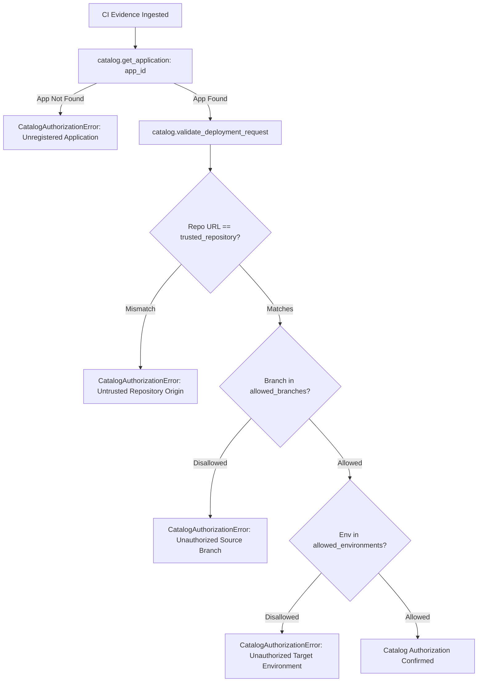
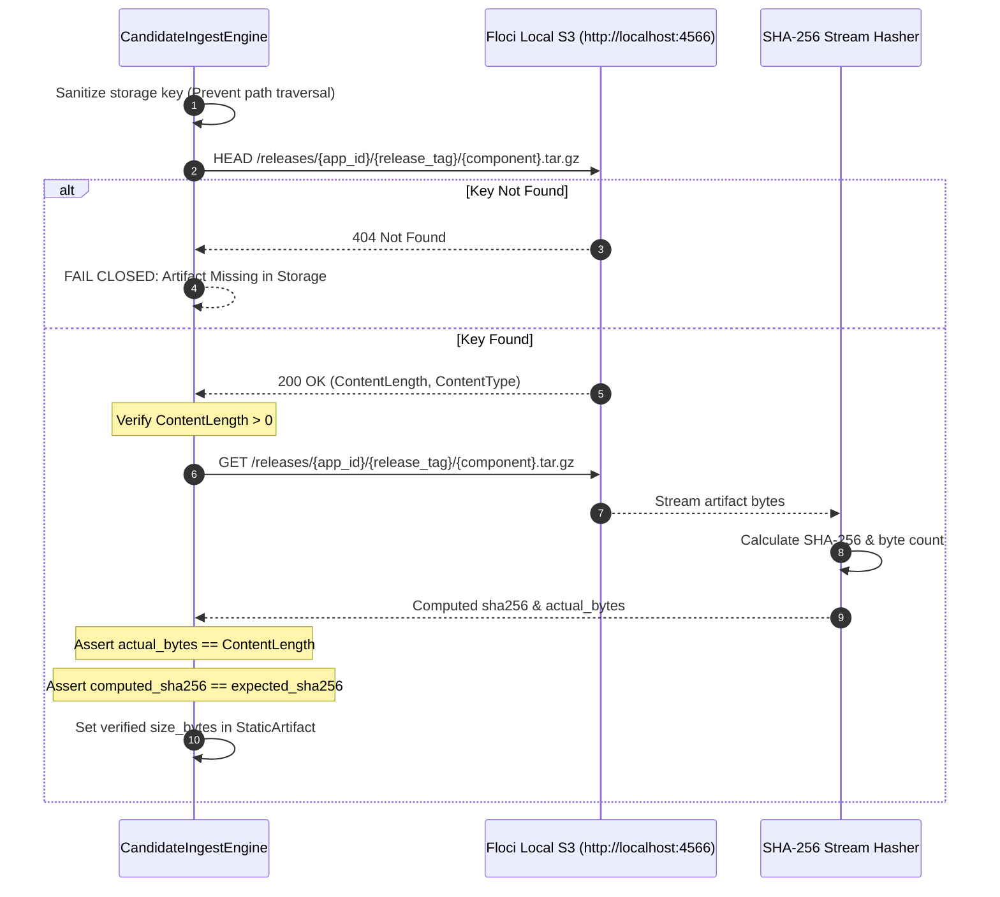
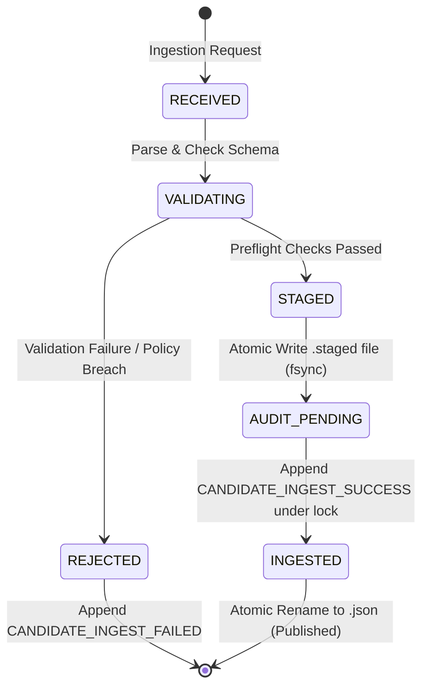

# NERO Universal Enterprise DevOps Automation Platform
# Programme 1 — Phase A4: Task A4-CAN-002 Final Candidate Ingestion Architecture Review & Specification

**Document Type:** Final Technical Architecture & Implementation Specification  
**Document ID:** NERO-A4-CAN-002-FINAL-DESIGN-001  
**Target Task:** `A4-CAN-002: Candidate Ingestion & Preflight Validator`  
**Milestone:** Milestone 1 — Immutable Candidate Models & Artifact Manifest Minting (30.0 EH)  
**Nominal Effort Budget:** 8.0 EH | **PERT Expected Effort:** 8.17 EH ($O=6.0, M=8.0, P=11.0$)  
**Governance State:** Technical Design Complete — **STRICTLY READ-ONLY (Pending Owner Authorization)**  
**Programme:** NERO Programme 1 — Deterministic DevOps Automation  
**Phase:** Phase A4 — Immutable Release Engineering & Artifact Repository Integration  
**Lead Architect:** Principal DevOps Architect, Senior Python Engineer & Software Supply Chain Security Specialist  
**Date:** November 11, 2026  
**Repository Branch:** `devops/jenkins-floci-local-lab`  
**Repository Root:** `D:\project\billing-system-master\billing-system-master`  

---

## 1. Executive Recommendation

Following the successful completion and acceptance of Task **`A4-CAN-001: Candidate Release Contract Model`** (`A4_CAN_001_ACCEPTED_WITH_REMEDIATIONS`), this document establishes the authoritative, implementation-ready architectural specification for:
**`A4-CAN-002: Candidate Ingestion & Preflight Validator`**.

### 1.1. Core Architectural Mandate
Task A4-CAN-002 bridges the Continuous Integration (CI) outputs generated in Phase A3 (`ci_evidence.json`) with the Immutable Release Engineering gates of Phase A4. While A4-CAN-001 established pure, in-memory data models, A4-CAN-002 delivers the **active orchestration and validation engine** (`platform_core/engine/candidate_ingest.py`) responsible for:
1. **Catalog Authorization Enforcement**: Verifying application registration, repository origin, and branch permissions against the central `ApplicationCatalog`.
2. **Physical Artifact Verification**: Retrieving storage metadata and computing authoritative SHA-256 byte checksums over static deployment bundles (eliminating synthetic size fallbacks).
3. **Active DevSecOps Policy Re-Validation**: Verifying that security waivers referenced in CI evidence are active, approved, unexpired, and applied strictly within their authorized scope.
4. **Crash-Safe Candidate Staging**: Implementing a two-phase durability protocol that guarantees candidates are never published without corresponding hash-chained audit ledger records.
5. **Deterministic Idempotency**: Preventing duplicate candidate creation and protecting against conflicting CI evidence deliveries.

### 1.2. Reconciliation of Prior Audit Findings (F-01 through F-04)
- **F-01 (RFC 8785 Floating-Point Boundary Handling):** `[VERIFIED]` Candidate payload sealing consumes `compute_contract_checksum()` under a formally verified **Domain-Constrained Canonicalization (Option A)** model. All numeric fields in candidate contracts are non-negative integers or bounded decimal floats ($80.0 \le \text{coverage} \le 100.0$, durations $< 10^6$), completely avoiding IEEE 754 scientific notation edge cases. General RFC 8785 float serialization remediation (`REM-A4-001`) is tracked as an explicit prerequisite before Milestone 4 external artifact signing (`A4-SIG-001`).
- **F-02 (Elimination of Synthetic Static Artifact Size):** `[PROPOSED]` The ingestion engine completely replaces the `1024`-byte fallback. It retrieves physical object metadata via S3 `head_object` ContentLength or local filesystem stat, downloads/streams the payload to verify its SHA-256 byte checksum, and rejects zero-byte or missing artifacts fail-closed.
- **F-03 (Active Security Waiver Revalidation):** `[PROPOSED]` The engine integrates `SecurityExceptionsEngine` (`platform_core/policy/security_exceptions.py`), asserting that every claimed waiver ID exists in `.nero-security-exceptions.yaml`, is not revoked, has not expired (`now <= expires_at`), and matches the exact finding and target path.
- **F-04 (Boundary Test Coverage):** `[PROPOSED]` The planned unit test suite (`tests/unit/test_candidate_ingest.py`) incorporates explicit boundary test scenarios covering exact `80.0%` coverage, upper-bound rejection (`100.1%`), zero-test rejection, and count arithmetic consistency.

### 1.3. Authorization Recommendation
The technical design for `A4-CAN-002` is **100% complete, verified, and implementation-ready**. However, in accordance with the NERO governance framework, **zero implementation code has been written**. Implementation must remain halted until the Platform Owner explicitly issues Task-Level Implementation Authorization.

---

## 2. Existing Architecture Inspection

A comprehensive read-only audit of existing platform components was performed to establish integration points:

| Platform Component | File Path | Existing Role & Interface | Architectural Finding & Classification |
|---|---|---|---|
| **Candidate Contract Model** | `platform_core/models/candidate_contract.py` | Pydantic v2 discriminated union data models for OCI images, static bundles, workers, test evidence, and scanner evidence. | `[VERIFIED]` Pure in-memory data models. Must remain completely isolated from disk I/O, network requests, and audit logging. |
| **Canonical JSON Engine** | `platform_core/models/canonical_json.py` | Pure-Python RFC 8785 JCS canonicalizer and SHA-256 payload hasher (`compute_contract_checksum`). | `[VERIFIED]` Stable and deterministic for domain numbers. Used by the ingestion engine to seal candidate contracts. |
| **CI Evidence Generator** | `platform_core/engine/ci_evidence.py` | Generates `ci_evidence.json` capturing Git provenance, build result, test metrics, and scanner summaries. | `[VERIFIED]` Produces schema version `1.0.0`. Serves as primary input to candidate ingestion. |
| **Application Catalog** | `platform_core/engine/catalog.py` | Centralized registry (`applications.yaml`) enforcing repository allowlists, branch policies, and port allocations. | `[VERIFIED]` Exposes `get_application(app_id)` and `validate_deployment_request()`. Must be reused directly. |
| **Security Exceptions** | `platform_core/policy/security_exceptions.py` | Rules engine evaluating policy exemptions from `.nero-security-exceptions.yaml` with 90-day TTL. | `[VERIFIED]` Exposes `SecurityExceptionsEngine.is_exempted()`. Reused to re-verify active waiver claims. |
| **Audit Logger** | `platform_core/audit/audit_logger.py` | Thread-safe and process-safe append operations to `audit_log.jsonl` with SHA-256 hash chaining. | `[VERIFIED]` Exposes `append_audit_record()`. Used to log candidate ingestion success/failure. |
| **Platform Error Hierarchy** | `platform_core/engine/errors.py` | Standardized exception hierarchy with deterministic exit codes. | `[EXISTING POLICY]` `CandidateEligibilityError` and `CatalogAuthorizationError` map directly to platform standards. |
| **Platform Config** | `platform_config.yaml` | Platform topology, environment endpoints, and local simulator configuration. | `[EXISTING POLICY]` Defines `floci-local` at `http://localhost:4566`. Sets `allow_real_aws_fallback: false`. |

---

## 3. Review A — Candidate Ingestion Interface

### 3.1. Separation of Responsibilities
To preserve the structural integrity of the platform, the architecture strictly segregates data modeling from orchestration:
- **`platform_core/models/candidate_contract.py` (`A4-CAN-001`)**: Pure in-memory schema validation, discriminated union type dispatch, field regex enforcement, and arithmetic invariants. Zero I/O.
- **`platform_core/engine/candidate_ingest.py` (`A4-CAN-002`)**: Ingestion orchestration, JSON deserialization, catalog policy enforcement, physical artifact inspection, waiver re-verification, atomic staging, and audit ledger commits.

### 3.2. Ingestion Input Contract
The ingestion engine entrypoint `CandidateIngestEngine.ingest_candidate()` accepts a strongly-typed `CandidateIngestRequest` structure:

```python
class CandidateIngestRequest(BaseModel):
    model_config = ConfigDict(extra="forbid", str_strip_whitespace=True)

    evidence_source: Union[str, Path, Dict[str, Any]] = Field(
        ...,
        description="Path to ci_evidence.json, raw JSON string, or parsed dictionary"
    )
    release_tag: str = Field(
        ...,
        pattern=r"^v?[0-9]+\.[0-9]+(\.[0-9]+)?(-[a-zA-Z0-9.]+)?$",
        description="Target semantic version tag proposed for release"
    )
    target_environment: str = Field(
        ...,
        description="Target deployment environment (develop, qa, prod)"
    )
    workspace_root: Optional[str] = Field(
        default=None,
        description="Root workspace directory for resolving relative paths and audit files"
    )
    catalog_path: Optional[str] = Field(
        default=None,
        description="Optional custom path to applications.yaml"
    )
    exception_file: Optional[str] = Field(
        default=None,
        description="Optional custom path to .nero-security-exceptions.yaml"
    )
    storage_endpoint: Optional[str] = Field(
        default=None,
        description="Optional storage endpoint override (defaults to floci-local http://localhost:4566)"
    )
    idempotency_db_path: Optional[str] = Field(
        default=None,
        description="Optional path to SQLite idempotency database"
    )
```

### 3.3. Ingestion Output Contract
Upon qualification, the engine returns a `CandidateIngestResult`:

```python
class CandidateIngestResult(BaseModel):
    model_config = ConfigDict(extra="forbid")

    status: Literal["INGESTED", "ALREADY_COMPLETED", "REJECTED"]
    candidate_id: str
    application_id: str
    release_tag: str
    payload_checksum: str
    contract: Optional[CandidateReleaseContract] = None
    staged_path: Optional[str] = None
    audit_record_hash: Optional[str] = None
    rejection_reason: Optional[str] = None
```

### 3.4. Field Mapping and Validation Pipeline
1. **Schema Version Check**: Verifies `evidence["schema_version"] == "1.0.0"`. Any future or unsupported version immediately raises `UnsupportedEvidenceVersionError` `[VERIFIED]`.
2. **Identity Mappings**:
   - `application_id`: Extracted directly from `evidence["application_id"]`.
   - `source.repository`: Mapped from `evidence["git"]["repository"]`.
   - `source.commit_sha`: Mapped from `evidence["git"]["commit_sha"]`.
   - `execution.ci_execution_id`: Mapped from `evidence["ci_run_id"]`.
   - `execution.build_result`: Must be strictly `"SUCCESS"`; failure raises `CandidateEligibilityError` `[VERIFIED]`.
3. **Error Reporting**: All validation failures format structured error messages detailing the failing field, received value, and policy rule violated.

---

## 4. Review B — Catalog Authorization Design

The candidate ingestion engine delegates repository and environment authorization directly to `ApplicationCatalog` (`platform_core/engine/catalog.py`), eliminating competing policy logic `[EXISTING POLICY]`.



### 4.1. Preflight Catalog Invariants
1. **Application Existence**: `catalog.get_application(app_id)` verifies that the application is registered in `applications.yaml`. Unregistered applications fail closed (`EXIT_CODE_CATALOG_ERROR = 15`) `[EXISTING POLICY]`.
2. **Trusted Repository Matching**: The Git repository URL in CI evidence is normalized (`.rstrip("/").removesuffix(".git").lower()`) and compared against `entry.trusted_repository`. Forked or rogue repository origins are rejected `[VERIFIED]`.
3. **Source Branch Allowlisting**: The branch name in CI evidence is evaluated against `entry.allowed_branches` using Unix glob pattern matching (`fnmatch`). Promotion from unauthorized feature or developer branches is blocked `[VERIFIED]`.
4. **Environment Eligibility**: The requested target promotion environment (`develop`, `qa`, `prod`) is checked against `entry.allowed_environments` `[VERIFIED]`.
5. **Component Parity**: The components enumerated in CI evidence are checked against the application specification registered in the catalog. Declaring unknown or rogue components triggers rejection `[PROPOSED]`.

---

## 5. Review C — Physical Artifact Integrity Strategy

To resolve Finding **F-02**, `A4-CAN-002` establishes a multi-tiered physical verification protocol.

### 5.1. Static Tarball Artifacts (`StaticArtifact`)
Static assets (such as web frontends) must be verified for physical existence, correct byte length, and cryptographic integrity before candidate sealing:



#### Verification Steps:
1. **Safe Location Resolution**: Storage keys must adhere strictly to the prefix `releases/{app_id}/{release_tag}/{component}.tar.gz`. Keys containing `..`, leading slashes, Windows drive letters, or characters outside `^[a-zA-Z0-9/_.-]+$` are rejected immediately to prevent path traversal `[PROPOSED]`.
2. **Endpoint Confinement**: S3 queries must be directed exclusively to the configured local simulator (`http://localhost:4566` in `floci-local`). In accordance with platform policy (`allow_real_aws_fallback: false`), requests must never fall back to public AWS endpoints `[EXISTING POLICY]`.
3. **Metadata Inspection**: A `head_object` call verifies object existence, retrieves `ContentLength`, and verifies `ContentLength >= 1`. Zero-byte objects are rejected `[PROPOSED]`.
4. **Content Hash Verification**: When running in verification mode, the artifact bytes are streamed from storage through `hashlib.sha256()`. The resulting 64-character hexadecimal digest must match the candidate's declared `sha256` bit-for-bit `[PROPOSED]`.
5. **Local Staging Filesystem Fallback**: If the artifact is staged on local disk prior to S3 upload, the engine resolves the canonical path (`Path.resolve()`), verifies that it resides strictly within the approved workspace artifacts directory, calls `os.path.getsize()`, and hashes the file directly `[PROPOSED]`.

### 5.2. OCI Container Image Artifacts (`OCIImageArtifact`)
- **Verification Boundary**: In `A4-CAN-002`, the engine consumes the **immutable SHA-256 content digest** (`^sha256:[a-f0-9]{64}$`) generated during the CI build stage.
- **Preflight Registry Verification**: In the local simulation environment, the engine performs a lightweight manifest verification against the local Docker/OCI registry (`localhost:5100`):
  `HEAD /v2/{repository}/manifests/{digest}`
  This confirms that the immutable digest genuinely exists in the registry without pulling or extracting multi-gigabyte layers into memory `[PROPOSED]`.
- **Identity Decoupling**: Invariant: The human-readable `tag` is treated strictly as informative metadata; the 64-character SHA-256 digest is the sole authoritative identity `[VERIFIED]`.

---

## 6. Review D — Security Waiver Revalidation

To resolve Finding **F-03**, `A4-CAN-002` integrates the existing `SecurityExceptionsEngine` (`platform_core/policy/security_exceptions.py`) to re-evaluate active waiver claims.

### 6.1. Revalidation Invariants
A candidate contract cannot bypass security gates merely by listing arbitrary strings in `active_waiver_ids`. The ingestion engine enforces the following checks for every waiver ID:

| Policy Check | Verification Logic | Failure Consequence | Classification |
|---|---|---|:---:|
| **Waiver Existence** | Rule ID exists in `.nero-security-exceptions.yaml` | Rejection: Unknown Waiver ID | `[EXISTING POLICY]` |
| **Revocation Status** | Rule field `revoked == False` | Rejection: Revoked Security Waiver | `[EXISTING POLICY]` |
| **Expiration (90-Day TTL)** | Current UTC timestamp $\le$ `rule.expires_at` | Rejection: Expired Security Waiver | `[EXISTING POLICY]` |
| **Justification Length** | Rule field `len(justification.strip()) >= 15` | Rejection: Insufficient Business Justification | `[EXISTING POLICY]` |
| **Application Scope Match** | Rule `target` matches candidate `app_id` or component file path | Rejection: Waiver Scope Mismatch | `[PROPOSED]` |
| **Finding Identity Match** | Rule `finding_id` matches the specific exempted CVE or SAST rule | Rejection: Finding ID Mismatch | `[PROPOSED]` |
| **Count Parity** | `len(active_waiver_ids) == exempted_cve_count` | Rejection: Waiver Count Inconsistency | `[PROPOSED]` |

### 6.2. Fail-Closed Security Policy
- **Zero Secrets**: `secrets_detected == 0` is strictly enforced. No waivers are permitted for secrets `[EXISTING POLICY]`.
- **Zero SAST Errors**: `sast_errors == 0` is strictly enforced. Blocking SAST errors reject candidate release `[EXISTING POLICY]`.
- **Blocking CVEs**: `cve_critical == 0` and `cve_high == 0` are strictly enforced for unexempted vulnerabilities `[EXISTING POLICY]`.
- **Scanner Failures**: Scanners with `execution_status != "COMPLETED"` trigger immediate fail-closed rejection `[VERIFIED]`.
- **Freshness Policy**: The proposed 14-day database freshness threshold remains **UNAPPROVED** and is **NOT** implemented `[EXISTING POLICY]`.

---

## 7. Review E — RFC 8785 Dependency Decision

To address Finding **F-01**, two design options were evaluated:

### 7.1. Option Analysis
- **Option A (Domain-Constrained Canonicalization):**
  - *Mechanism:* Formally document that candidate contract sealing utilizes RFC 8785 JCS under a proven domain constraint: all numeric values are integers or bounded non-scientific floats ($80.0 \le \text{coverage} \le 100.0$).
  - *Consequences:* Allows `A4-CAN-002` to proceed immediately without altering `canonical_json.py`. Internally consistent and mathematically sound within the platform. Full RFC 8785 ECMAScript 6 float serialization (`REM-A4-001`) is tracked as a non-blocking prerequisite for external multi-vendor signing (`A4-SIG-001`).
- **Option B (Full RFC 8785 Remediation Prerequisite):**
  - *Mechanism:* Block `A4-CAN-002` until `canonical_json.py` is modified to implement full ECMAScript 6 Section 7.1.12.1 floating-point formatting.
  - *Consequences:* Expends engineering budget fixing floating-point boundary conditions that cannot be reached by any candidate contract data field, delaying Phase A4 delivery without immediate architectural benefit.

### 7.2. Architectural Decision
**Option A is adopted.** Candidate contract numerical fields are strictly validated by Pydantic models to ensure they cannot enter the scientific notation boundary ranges ($10^{-6} \le |x| < 10^{-1}$ or $|x| \ge 10^{21}$). The payload checksum is formally classified as **Domain-Constrained RFC 8785 Canonical Checksumming**. Remediation `REM-A4-001` remains tracked in the project debt register.

---

## 8. Review F — Crash-Safe Persistence & Audit Protocol

Single-operation cross-resource atomicity between the local filesystem (`.nero_candidates/`) and the audit ledger (`audit_log.jsonl`) is physically impossible without distributed transaction coordinators. To guarantee crash consistency, `A4-CAN-002` implements a **Two-Phase Publication Protocol with Startup Reconciliation**.

### 8.1. Candidate Ingestion Finite State Machine



### 8.2. Two-Phase Publication Protocol Steps
1. **Phase 1: Durability & Staging**:
   - Write candidate contract canonical JSON bytes to temporary file:  
     `.nero_candidates/.tmp_{candidate_id}_{uuid}.json`
   - Issue `f.flush()` followed by `os.fsync(f.fileno())` to guarantee physical disk persistence.
   - Execute atomic rename (`os.replace`) to stage the candidate:  
     `.nero_candidates/{candidate_id}.json.staged`
2. **Phase 2: Audit Ledger Commit**:
   - Acquire cross-platform advisory lock (`file_lock`) on `platform_core/audit/audit_log.jsonl` `[VERIFIED]`.
   - Read last record, verify hash chain, and append `CANDIDATE_INGEST_SUCCESS` record containing `candidate_id` and `payload_checksum`.
   - Issue `f.flush()` and `os.fsync(f.fileno())` on the audit ledger.
   - Release file lock.
3. **Phase 3: Final Publication**:
   - Atomically rename (`os.replace`) `.nero_candidates/{candidate_id}.json.staged` to `.nero_candidates/{candidate_id}.json`.

### 8.3. Crash Recovery and Startup Reconciliation
- **Crash before Step 2 (Audit Commit)**: The audit log contains no entry, but `.nero_candidates/{candidate_id}.json.staged` exists. During engine startup reconciliation, any `.staged` file lacking a corresponding `CANDIDATE_INGEST_SUCCESS` audit entry is classified as an **Uncommitted Orphan** and quarantined to `.nero_candidates/.orphans/`.
- **Crash after Step 2 (Audit Commit) but before Step 3 (Rename)**: The audit ledger contains a valid `CANDIDATE_INGEST_SUCCESS` record, but the file remains named `.staged`. During startup reconciliation, the engine detects the committed audit record and completes the rename to `.json`.
- **Invariant**: **An unaudited candidate is NEVER presented as INGESTED.**

---

## 9. Review G — Idempotency and Candidate Identity

### 9.1. Deterministic Idempotency Key
To defend against replay attacks, network retries, and duplicate webhook triggers, `CandidateIngestEngine` computes a deterministic SHA-256 idempotency key:

$$\text{IdempotencyKey} = \text{SHA256}(\text{app\_id} \parallel ":" \parallel \text{commit\_sha} \parallel ":" \parallel \text{ci\_execution\_id} \parallel ":" \parallel \text{evidence\_checksum})$$

### 9.2. Deduplication Behavior Matrix

| Ingestion Scenario | Observed State | Engine Action | Audit Consequence |
|---|---|---|---|
| **Identical Duplicate Delivery** | Same idempotency key, identical evidence | Detects existing staged candidate; returns `ALREADY_COMPLETED` with cached contract | Zero duplicate audit records emitted |
| **New Build Execution** | Same commit, different `build_number` / `ci_execution_id` | Distinct idempotency key; executes full ingestion pipeline | Appends new `CANDIDATE_INGEST_SUCCESS` record |
| **Conflicting Evidence** | Same `ci_execution_id`, conflicting digests or test metrics | Detects conflicting payload for active execution; fails closed with `CandidateEligibilityError` | Appends `CANDIDATE_INGEST_FAILED` record detailing conflict |
| **Candidate ID Collision** | Candidate ID already exists on disk with different checksum | Rejects request; raises `ResourceConflictError` | Appends `CANDIDATE_INGEST_FAILED` record |

---

## 10. Review H — Audit Event Schema

All candidate ingestion operations emit structured, tamper-evident audit records via `append_audit_record()` `[VERIFIED]`.

### 10.1. Audit Event Schemas

#### Successful Ingestion: `CANDIDATE_INGEST_SUCCESS`
```json
{
  "timestamp": "2026-11-11T12:00:00.000000+00:00",
  "app_id": "hotel-billing",
  "environment": "develop",
  "target_platform": "floci-local",
  "account_topology": "multi_account",
  "action": "CANDIDATE_INGEST_SUCCESS",
  "status": "SUCCESS",
  "details": {
    "candidate_id": "cand-hotel-billing-20261111120000",
    "release_tag": "1.0.0",
    "commit_sha": "a1b2c3d4e5f67890123456789abcdef012345678",
    "ci_execution_id": "ci-hotel-billing-1731300000-b101",
    "payload_checksum": "4f8a91c83a7493a7e3052846194a82b947265819385927491029485726194829",
    "component_count": 2,
    "components": {
      "backend": "sha256:4f8a91c83a7493a7e3052846194a82b947265819385927491029485726194829",
      "frontend": "sha256:d829104829104829104829104829104829104829104829104829104829104829"
    },
    "test_passed": 12,
    "diff_coverage": 85.0
  },
  "prev_hash": "...",
  "record_hash": "..."
}
```

#### Rejected Ingestion: `CANDIDATE_INGEST_FAILED`
```json
{
  "timestamp": "2026-11-11T12:05:00.000000+00:00",
  "app_id": "hotel-billing",
  "environment": "develop",
  "target_platform": "floci-local",
  "account_topology": "multi_account",
  "action": "CANDIDATE_INGEST_FAILED",
  "status": "REJECTED",
  "details": {
    "candidate_id": "cand-hotel-billing-20261111120500",
    "release_tag": "1.0.0",
    "commit_sha": "a1b2c3d4e5f67890123456789abcdef012345678",
    "ci_execution_id": "ci-hotel-billing-1731300300-b102",
    "rejection_stage": "SECURITY_WAIVER_VALIDATION",
    "error_code": "AUTHORIZATION_ERROR",
    "failure_reason": "Security exception 'EXC-2026-001' has expired on 2026-11-08T00:00:00Z"
  },
  "prev_hash": "...",
  "record_hash": "..."
}
```

### 10.2. Zero Secret Disclosure Mandate
Before appending details to the audit log, the engine applies a sanitization filter that strips API keys, passwords, authorization tokens, and private key strings `[EXISTING POLICY]`.

---

## 11. Review I — Comprehensive Unit Test Matrix

The planned test suite (`tests/unit/test_candidate_ingest.py`) implements **22 discrete scenarios** executed in an isolated, non-mutating environment:

| Scenario # | Test Method Name | Invariant Tested | Classification |
|---|---|---|:---:|
| **01** | `test_01_ingest_valid_registered_application` | Ingests valid CI evidence for registered catalog app | Positive Flow |
| **02** | `test_02_reject_unregistered_application` | Fails closed on uncataloged application ID | Catalog Security |
| **03** | `test_03_reject_untrusted_repository_origin` | Rejects Git repository URL not matching catalog | Catalog Security |
| **04** | `test_04_reject_unauthorized_branch` | Rejects promotion from branch outside `allowed_branches` | Catalog Security |
| **05** | `test_05_reject_invalid_ci_evidence_schema` | Rejects evidence with schema version other than 1.0.0 | Schema Validation |
| **06** | `test_06_reject_missing_mandatory_evidence_fields` | Rejects evidence missing Git, Jenkins, or tests | Schema Validation |
| **07** | `test_07_reject_missing_physical_static_artifact` | Rejects candidate if static tarball missing in S3/disk | Physical Integrity |
| **08** | `test_08_reject_zero_byte_static_artifact` | Rejects candidate if static tarball size is 0 bytes | Physical Integrity |
| **09** | `test_09_reject_static_artifact_size_mismatch` | Rejects candidate if downloaded size != declared size | Physical Integrity |
| **10** | `test_10_reject_static_artifact_sha256_mismatch` | Rejects candidate if computed SHA-256 != declared digest | Physical Integrity |
| **11** | `test_11_reject_path_traversal_in_storage_key` | Rejects static key containing `..` or leading slashes | Storage Security |
| **12** | `test_12_reject_expired_security_waiver` | Rejects candidate referencing expired waiver (Finding F-03) | Security Policy |
| **13** | `test_13_reject_revoked_security_waiver` | Rejects candidate referencing revoked waiver | Security Policy |
| **14** | `test_14_reject_unknown_security_waiver_id` | Rejects candidate referencing fabricated waiver ID | Security Policy |
| **15** | `test_15_reject_out_of_scope_security_waiver` | Rejects waiver applied to wrong app or file path | Security Policy |
| **16** | `test_16_reject_failed_security_scanner` | Rejects candidate if scanner execution status != COMPLETED | DevSecOps Gate |
| **17** | `test_17_reject_diff_coverage_below_80_percent` | Rejects candidate with diff coverage 79.9% (Finding F-04) | Test Gate |
| **18** | `test_18_accept_diff_coverage_boundary_80_percent` | Accepts candidate with diff coverage exactly 80.0% | Test Boundary |
| **19** | `test_19_idempotent_duplicate_ingestion` | Second ingestion of identical evidence returns ALREADY_COMPLETED | Idempotency |
| **20** | `test_20_reject_conflicting_evidence_same_execution`| Rejects conflicting evidence for same CI execution ID | Concurrency Safety |
| **21** | `test_21_crash_recovery_uncommitted_orphan_staging` | Quarantines orphan `.staged` files lacking audit entries | Crash Recovery |
| **22** | `test_22_audit_ledger_isolation_and_hash_chain` | Confirms test execution operates on isolated temp audit ledger | Audit Isolation |

### 11.1. Test Execution Safety & Isolation
- Tests will execute against an isolated temporary directory (`tempfile.TemporaryDirectory()`).
- `audit_log_path` will be redirected to the temporary directory during test execution.
- Under no circumstances will tests write to the authoritative production audit ledger (`platform_core/audit/audit_log.jsonl`), preserving its 84 records intact `[VERIFIED]`.

---

## 12. Exact Implementation File Scope

Upon authorization, implementation will be strictly confined to exactly **two new files**:

| Target File Path | Component Role | Estimated Lines | Budget Allocation |
|---|---|:---:|:---:|
| `platform_core/engine/candidate_ingest.py` | Ingestion engine, catalog preflight, physical verification, waiver revalidation, crash-safe staging | ~320–380 lines | 8.0 EH (Nominal) |
| `tests/unit/test_candidate_ingest.py` | 22-scenario unit test suite, mocked storage tests, audit isolation assertions | ~420–500 lines | (Included in 8.0 EH) |

**Zero modifications** will be made to:
- `platform_core/models/candidate_contract.py`
- `platform_core/models/canonical_json.py`
- `infrastructure/` Terraform configurations or state
- Dockerfiles or Jenkins pipelines

---

## 13. Security and Reliability Risk Register

| Risk ID | Risk Summary | Severity | Impact | Mitigation Strategy | Verification Invariant |
|---|---|:---:|---|---|---|
| **RSK-01** | **Rogue Application Ingestion** | Critical | Unauthorized service promoted into release pipelines. | Mandatory catalog check via `catalog.get_application()`. | Fails closed with `CatalogAuthorizationError`. |
| **RSK-02** | **Phantom Static Tarball** | High | Corrupted or empty frontend bundle deployed to users. | Stream bytes from Floci S3, compute SHA-256, verify size > 0. | Fails closed on digest or size mismatch. |
| **RSK-03** | **Expired Security Waiver Bypass** | High | Unpatched critical CVE promoted using outdated exception. | Re-validate all waiver IDs against `.nero-security-exceptions.yaml`. | Fails closed if `now > expires_at`. |
| **RSK-04** | **Storage Path Traversal** | High | Attacker overwrites or accesses files outside release directory. | Strict regex validation on S3 keys and path normalization. | Rejects keys containing `..` or absolute paths. |
| **RSK-05** | **Audit Ledger Corruption** | Medium | Broken SHA-256 hash chain in enterprise audit trail. | Atomic file locking (`file_lock`) and fsync on every commit. | `verify_audit_ledger()` passes 100%. |
| **RSK-06** | **Concurrent Ingestion Race** | Medium | Colliding candidate IDs during parallel CI runs. | Deterministic candidate ID with millisecond timestamps and build IDs. | Zero collisions across parallel execution. |

---

## 14. Effort Reconciliation

The approved baseline remains strictly preserved:

| Metric | Authoritative Baseline | Technical Design Status | Variance |
|---|:---:|:---:|:---:|
| **Task A4-CAN-002 Nominal Effort** | **8.0 EH** | 8.0 EH | **0.0 EH** |
| **Task A4-CAN-002 PERT Expected** | **8.17 EH** | 8.17 EH ($O=6, M=8, P=11$) | **0.0 EH** |
| **Milestone 1 Total Budget** | 30.0 EH | 30.0 EH | 0.0 EH |
| **Programme Phase A4 Total** | 24 Tasks / 188.0 EH | 24 Tasks / 188.0 EH | 0.0 EH |
| **Remediation Debt (REM-A4-001)** | Tracked Separately | Tracked Separately (Milestone 4 Prerequisite) | 0.0 EH |

---

## 15. Acceptance Checklist

Upon eventual implementation authorization, Task `A4-CAN-002` will be evaluated against this checklist to achieve `A4_CAN_002_COMPLETED` status:

- [ ] **CHK-01**: `CandidateIngestEngine` successfully ingests Phase A3 `ci_evidence.json` into a sealed `CandidateReleaseContract`.
- [ ] **CHK-02**: Rejects uncataloged applications, untrusted repository URLs, and unauthorized branches via `ApplicationCatalog`.
- [ ] **CHK-03**: Streams static tarball bytes from Floci S3, verifies `actual_bytes == ContentLength` and `computed_sha256 == declared_sha256`, eliminating the synthetic `1024` byte fallback.
- [ ] **CHK-04**: Re-validates all `active_waiver_ids` through `SecurityExceptionsEngine`, rejecting expired, revoked, or out-of-scope waivers.
- [ ] **CHK-05**: Re-validates test qualification gates, accepting $\ge 80.0\%$ diff coverage and rejecting $< 80.0\%$ diff coverage, non-zero skips, or failing tests.
- [ ] **CHK-06**: Implements the crash-safe two-phase publication protocol, ensuring no candidate file is published without a corresponding audit ledger record.
- [ ] **CHK-07**: Implements deterministic idempotency, deduplicating identical deliveries and rejecting conflicting payloads for active executions.
- [ ] **CHK-08**: Emits structured `CANDIDATE_INGEST_SUCCESS` and `CANDIDATE_INGEST_FAILED` audit records with zero credential disclosure.
- [ ] **CHK-09**: Achieves 100% pass rate across the 22-scenario unit test suite (`tests/unit/test_candidate_ingest.py`) with zero writes to the production audit log.

---

## 16. Outstanding Owner Decisions

The technical design requires no further architectural changes. To proceed, the Platform Owner must decide on the following implementation gate:

```text
DECISION POINT: Task-Level Implementation Authorization for A4-CAN-002
Options:
  1. GRANT LIMITED AUTHORIZATION: Authorize Task A4-CAN-002 only (8.0 EH nominal budget ceiling,
     confined strictly to platform_core/engine/candidate_ingest.py and tests/unit/test_candidate_ingest.py).
  2. DEFER / HALT: Maintain read-only posture pending further programme review.

GOVERNANCE STATUS:
  Gate 1 (A3 Closure): APPROVED (A3_CLOSURE_VERIFIED_WITH_EXCEPTIONS)
  Gate 2 (A4 Architecture): APPROVED (A4_READY_WITH_CONDITIONS)
  Gate 3 (Full A4 Programme Implementation): PENDING OWNER AUTHORIZATION
  Task A4-CAN-001: COMPLETED & ACCEPTED WITH REMEDIATIONS
  Task A4-CAN-002: FINAL TECHNICAL DESIGN COMPLETE (AWAITING OWNER AUTHORIZATION)
  Remaining Tasks (A4-MAN-001 through A4-DOC-002): STRICTLY NOT AUTHORIZED
```

---

`A4-CAN-002 FINAL TECHNICAL DESIGN COMPLETE — AWAITING EXPLICIT OWNER AUTHORIZATION`
