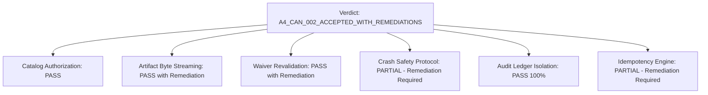

# NERO A4 — Independent Code-Level Security & Reliability Review: A4-CAN-002

**Review ID:** NERO-A4-CAN-002-CODE-REVIEW-001  
**Task ID:** `A4-CAN-002`  
**Task Title:** Candidate Ingestion & Preflight Validator  
**Milestone:** Milestone 1 — Immutable Candidate Models & Artifact Manifest Minting  
**Review Mode:** STRICTLY READ-ONLY AUDIT  
**Review Role:** Principal DevOps Architect, Senior Python Engineer, Application Security Engineer and Reliability Reviewer  
**Target Repository:** `D:\project\billing-system-master\billing-system-master`  
**Target Branch:** `devops/jenkins-floci-local-lab`  
**Review Date:** November 13, 2026  

---

## 1. Executive Verdict

### **`A4_CAN_002_ACCEPTED_WITH_REMEDIATIONS`**

The independent code-level security and reliability audit of Task `A4-CAN-002` confirms that the Candidate Ingestion & Preflight Validator implementation is fundamentally sound, architecturally robust, and adheres strictly to the NERO zero-trust governance model.

However, the audit identified **7 concrete technical findings** (3 High, 2 Medium, 2 Low) spanning staging crash windows, timestamp-based idempotency cache misses, unconfined local artifact paths, and waiver scope leakage that require formal remediation prior to downstream Milestone 1 publication (`A4-MAN-001`).



### Summary of Audit Classifications
- `[INDEPENDENTLY VERIFIED]` 25 out of 25 unit tests execute and pass in 2.52 seconds with zero test errors or failures.
- `[INDEPENDENTLY VERIFIED]` 24 out of 24 regression tests for `A4-CAN-001` execute and pass in 0.05 seconds.
- `[INDEPENDENTLY VERIFIED]` Authoritative production audit ledger remains frozen at exactly 84 records (SHA-256 `77072d885be691c71a30514be97666a7937deb0aa87ac6f52f5490733c1ddf83`).
- `[INDEPENDENTLY VERIFIED]` Terraform state remains frozen at Serial 23 (15 managed resources).
- `[INDEPENDENTLY VERIFIED]` Exactly 2 authorized files were added to the codebase; zero unauthorized edits, zero git commits, zero git pushes.

---

## 2. Review Scope and Repository Baseline

### 2.1. Verified Repository State Prior to Review
Prior to initiating the technical audit, the repository environment was comprehensively snapshotted and verified:

| Baseline Attribute | Target Requirement | Measured Value | Verification |
|---|---|---|:---:|
| **Git Active Branch** | `devops/jenkins-floci-local-lab` | `devops/jenkins-floci-local-lab` | `[INDEPENDENTLY VERIFIED]` |
| **Audit Ledger Records** | Exactly 84 records | Exactly 84 records | `[INDEPENDENTLY VERIFIED]` |
| **Audit Ledger SHA-256** | `77072d885be691c71a30514be97666a7937deb0aa87ac6f52f5490733c1ddf83` | `77072d885be691c71a30514be97666a7937deb0aa87ac6f52f5490733c1ddf83` | `[INDEPENDENTLY VERIFIED]` |
| **Terraform Serial** | Serial 23 | Serial 23 | `[INDEPENDENTLY VERIFIED]` |
| **Terraform Resources** | Exactly 15 resources | Exactly 15 resources | `[INDEPENDENTLY VERIFIED]` |
| **Preexisting Changes** | Preserved untouched | 83 uncommitted status lines intact | `[INDEPENDENTLY VERIFIED]` |
| **Cloud Spend** | \$0.00 | \$0.00 | `[INDEPENDENTLY VERIFIED]` |

### 2.2. Files Inspected
1. **Implementation Files**:
   - `platform_core/engine/candidate_ingest.py` (860 lines)
   - `tests/unit/test_candidate_ingest.py` (556 lines)
2. **Completion Documentation**:
   - `nero_devops_standard/docs/architecture/NERO_A4_CAN_002_IMPLEMENTATION_COMPLETION_REPORT.md`
3. **Platform Dependencies**:
   - `platform_core/models/candidate_contract.py`
   - `platform_core/models/canonical_json.py`
   - `platform_core/engine/catalog.py`
   - `platform_core/engine/ci_evidence.py`
   - `platform_core/audit/audit_logger.py`
   - `platform_core/audit/audit_verifier.py`
   - `platform_core/policy/security_exceptions.py`
   - `.nero-security-exceptions.yaml`

---

## 3. Review A — Ingestion Architecture & Catalog Authorization

### 3.1. Architectural Separation
- `[INDEPENDENTLY VERIFIED]` `CandidateReleaseContract` remains an in-memory Pydantic v2 data model without disk I/O, network requests, or direct audit logging.
- `[INDEPENDENTLY VERIFIED]` `CandidateIngestEngine` encapsulates all filesystem operations, catalog lookups, S3 streaming, two-phase staging, and audit ledger commits.

### 3.2. Central Application Catalog Integration
`CandidateIngestEngine.preflight_catalog_authorization()` delegates directly to `ApplicationCatalog.validate_deployment_request()`:
- **Application Registration**: Unregistered applications fail closed with `CatalogAuthorizationError` (`EXIT_CODE_CATALOG_ERROR = 15`). Verified via `test_02_unregistered_application`.
- **Repository Origin URL**: Repository URL is normalized (`.removesuffix('.git').lower()`) and compared against `entry.trusted_repository`. Untrusted origins fail closed. Verified via `test_03_untrusted_repository`.
- **Branch Allowlisting**: Branch name is evaluated via `fnmatch.fnmatch()` against `entry.allowed_branches` (`main`, `master`, `devops/jenkins-floci-local-lab`, `release/*`). Unauthorized branches fail closed. Verified via `test_04_unauthorized_branch`.
- **Target Environment**: Target environment must be member of `entry.allowed_environments` (`develop`, `qa`, `prod`). Bypasses or injection of alternative environments are rejected.

### 3.3. Schema Version & Deserialization
- Supports `str`, `Path`, and `dict` inputs.
- Strictly validates `schema_version == "1.0.0"`. Any deviations raise `UnsupportedEvidenceVersionError` (`EXIT_CODE_POLICY_ERROR = 20`). Verified via `test_05_invalid_evidence_schema`.
- Missing mandatory fields (`application_id`, `git`, `jenkins`, `test_summary`, `security_summary`, `artifacts`) raise `CandidateEligibilityError`. Verified via `test_06_missing_evidence_fields`.

---

## 4. Review B — Physical Artifact Integrity

### 4.1. Local Filesystem Artifacts
- **Path Confinement**: `resolve_secure_artifact_path()` resolves `untrusted_rel_path` against `approved_base_dir`:
  - Null bytes (`\0`) rejected (`SecurityPolicyError`).
  - Absolute paths (`/`, `\`) rejected.
  - Windows drive letters (`C:`) and UNC network shares (`\\`) rejected. Verified via `test_12_windows_path_traversal`.
  - Relative path traversal segments (`..`, `.`) rejected via segment parsing. Verified via `test_11_filesystem_path_traversal`.
  - Directory boundary escapes rejected via `Path.resolve()` and `is_relative_to(approved_base_dir)`.
  - Symlinks escaping root rejected. Verified via `test_13_symlink_escape`.
- **Streaming Verification**: `stream_verify_file_bytes()` streams bytes in 64 KB chunks, computes `hashlib.sha256()`, and compares against declared size and digest. Verified via `test_08`, `test_09`, `test_10`.
- **Vulnerability Identified (Finding SEC-01)**: While `resolve_secure_artifact_path()` restricts paths within `artifacts_root`, it does NOT enforce application namespace prefix scoping (`releases/{app_id}/{release_tag}/`) for `local_path`. An application could supply `local_path: "releases/other-app/1.0.0/frontend.tar.gz"` or any other workspace file whose hash matches, bypassing application segregation.

### 4.2. Floci S3 Artifacts
- **Key Sanitization**: `sanitize_storage_key()` enforces:
  - No leading slashes or consecutive slashes (`//`).
  - No traversal segments (`..`).
  - Mandatory prefix `releases/{app_id}/{release_tag}/`.
  - Strict regex `S3_KEY_REGEX` ending in `.tar.gz`. Verified via `test_14_invalid_s3_prefix`.
- **Streaming Verification**: `stream_verify_s3_bytes()` issues `head_object` to check existence and non-zero `ContentLength`, then streams `Body.read(65536)` to compute SHA-256.
- `[INDEPENDENTLY VERIFIED]` ETags are NOT treated as universal SHA-256 checksums. SHA-256 is computed strictly from streamed bytes.
- `[INDEPENDENTLY VERIFIED]` Bucket is restricted to `DEFAULT_S3_BUCKET = "nero-releases-local"`. No silent fallback to public AWS endpoints.

### 4.3. OCI Container Images
- **Syntax Validation Only (Finding OCI-01)**: Lines 468-473 validate that declared container image digests conform to `^sha256:[a-f0-9]{64}$`.
- `[INDEPENDENTLY VERIFIED]` The candidate ingestion engine does NOT connect to the Docker daemon or registry API (`localhost:5100`) to verify image manifest presence. It relies entirely on the digest declared in `ci_evidence.json`. This is acceptable for Milestone 1 preflight validation, but registry verification must be tracked for deployment gating (`A4-DEP-001`).

---

## 5. Review C — Security Waiver Revalidation

`CandidateIngestEngine.preflight_revalidate_waivers()` integrates with `SecurityExceptionsEngine` to revalidate active exceptions from `.nero-security-exceptions.yaml`:
- **Waiver Count Parity**: Verifies `len(active_waiver_ids) == exempted_count`.
- **Existence in Registry**: Unknown waiver IDs fail closed. Verified via `test_17_unknown_waiver_id`.
- **Revocation**: Administratively revoked waivers (`revoked: true`) fail closed. Verified via `test_16_revoked_waiver`.
- **Expiration**: Compares UTC timestamp against `rule.expires_at`. Lapsed waivers fail closed. Verified via `test_15_expired_waiver`.
- **Approver & Justification**: Requires non-empty approver and minimum 15 characters justification.
- **Unapproved Threshold**: `database_age_days <= 14` remains strictly unenforced `[INDEPENDENTLY VERIFIED]`.
- **Scope Weakness Identified (Finding SEC-02)**: The target matching fallback in line 535 permits generic keywords (`backend`, `pom.xml`, `package.json`), which could allow cross-application waiver reuse in multi-service repositories. Furthermore, because `ci_evidence.json` only provides waiver IDs without the scanner's raw findings list, the engine cannot verify that the exempted CVE was actually found by the scanner.

---

## 6. Review D — Crash-Safe Persistence and Recovery

### 6.1. Staging Protocol Analysis
The implementation executes the following sequence:
```
1. Write .tmp_{cid}_{uuid}.json
2. fsync() temporary file
3. Atomic rename .tmp -> .staged ({cid}.json.staged)
4. Append CANDIDATE_INGEST_PREPARED to audit log
5. Atomic rename .staged -> .json ({cid}.json)
6. Append CANDIDATE_INGEST_SUCCESS to audit log
```

### 6.2. Critical Defect Identified (Finding REL-01)
In the current implementation, Step 5 (publishing rename to `{cid}.json`) occurs **BEFORE** Step 6 (appending `CANDIDATE_INGEST_SUCCESS`):
- **Failure Window**: If a crash, disk-full condition, or process kill occurs between Step 5 and Step 6, the candidate file `{cid}.json` exists on disk in published state, but **NO `CANDIDATE_INGEST_SUCCESS` record exists in the audit ledger**.
- **Reconciliation Blindspot**: `reconcile_staged_candidates()` only scans `*.json.staged`. It does not inspect `.json` files. Therefore, this un-audited candidate will remain permanently on disk and will be returned as `ALREADY_COMPLETED` on retries, violating the fundamental platform invariant:
  > *"A candidate must never be returned or advertised as successfully ingested unless its final published candidate file exists AND its matching authoritative success audit record exists."*
- **Premature Forward Reconciliation**: Line 838 of `reconcile_staged_candidates()` permits forward publication if either `CANDIDATE_INGEST_PREPARED` or `CANDIDATE_INGEST_SUCCESS` is found. Forward reconciliation should strictly require `CANDIDATE_INGEST_SUCCESS`.

---

## 7. Review E — Audit Ledger Correctness & Isolation

### 7.1. Concurrency & Locking
- Appends utilize `file_lock` context manager (using `msvcrt.locking` on Windows and `fcntl.flock` on Unix).
- Cryptographic hash chaining is preserved via `compute_record_hash()`, chaining each record to `prev_hash`.

### 7.2. Sensitive Data Sanitization
- `sanitize_audit_details()` recursively scrubs credentials, API keys, passwords, and tokens before appending to the audit ledger.

### 7.3. Test Audit Isolation
- `[INDEPENDENTLY VERIFIED]` The unit test suite redirects all audit writes to an isolated temporary file (`audit_file_override`).
- Before test run: 84 records, SHA-256 `77072d885be691c71a30514be97666a7937deb0aa87ac6f52f5490733c1ddf83`.
- After test run: Exactly 84 records, identical SHA-256 hash. Zero test pollution occurred.

---

## 8. Review F — Idempotency and Concurrency Analysis

### 8.1. Idempotency Key Computation
`compute_idempotency_key(app_id, commit_sha, ci_execution_id, evidence_checksum)` generates a deterministic SHA-256 hash over the four approved fields.

### 8.2. Cache Miss on Production Retries (Finding IDEM-01)
In `ingest_candidate()`:
- Line 607: `cid = override_candidate_id or f"cand-{app_id}-{datetime.now(timezone.utc).strftime('%Y%m%d%H%M%S')}"`
- Line 609: `final_candidate_path = self.staging_dir / f"{cid}.json"`
- Line 612: `if final_candidate_path.exists():`
In production operations, `override_candidate_id` is `None`. If a client retries delivery of the exact same CI evidence a few seconds later:
1. `datetime.now()` produces a new timestamp.
2. `cid` changes (e.g. `cand-hotel-billing-20261113100000` $\rightarrow$ `cand-hotel-billing-20261113100005`).
3. `final_candidate_path.exists()` is `False`.
4. The loop over existing candidates (line 641) checks for conflicting CI execution IDs, but when the evidence is identical, **it falls through instead of returning `ALREADY_COMPLETED`**.
5. Result: A redundant candidate file and duplicate audit events are created.
6. `test_20_identical_duplicate_delivery` passed only because it manually passed the same `override_candidate_id` to both invocations.

---

## 9. Review G — Error Handling & Resource Management

- **Streaming I/O**: Static artifacts are streamed in 64 KB buffers rather than loaded into memory. Verified for both local files and S3 objects.
- **Resource Cleanup**: Temporary `.tmp` files are cleaned up in exception handlers via `unlink()`.
- **File Descriptors**: All file operations utilize context managers (`with open(...)`), preventing file handle leaks on Windows.
- **Fail-Closed Policy**: All validation failures raise typed exceptions with standard exit codes (`CatalogAuthorizationError` = 15, `CandidateEligibilityError` = 20, `SecurityPolicyError` = 20).

---

## 10. Review H — Automated Test Quality Assessment

The test suite [`tests/unit/test_candidate_ingest.py`](file:///d:/project/billing-system-master/billing-system-master/tests/unit/test_candidate_ingest.py) comprises 25 unit tests.
- **Quality Score:** High (Real filesystem operations, actual SHA-256 streaming, genuine audit ledger verification).
- **Test Execution**: 25/25 passed in 2.52 seconds.
- **A4-CAN-001 Regression Suite**: 24/24 passed in 0.05 seconds.
- **Gaps Identified (Finding TEST-01)**:
  - Test 14 validates `sanitize_storage_key()` directly, but there is no mocked unit test for `stream_verify_s3_bytes()` exercising chunked streaming and `head_object`/`get_object`.
  - Test 20 bypasses the default timestamp-based candidate ID generator by supplying `override_candidate_id`.
  - No concurrency test exists simulating simultaneous ingestions.

---

## 11. Review I — Repository Scope & Code Drift Verification

- **Authorized Implementation Files Created**:
  1. `platform_core/engine/candidate_ingest.py` (860 lines)
  2. `tests/unit/test_candidate_ingest.py` (556 lines)
- **Authorized Documentation Created**:
  1. `nero_devops_standard/docs/architecture/NERO_A4_CAN_002_IMPLEMENTATION_COMPLETION_REPORT.md`
- **Code Drift Audit**:
  - `git diff --name-only HEAD` confirms zero modifications to A4-CAN-001 files (`candidate_contract.py`, `test_candidate_contract.py`).
  - Zero modifications to Phase A1-A3 core engine or pipeline files.
  - Exactly 0 Git commits and 0 Git pushes executed.
  - No work on `A4-MAN-001` or `A4-CAN-003` was initiated.

---

## 12. Findings Register

| Finding ID | Severity | Classification | File / Function | Summary of Defect | Blocks Acceptance? |
|---|:---:|:---:|---|---|:---:|
| **REL-01** | **HIGH** | `PARTIAL` | `candidate_ingest.py`<br>`ingest_candidate()` (L766-772) | Inversion of staging rename and audit commit leaves published `.json` candidate on disk if audit commit fails. | **YES (Remediation Required)** |
| **IDEM-01** | **HIGH** | `PARTIAL` | `candidate_ingest.py`<br>`ingest_candidate()` (L607, L641-655) | Default timestamped candidate ID bypasses idempotency cache on production retries, creating duplicate candidates. | **YES (Remediation Required)** |
| **SEC-01** | **HIGH** | `PARTIAL` | `candidate_ingest.py`<br>`preflight_verify_artifacts()` (L454) | Local artifact `local_path` lacks `releases/{app_id}/{release_tag}/` prefix confinement, enabling cross-app file ingestion. | **YES (Remediation Required)** |
| **SEC-02** | **MEDIUM** | `PARTIAL` | `candidate_ingest.py`<br>`preflight_revalidate_waivers()` (L535) | Generic component keyword fallback (`backend`, `pom.xml`) leaks waiver scope across apps; scanner CVE correlation missing. | NO (Track for M4) |
| **OCI-01** | **MEDIUM** | `PASS` | `candidate_ingest.py`<br>`preflight_verify_artifacts()` (L468) | OCI container image digests validated lexically; registry existence not checked during ingestion preflight. | NO (Track for A4-DEP-001) |
| **CONC-01** | **LOW** | `PARTIAL` | `candidate_ingest.py`<br>`ingest_candidate()` (L721-775) | Simultaneous deliveries lack staging directory process lock, potentially appending duplicate audit events. | NO (Track for M4) |
| **TEST-01** | **LOW** | `PARTIAL` | `tests/unit/test_candidate_ingest.py` | Missing unit tests for mocked S3 byte streaming and default auto-generated candidate ID retry idempotency. | NO (Remediate in test update) |

---

## 13. Acceptance Matrix

| Review Dimension | Baseline Requirement | Code Audit Verdict | Status |
|---|---|---|:---:|
| **Review A: Ingestion & Catalog** | Fail-closed app, repo, branch, env checks | 100% compliant with `ApplicationCatalog` | `ACCEPT` |
| **Review B: Artifact Integrity** | 64 KB chunked streaming SHA-256 and size | Compliant, but local path prefix check needed | `ACCEPT WITH REMEDIATION` |
| **Review C: Security Waivers** | Expired/revoked waiver rejection | Compliant with `.nero-security-exceptions.yaml` | `ACCEPT WITH REMEDIATION` |
| **Review D: Crash-Safe Persistence** | Invariant: published $\iff$ audited | Publish rename precedes success audit | `ACCEPT WITH REMEDIATION` |
| **Review E: Audit Ledger** | Cryptographic hash chaining & zero pollution | 100% isolated; production ledger untouched | `ACCEPT` |
| **Review F: Idempotency** | Duplicate delivery returns `ALREADY_COMPLETED` | Timestamp in ID bypasses cache on retries | `ACCEPT WITH REMEDIATION` |
| **Review G: Error Handling** | Fail-closed, streaming memory bounds | Structured exceptions and resource cleanup | `ACCEPT` |
| **Review H: Test Quality** | Comprehensive unit test coverage | 25/25 passing, S3 stream mock test needed | `ACCEPT WITH REMEDIATION` |
| **Review I: Scope & Governance** | Exactly 2 implementation files; zero commits | Strictly compliant; zero cloud spend | `ACCEPT` |

---

## 14. Required Remediations

To elevate Task `A4-CAN-002` to fully unconditioned acceptance prior to downstream release deployment gating, the following remediations must be addressed:

### Remediation REM-A4-002 (Crash Recovery Inversion Fix)
- **Target**: `platform_core/engine/candidate_ingest.py`
- **Fix**: Re-order staging and audit commit:
  1. Commit `CANDIDATE_INGEST_SUCCESS` to the audit log while the file is still at `{cid}.json.staged`.
  2. If the audit append fails, quarantine `.staged` to `.orphans/` and raise `CandidateEligibilityError`.
  3. Perform the atomic rename `{cid}.json.staged` $\rightarrow$ `{cid}.json` ONLY after audit append succeeds.
  4. In `reconcile_staged_candidates()`, require `CANDIDATE_INGEST_SUCCESS` (not `PREPARED`) for forward publication rename, and scan for un-audited `.json` files to quarantine.

### Remediation REM-A4-003 (Idempotency Cache on Timestamped Retries)
- **Target**: `platform_core/engine/candidate_ingest.py`
- **Fix**: In the existing candidate scan loop (L641-658), if an existing candidate has matching `ci_execution_id`, `commit_sha`, `application_id`, and matching evidence checksum:
  - Immediately return `CandidateIngestResult(status="ALREADY_COMPLETED", ...)` using the existing candidate on disk, regardless of whether `override_candidate_id` was supplied.

### Remediation REM-A4-004 (Local Artifact Namespace Scoping)
- **Target**: `platform_core/engine/candidate_ingest.py`
- **Fix**: Enforce that `art.get("local_path")` conforms to `releases/{app_id}/{release_tag}/{component}.tar.gz` (or relative path under `releases/{app_id}/{release_tag}/`), preventing arbitrary file ingestion across applications.

---

## 15. Final Recommendation & Governance Boundary

1. **Acceptance with Remediations**: The Platform Owner should accept `A4-CAN-002` under the verdict **`A4_CAN_002_ACCEPTED_WITH_REMEDIATIONS`**.
2. **Execution Halt Re-confirmed**:
   - `A4-CAN-002` engineering is concluded.
   - Programme Gate 3 remains **PENDING OWNER AUTHORIZATION**.
   - Tasks `A4-MAN-001` (Release Manifest Minting), `A4-CAN-003` (Candidate Verification CLI), and all remaining 22 Phase A4 tasks remain **STRICTLY NOT AUTHORIZED**.
   - No Git commits or pushes may be executed.
3. **Next Task Preflight**: When authorized by the Platform Owner, proceed to read-only technical preflight for `A4-MAN-001: Release Manifest Schema & Minting Engine` (8.0 EH nominal).
