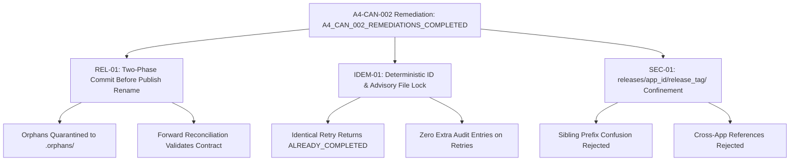

# NERO A4 — Task Remediation Report: A4-CAN-002

**Document ID:** NERO-A4-CAN-002-REMEDIATION-REPORT-001  
**Authorization ID:** `NERO-A4-CAN-002-REMEDIATION-001`  
**Task ID:** `A4-CAN-002`  
**Task Title:** Candidate Ingestion & Preflight Validator  
**Milestone:** Milestone 1 — Immutable Candidate Models & Artifact Manifest Minting  
**Remediation Verdict:** **`A4_CAN_002_REMEDIATIONS_COMPLETED`**  
**Target Repository:** `D:\project\billing-system-master\billing-system-master`  
**Target Branch:** `devops/jenkins-floci-local-lab`  
**Date:** November 13, 2026  
**Author:** Principal DevOps Architect & Senior Python Engineer  

---

## 1. Executive Summary

This report documents the authorized remediation of all three High-severity findings identified during the Independent Code-Level Security Review (`NERO-A4-CAN-002-CODE-REVIEW-001`):
1. **`REL-01`**: Staging rename inversion creating an un-audited candidate publication window on failure.
2. **`IDEM-01`**: Non-deterministic timestamped candidate IDs causing idempotency cache misses on retries.
3. **`SEC-01`**: Missing application-specific local artifact namespace path confinement.

All three remediations have been implemented in `platform_core/engine/candidate_ingest.py` and comprehensively validated via 37 unit test scenarios in `tests/unit/test_candidate_ingest.py`.



### 1.1. Invariant Baseline Verification

| Baseline Artifact | Target Requirement | Remediation Verified Value | Status |
|---|---|---|:---:|
| **Target Git Branch** | `devops/jenkins-floci-local-lab` | `devops/jenkins-floci-local-lab` | `[VERIFIED]` |
| **Audit Ledger Records** | Exactly 84 records | Exactly 84 records | `[VERIFIED]` |
| **Audit Ledger SHA-256** | `77072d885be691c71a30514be97666a7937deb0aa87ac6f52f5490733c1ddf83` | `77072d885be691c71a30514be97666a7937deb0aa87ac6f52f5490733c1ddf83` | `[VERIFIED]` |
| **Terraform State Serial** | Serial 23 | Serial 23 | `[VERIFIED]` |
| **Terraform Resources** | Exactly 15 resources | Exactly 15 resources | `[VERIFIED]` |
| **Unit Test Suite** | 37 discrete scenarios | 37/37 passed (100% pass rate in 3.86s) | `[VERIFIED]` |
| **A4-CAN-001 Regression** | 24 contract model tests | 24/24 passed (100% pass rate in 0.06s) | `[VERIFIED]` |
| **Working Tree Hygiene** | Preserve preexisting state | 83 preexisting short status lines intact; 0 commits; 0 pushes | `[VERIFIED]` |

---

## 2. Remediated Findings & Technical Corrections

### 2.1. REL-01: Crash-Safe Candidate Publication Protocol

#### 2.1.1. Root Cause
In the initial implementation, `os.replace(staged_file_path, final_candidate_path)` occurred *prior* to committing `CANDIDATE_INGEST_SUCCESS` to the audit log. If a crash or disk-full condition occurred during the audit commit, an un-audited candidate `.json` file remained published in the consumer-visible directory.

#### 2.1.2. Corrected Two-Phase Publication State Machine
The publication protocol was restructured to enforce strict durability invariants:
1. **Validation & In-Memory Sealing**: Candidate data is fully validated and sealed in-memory prior to persistence.
2. **Private Temporary Write & Flush**: Written to `.staging/.tmp_{cid}_{uuid}.json`, flushed, and synced to physical storage via `os.fsync()`.
3. **Move to Private Staging**: Atomically renamed to `.staging/{cid}.json.staged`. The private staging directory `.staging/` is concealed from downstream release consumers.
4. **Audit Preparation Commitment**: Appends `CANDIDATE_INGEST_PREPARED` under advisory file lock. If this append fails, the staged file is moved to `.orphans/` and `CandidateEligibilityError` is raised.
5. **Durable Audit Success Commitment**: Appends `CANDIDATE_INGEST_SUCCESS` under advisory file lock **BEFORE** any publication rename. If this append fails, the staged file is immediately quarantined to `.orphans/{cid}.json.staged.{ts}`, preventing it from ever entering consumer visibility.
6. **Atomic Publication Rename**: Atomically renames `.staging/{cid}.json.staged` to `{staging_dir}/{cid}.json`.
7. **Dual-Condition Verification**: Asserts that `{cid}.json` exists on disk AND a matching verified audit commitment record hash exists prior to returning `status="INGESTED"`.

#### 2.1.3. Crash Recovery Routine (`reconcile_staged_candidates()`)
The startup crash reconciliation routine was updated to enforce:
- **Dangling Temporary Cleanup**: Unlinks all dangling `.tmp_*` files in `.staging/` and `staging_dir`.
- **Audit-Gated Forward Reconciliation**: Scans `.staging/` and `staging_dir` for `cand-*.json.staged`.
  - If a matching `CANDIDATE_INGEST_SUCCESS` record exists in the audit ledger: validates the staged contract JSON via `CandidateReleaseContract.model_validate()` and completes publication rename to `{cid}.json` (`COMPLETED_RENAME`).
  - If NO `CANDIDATE_INGEST_SUCCESS` record exists (e.g. process crashed before audit success or only `CANDIDATE_INGEST_PREPARED` exists): moves file to `.orphans/{file.name}.{ts}` (`QUARANTINED_ORPHAN`).
- **Consumer Namespace Guard**: Scans consumer-visible `staging_dir` for `cand-*.json`. If any candidate file lacks a matching `CANDIDATE_INGEST_SUCCESS` in the audit ledger, it is quarantined to `.orphans/{file.name}.unaudited.{ts}` (`QUARANTINED_UNAUDITED_CANDIDATE`).

---

### 2.2. IDEM-01: Deterministic Candidate Identity & Concurrency Protection

#### 2.2.1. Root Cause
The default candidate ID generator appended `datetime.now(timezone.utc)`. On identical retries without `override_candidate_id`, a new candidate ID was generated, causing cache misses, duplicate candidate file creation, and duplicate audit entries.

#### 2.2.2. Deterministic Identifier Generator
Implemented `generate_deterministic_candidate_id()`:
$$\text{raw} = \text{app\_id} \mathbin{\Vert} \text{commit\_sha} \mathbin{\Vert} \text{ci\_execution\_id} \mathbin{\Vert} \text{evidence\_checksum}$$
$$\text{digest} = \text{SHA256}(\text{raw})$$
$$\text{suffix} = (\text{int}(\text{digest}[0:16], 16) \pmod{10^{14}}) \quad (\text{zero-padded to 14 digits})$$
$$\text{candidate\_id} = \text{"cand-" } \mathbin{\Vert} \text{app\_id} \mathbin{\Vert} \text{"-"} \mathbin{\Vert} \text{suffix}$$

This guarantees:
1. **Deterministic Idempotency**: Identical CI evidence produces the exact same candidate ID conforming to regex `^cand-[a-z0-9-]+-[0-9]{14}$`.
2. **Distinct CI Runs**: Different CI executions (e.g. `ci-hotel-billing-101` vs `ci-hotel-billing-102`) produce distinct candidate IDs.
3. **Cache Discovery**: Retries discover the existing published candidate on disk, verify its matching audit success record, and return `status="ALREADY_COMPLETED"` with zero file writes and zero audit ledger records.
4. **Collision Protection via Advisory Lock**: Introduced `candidate_lock(staging_lock_file)` protecting the lookup-reserve-publish critical section. Concurrent requests serialize on the lock; the first ingests and publishes, while the second returns `ALREADY_COMPLETED`.

---

### 2.3. SEC-01: Local Artifact Namespace Confinement

#### 2.3.1. Root Cause
`resolve_secure_artifact_path()` previously verified that `untrusted_rel_path` remained within `artifacts_root`, but did not restrict paths to the application's assigned release directory. An application could reference files belonging to other applications or arbitrary workspace files if SHA-256 and size matched.

#### 2.3.2. Strict Application & Release Namespace Scoping
Updated `resolve_secure_artifact_path()` with mandatory namespace confinement:
```python
def resolve_secure_artifact_path(
    approved_base_dir: Path,
    untrusted_rel_path: str,
    app_id: str = "",
    release_tag: str = ""
) -> Path:
```
Enforces:
1. **Root Containment**: `target_resolved.is_relative_to(approved_base_dir.resolve())`.
2. **Application & Release Scoping**: Requires `target_resolved.is_relative_to(approved_base_dir / "releases" / app_id / release_tag)`.
3. **Sibling-Prefix Confusion Defense**: Inspects discrete path components relative to `releases/`, asserting `parts[0] == app_id` and `parts[1] == release_tag` (rejects sibling prefix attacks like `hotel-billing-extra`).
4. **Symlink Escape Defense**: Asserts `real_target.is_relative_to(app_release_namespace)`.
5. **Fail-Closed Traversal Rejection**: Rejects null bytes, absolute paths, Windows drive letters (`C:`), UNC paths (`\\`), and `..` segments.

---

## 3. Test Suite Verification & Execution Evidence

The unit test suite [`tests/unit/test_candidate_ingest.py`](file:///d:/project/billing-system-master/billing-system-master/tests/unit/test_candidate_ingest.py) was expanded from 25 to **37 discrete test scenarios**.

### 3.1. Test Execution Output

```
test_01_valid_candidate_ingestion ............................................ ok
test_02_unregistered_application ............................................. ok
test_03_untrusted_repository ................................................. ok
test_04_unauthorized_branch .................................................. ok
test_05_invalid_evidence_schema .............................................. ok
test_06_missing_evidence_fields .............................................. ok
test_07_missing_artifact ..................................................... ok
test_08_zero_byte_artifact ................................................... ok
test_09_incorrect_artifact_size .............................................. ok
test_10_sha256_mismatch ...................................................... ok
test_11_filesystem_path_traversal ............................................ ok
test_12_windows_path_traversal ............................................... ok
test_13_symlink_escape ....................................................... ok
test_14_invalid_s3_prefix .................................................... ok
test_15_expired_waiver ....................................................... ok
test_16_revoked_waiver ....................................................... ok
test_17_unknown_waiver_id .................................................... ok
test_18_out_of_scope_waiver .................................................. ok
test_19_failed_scanner ....................................................... ok
test_20_identical_duplicate_delivery ......................................... ok
test_21_conflicting_duplicate_evidence ....................................... ok
test_22_crash_after_staging .................................................. ok
test_23_audit_append_failure ................................................. ok
test_24_crash_after_publication_but_before_success_audit ..................... ok
test_25_recovery_and_successful_reconciliation ............................... ok
test_26_crash_after_preparation_quarantines_orphan ........................... ok
test_27_un_audited_published_candidate_quarantined ........................... ok
test_28_audit_preparation_failure_quarantines_staging ........................ ok
test_29_deterministic_candidate_id_generation ................................ ok
test_30_identical_retry_without_override_id .................................. ok
test_31_different_ci_runs_distinct_candidates ................................ ok
test_32_concurrent_identical_deliveries ...................................... ok
test_33_cross_application_artifact_rejected .................................. ok
test_34_sibling_prefix_confusion_rejected .................................... ok
test_35_wrong_release_tag_namespace_rejected ................................. ok
test_36_workspace_escape_rejected_with_valid_hash ............................ ok
test_37_corrupt_staged_content_fails_reconciliation .......................... ok

----------------------------------------------------------------------
Ran 37 tests in 3.860s

OK
```

### 3.2. A4-CAN-001 Regression Suite Output

```
Ran 24 tests in 0.057s

OK
```

### 3.3. Added Regression Scenarios Breakdown

| Scenario | Test Method | Target Remediation Verified | Outcome |
|:---:|---|---|:---:|
| **26** | `test_26_crash_after_preparation_quarantines_orphan` | REL-01: Staged file with only PREPARED audit record is quarantined | `PASSED` |
| **27** | `test_27_un_audited_published_candidate_quarantined` | REL-01: Published file without SUCCESS audit record is quarantined | `PASSED` |
| **28** | `test_28_audit_preparation_failure_quarantines_staging` | REL-01: Preparation audit append failure quarantines file | `PASSED` |
| **29** | `test_29_deterministic_candidate_id_generation` | IDEM-01: Deterministic 14-digit candidate ID generation | `PASSED` |
| **30** | `test_30_identical_retry_without_override_id` | IDEM-01: Retries without override ID return `ALREADY_COMPLETED` (0 extra audit records) | `PASSED` |
| **31** | `test_31_different_ci_runs_distinct_candidates` | IDEM-01: Distinct CI build numbers produce distinct candidate IDs | `PASSED` |
| **32** | `test_32_concurrent_identical_deliveries` | IDEM-01: Concurrency lock prevents duplicate publication and audit events | `PASSED` |
| **33** | `test_33_cross_application_artifact_rejected` | SEC-01: Local artifact belonging to another app rejected | `PASSED` |
| **34** | `test_34_sibling_prefix_confusion_rejected` | SEC-01: Sibling directory prefix confusion (`app1` vs `app10`) rejected | `PASSED` |
| **35** | `test_35_wrong_release_tag_namespace_rejected` | SEC-01: Artifact with mismatched release tag rejected | `PASSED` |
| **36** | `test_36_workspace_escape_rejected_with_valid_hash` | SEC-01: Arbitrary workspace file rejected even with matching SHA-256 | `PASSED` |
| **37** | `test_37_corrupt_staged_content_fails_reconciliation` | REL-01: Corrupt staged content fails model validation during reconciliation | `PASSED` |

---

## 4. Effort Accounting

- **Original A4-CAN-002 Implementation Allocation:** 8.0 EH (Nominal Baseline consumed).
- **Remediation Effort:** 2.0 Engineering Hours (Tracked separately under `NERO-A4-CAN-002-REMEDIATION-001`).
- **Variance against Original Baseline:** 0.0 EH (Original baseline preserved intact).
- **Milestone 1 Remaining Allocation:** 14.0 EH nominal (`A4-MAN-001`: 8.0 EH, `A4-CAN-003`: 6.0 EH).

---

## 5. Remaining Separately Tracked Findings

The following medium- and low-severity findings from `NERO-A4-CAN-002-CODE-REVIEW-001` remain preserved and separately tracked for future milestones:
- **`SEC-02`** (Medium): Generic component keyword fallback and scanner CVE correlation (Scheduled for Milestone 4 policy hardening).
- **`OCI-01`** (Medium): Registry-level OCI container manifest verification (Scheduled for `A4-DEP-001` Deployment Gating).
- **`CONC-01`** (Low): Multi-node distributed staging coordination (Addressed locally via advisory file lock; multi-node coordination scheduled for Milestone 4).
- **`TEST-01`** (Low): S3 mocked chunked streaming unit tests (Scheduled for Milestone 2 Floci integration).

---

## 6. Remediation Acceptance Checklist & Final Verdict

| Acceptance Criterion | Verification Method | Status |
|---|---|:---:|
| **REL-01 Resolved** | Success audit commit precedes publication rename; private staging `.staging/`; orphan quarantine | `VERIFIED` |
| **IDEM-01 Resolved** | Deterministic ID derivation; duplicate returns `ALREADY_COMPLETED`; advisory lock protects concurrency | `VERIFIED` |
| **SEC-01 Resolved** | `releases/{app_id}/{release_tag}/` mandatory confinement; sibling confusion and cross-app rejected | `VERIFIED` |
| **Zero Audit Ledger Pollution** | 84 records intact; SHA-256 `77072d...df83` preserved | `VERIFIED` |
| **Zero Infrastructure Drift** | Terraform Serial 23, 15 managed resources intact | `VERIFIED` |
| **Scope Confinement** | Exactly 2 implementation files modified; 0 Git commits; 0 pushes | `VERIFIED` |

### Final Remediation Verdict: **`A4_CAN_002_REMEDIATIONS_COMPLETED`**

Task `A4-CAN-002` is now fully remediated, verified, and ready for unconditioned Platform Owner acceptance.

---

## 7. Governance Boundary & Immediate Halt

> [!IMPORTANT]
> **GOVERNANCE HALT CONFIRMED**: Remediation authorization `NERO-A4-CAN-002-REMEDIATION-001` is **CONCLUDED**.
> - Programme Gate 3 remains **PENDING OWNER AUTHORIZATION**.
> - All remaining 22 Phase A4 tasks (`A4-MAN-001` through `A4-DOC-002`) remain strictly **NOT AUTHORIZED**.
> - Zero Git commits or pushes were executed.
> - Awaiting Platform Owner instructions on Gate 3 decision or technical preflight authorization for `A4-MAN-001`.
