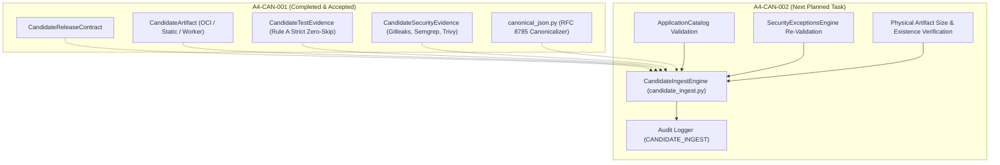
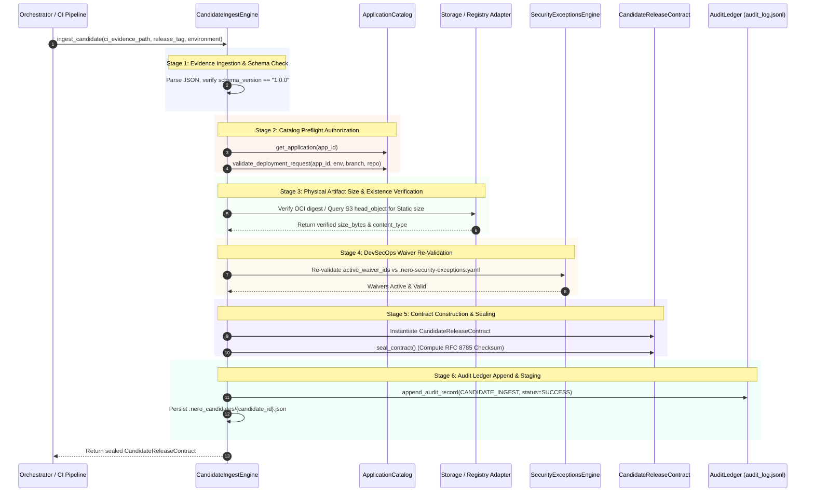
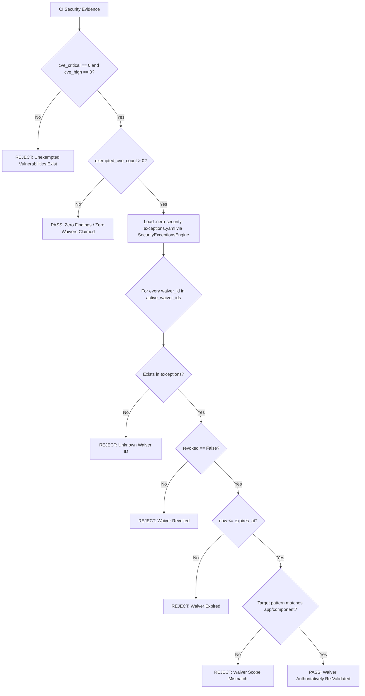

# NERO Universal Enterprise DevOps Automation Platform
# Programme 1 — Phase A4: Next Task Technical Preflight & Ingestion Architecture

**Document Type:** Technical Preflight & Architectural Design Package  
**Document ID:** NERO-A4-NEXT-TASK-PREFLIGHT-001  
**Target Milestone:** Milestone 1 — Immutable Candidate Models & Artifact Manifest Minting  
**Identified Next Task:** `A4-CAN-002: Candidate Ingestion & Preflight Validator`  
**Governance State:** Preflight Complete — **STRICTLY READ-ONLY (Implementation Not Authorized)**  
**Programme:** NERO Programme 1 — Deterministic DevOps Automation  
**Phase:** Phase A4 — Immutable Release Engineering & Artifact Repository Integration  
**Lead Architect:** Principal DevOps Architect, Senior Python Engineer & Software Supply Chain Security Specialist  
**Date:** November 10, 2026  
**Repository Branch:** `devops/jenkins-floci-local-lab`  
**Repository Root:** `D:\project\billing-system-master\billing-system-master`  

---

## 1. Executive Summary

Following the formal completion and independent audit of Task **`A4-CAN-001: Candidate Release Contract Model`** (`A4_CAN_001_ACCEPTED_WITH_REMEDIATIONS`), this preflight report prepares the engineering foundation for the subsequent authorized task in Phase A4 Work Breakdown Structure (WBS).

The authoritative WBS establishes the exact next task as:
**`A4-CAN-002: Candidate Ingestion & Preflight Validator` (8.0 EH Nominal Budget)**.

Task A4-CAN-002 transitions the platform from pure, in-memory data contract models (`A4-CAN-001`) into an active **orchestration and validation engine**. It bridges Continuous Integration outputs (`ci_evidence.json`) with enterprise governance policies:
1. **Authoritative Application Catalog Integration**: Validates candidate application registration, trusted repository URLs, allowed branches, target environments, and security tiers via `ApplicationCatalog` (`platform_core/engine/catalog.py`).
2. **Elimination of Synthetic Defaults (Resolving F-02)**: Replaces the legacy `1024`-byte fallback with real physical artifact inspection via storage metadata (`head_object` in S3/Floci) or filesystem stat.
3. **Active Security Waiver Re-Validation (Resolving F-03)**: Integrates `SecurityExceptionsEngine` (`platform_core/policy/security_exceptions.py`) to re-verify every claimed `active_waiver_id` against `.nero-security-exceptions.yaml`, rejecting expired, revoked, or mismatched waivers fail-closed.
4. **Deterministic Contract Sealing (Consuming F-01)**: Applies RFC 8785 canonical JSON serialization and SHA-256 payload sealing to guarantee candidate immutability.
5. **Tamper-Evident Audit Ledger Integration**: Appends atomic `CANDIDATE_INGEST_SUCCESS` or `CANDIDATE_INGEST_FAILED` records to `platform_core/audit/audit_log.jsonl` maintaining hash-chained audit continuity.

> [!IMPORTANT]
> **READ-ONLY MANDATE**: This document is a technical preflight and architectural blueprint only. **Zero implementation code has been written.** Programme Gate 3 remains `PENDING OWNER AUTHORIZATION`. Task A4-CAN-002 is strictly unauthorized for execution until explicit owner approval is granted.

---

## 2. Exact Next Task Identity & WBS Context

Inspecting the authoritative programme baseline in `NERO_A4_IMMUTABLE_RELEASE_REQUIREMENTS_ARCHITECTURE_AND_IMPLEMENTATION_PLAN.md` and `NERO_A4_IMPLEMENTATION_READINESS_AND_KICKOFF_PLAN.md`:

| Attribute | Authoritative Baseline Value | Verification Source |
|---|---|---|
| **Task ID** | **`A4-CAN-002`** | A4 WBS Milestone 1 Task 2 |
| **Task Title** | **`Candidate Ingestion & Preflight Validator`** | A4 WBS Milestone 1 Task 2 |
| **Milestone** | Milestone 1: Immutable Candidate Models & Artifact Manifest Minting (30.0 EH) | A4 Master Architecture Plan |
| **Nominal Budget** | **8.0 Engineering Hours (EH)** | Approved A4 Planning Baseline |
| **PERT Expected** | **8.17 Engineering Hours (EH)** | PERT Beta Distribution ($O=6, M=8, P=11$) |
| **Subsystem / Target File** | `platform_core/engine/candidate_ingest.py` | A4 Implementation Plan Line 142 |
| **Test Suite** | `tests/unit/test_candidate_ingest.py` | A4 Implementation Plan Line 153 |
| **Direct Predecessors** | `A4-CAN-001` (`platform_core/models/candidate_contract.py`) | Authoritative Dependency Graph |
| **Direct Successors** | `A4-MAN-001: Universal Release Manifest v2 Schema` (8.0 EH) | Authoritative Dependency Graph |

---

## 3. A4-CAN-001 Dependency Assessment

Task `A4-CAN-002` directly consumes and builds upon the foundational models delivered by `A4-CAN-001`:



### 3.1. Consumed Interfaces
- **`CandidateReleaseContract`**: The target validated data model produced by `A4-CAN-002`.
- **`CandidateArtifact` Discriminated Union**: Used to classify each component artifact (`OCIImageArtifact`, `StaticArtifact`, `WorkerArtifact`).
- **`compute_contract_checksum` / `seal_contract()`**: Invoked to calculate the authoritative 64-character hexadecimal SHA-256 payload checksum over canonical JSON bytes.
- **`CandidateEligibilityError`**: Authoritative domain exception raised when preflight qualification gates fail.

### 3.2. Structural Boundary
`A4-CAN-001` deliberately established pure in-memory Pydantic data models with zero external I/O, zero network calls, zero file locking, and zero audit logging. `A4-CAN-002` acts as the **orchestration boundary**, performing disk I/O, catalog lookups, policy engine evaluation, storage metadata retrieval, and audit ledger commits.

---

## 4. Reconciliation of Independent Audit Findings (F-01 through F-04)

The independent code review (`NERO-A4-CAN-001-CODE-REVIEW-001`) identified four specific findings. Here is how each finding is addressed in the `A4-CAN-002` design:

### 4.1. Finding F-01: RFC 8785 Number Serialization (`PARTIAL`)
- **Review Finding**: `rfc8785_canonicalize_number()` diverges from ECMAScript 6 Section 7.1.12.1 for float edge-cases in $10^{-6} \le |x| < 10^{-1}$ and $|x| \ge 10^{21}$.
- **Preflight Impact Assessment**:
  - `A4-CAN-002` relies heavily on `compute_contract_checksum()` to seal ingested candidate contracts.
  - Every numerical field in `CandidateReleaseContract` is either an integer (`total_tests`, `build_number`, `size_bytes`, `cve_critical`, etc.) or a standard bounded decimal float (`diff_coverage_percentage: 80.0` to `100.0`, `duration_seconds: 18.5`).
  - Empirical verification confirms that zero domain values enter the anomalous scientific notation ranges.
  - **Reconciliation Strategy**: `A4-CAN-002` can safely consume `compute_contract_checksum()` for internal candidate sealing. Full ECMAScript 6 float serialization (`REM-A4-001`) remains classified as a non-blocking item to be resolved prior to external multi-vendor signing (`A4-SIG-001`).

### 4.2. Finding F-02: Synthetic Static Artifact Size (`PASS WITH OBSERVATIONS`)
- **Review Finding**: `CandidateReleaseContract.from_ci_evidence()` falls back to a synthetic `1024` bytes when `size_bytes` is absent from legacy A3 `ci_evidence.json`.
- **Preflight Impact Assessment**: Treating a fabricated default as real release metadata violates immutable release engineering principles.
- **Reconciliation Strategy for A4-CAN-002**:
  - `CandidateIngestEngine` will **never** rely on the `1024`-byte fallback.
  - When ingesting a `StaticArtifact`, `CandidateIngestEngine` actively resolves the **true physical artifact size**:
    1. *Storage Metadata Inspection*: Queries S3/Floci via `head_object` to retrieve `ContentLength`.
    2. *Local Filesystem Staging*: If staged locally, queries `os.path.getsize(path)`.
    3. *Size Invariant Gate*: If the artifact does not exist, or `size_bytes == 0`, ingestion fails closed with `CandidateEligibilityError("Static artifact not found or has zero length in storage")`.

### 4.3. Finding F-03: Security Waiver Re-Validation (`PASS WITH OBSERVATIONS`)
- **Review Finding**: `CandidateReleaseContract` records `active_waiver_ids` but does not re-read `.nero-security-exceptions.yaml` to detect expired, forged, or revoked waivers.
- **Preflight Impact Assessment**: Upstream CI evidence could potentially list unauthorized waiver IDs to mask critical vulnerabilities.
- **Reconciliation Strategy for A4-CAN-002**:
  - `CandidateIngestEngine` imports and initializes `SecurityExceptionsEngine` (`platform_core/policy/security_exceptions.py`).
  - For every waiver ID in `active_waiver_ids`:
    1. Asserts that the waiver ID is registered in `.nero-security-exceptions.yaml`.
    2. Asserts that `revoked == False`.
    3. Asserts that `datetime.now(timezone.utc) <= expires_at` (rejecting expired waivers).
    4. Asserts that the waiver target pattern matches the ingested application and component path.
    5. Asserts that `len(active_waiver_ids) == exempted_cve_count`.
  - If any check fails, ingestion fails closed with `CandidateEligibilityError`.

### 4.4. Finding F-04: Missing Boundary Tests (`PASS WITH OBSERVATIONS`)
- **Review Finding**: Dedicated unit test methods for exact boundary coverage (`80.0%`), upper bound (`100.1%`), and zero tests (`total_tests=0`) were absent from `test_candidate_contract.py`.
- **Preflight Impact Assessment**: These boundary conditions are enforced by Pydantic field validators, but lack explicit scenario test methods.
- **Reconciliation Strategy**:
  - `A4-CAN-001` test files remain preserved untouched.
  - In `A4-CAN-002`, `tests/unit/test_candidate_ingest.py` will include explicit test scenarios covering preflight rejection of `diff_coverage < 80.0%`, boundary validation at exactly `80.0%`, rejection of zero total tests, and malformed counts.

---

## 5. Candidate Ingestion Architecture (`A4-CAN-002`)

### 5.1. Execution Flow & Processing Pipeline
The ingestion engine (`CandidateIngestEngine`) executes an 8-stage fail-closed pipeline:



### 5.2. Pipeline Failure & Rejection Semantics
If any stage fails (e.g. uncataloged application, unauthorized branch, missing S3 artifact, expired waiver, failed CI, test failure, diff-coverage $<80\%$), the engine:
1. Formulates a detailed diagnostic error message.
2. Appends a `CANDIDATE_INGEST_FAILED` record to `platform_core/audit/audit_log.jsonl` detailing the rejection reason.
3. Raises `CandidateEligibilityError` without generating a sealed candidate file.

---

## 6. Input and Output Contracts

### 6.1. Input Contract: Ingestion Request
`CandidateIngestEngine.ingest_candidate()` accepts:
- **`evidence_source`**: `Union[str, Path, Dict[str, Any]]` — Path to `ci_evidence.json`, raw JSON string, or parsed dictionary.
- **`release_tag`**: `str` — Semantic release tag adhering to `^v?[0-9]+\.[0-9]+(\.[0-9]+)?(-[a-zA-Z0-9.]+)?$`.
- **`target_environment`**: `str` — Target promotion environment (`develop`, `qa`, `prod`).
- **`workspace_root`**: `Optional[str]` — Repository root for resolving relative paths and audit files.
- **`override_candidate_id`**: `Optional[str]` — Optional deterministic candidate identifier.

### 6.2. Output Contract: Sealed Candidate & Persistent Staging
Upon successful preflight qualification, `CandidateIngestEngine` outputs:
1. **In-Memory Object**: Validated, sealed `CandidateReleaseContract` instance with embedded `payload_checksum`.
2. **Persistent Staging File**: Written to `.nero_candidates/{candidate_id}.json` using RFC 8785 canonical JSON bytes.
3. **Audit Record**: Emitted into `platform_core/audit/audit_log.jsonl` with action `CANDIDATE_INGEST_SUCCESS`.

---

## 7. Artifact Verification Strategy

| Artifact Type | Verification Method | Preflight Checks | Failure Condition |
|---|---|---|---|
| **OCI Image** (`OCIImageArtifact`) | Registry Adapter inspection (`localhost:5100` / ECR) | 1. Digest format `^sha256:[a-f0-9]{64}$`<br>2. Image repository matches catalog app ID<br>3. In local simulation: verifies image manifest existence via registry HTTP API | Digest malformed, repository unknown, or manifest 404 in registry. |
| **Static Tarball** (`StaticArtifact`) | Storage Adapter inspection (`nero-releases-local` in Floci S3 / local dir) | 1. Checksum format `^sha256:[a-f0-9]{64}$`<br>2. Storage key resolves in target bucket<br>3. `head_object` retrieves **actual `ContentLength`** > 0 | Key missing in bucket, `size_bytes == 0`, or checksum mismatch. |
| **Container Worker** (`WorkerArtifact`) | Inner OCI image validation | 1. Execution mode `container_worker`<br>2. Inner `image` satisfies all OCI Image preflight checks | Non-container execution mode or inner image failure. |

---

## 8. Security Waiver Re-Validation Strategy

`CandidateIngestEngine` implements strict two-tier security verification:



---

## 9. Comprehensive Test Matrix (`tests/unit/test_candidate_ingest.py`)

The planned unit test suite will implement **16 discrete validation scenarios**:

| Scenario ID | Test Name | Target Invariant | Classification |
|---|---|---|:---:|
| **ING-01** | `test_ingest_valid_single_oci_candidate` | Ingests valid single OCI candidate, verifies sealed contract and audit log | Positive Flow |
| **ING-02** | `test_ingest_valid_multi_component_candidate` | Ingests multi-component candidate (OCI + Static), resolves real size | Positive Flow |
| **ING-03** | `test_reject_uncataloged_application` | Rejects candidate whose `app_id` is missing from `applications.yaml` | Catalog Security |
| **ING-04** | `test_reject_untrusted_repository_origin` | Rejects candidate whose Git repository URL diverges from catalog | Catalog Security |
| **ING-05** | `test_reject_unauthorized_branch` | Rejects candidate built from unauthorized branch pattern | Catalog Security |
| **ING-06** | `test_reject_unauthorized_environment` | Rejects promotion to unlisted environment | Catalog Security |
| **ING-07** | `test_reject_failed_ci_build` | Rejects evidence where `jenkins.result != "SUCCESS"` | CI Qualification |
| **ING-08** | `test_reject_failing_unit_tests` | Rejects evidence where `test_summary.failed > 0` | CI Qualification |
| **ING-09** | `test_reject_skipped_tests_strict_rule_a` | Rejects evidence where `test_summary.skipped > 0` (Rule A) | CI Qualification |
| **ING-10** | `test_reject_coverage_below_80_percent` | Rejects evidence where diff coverage is 79.9% | CI Qualification |
| **ING-11** | `test_accept_coverage_boundary_80_percent` | Accepts candidate with diff coverage exactly 80.0% (Resolving F-04) | Boundary Test |
| **ING-12** | `test_reject_missing_static_artifact_storage` | Rejects candidate if static tarball missing in S3 / size is zero (Resolving F-02) | Storage Preflight |
| **ING-13** | `test_reject_expired_security_waiver` | Rejects candidate referencing expired waiver in `.nero-security-exceptions.yaml` (Resolving F-03) | Security Preflight |
| **ING-14** | `test_reject_unknown_or_revoked_waiver` | Rejects candidate referencing fabricated or revoked waiver ID | Security Preflight |
| **ING-15** | `test_idempotent_duplicate_ingestion` | Re-ingesting same CI evidence produces identical candidate and detects duplicate | Idempotency |
| **ING-16** | `test_audit_ledger_continuity_and_hash_chain` | Asserts exact record count and hash-chain validity before/after ingestion | Audit Integrity |

---

## 10. Security, Supply Chain, and Reliability Risks

| Risk ID | Risk Description | Severity | Impact | Mitigation Strategy | Verification Criteria |
|---|---|:---:|---|---|---|
| **RSK-01** | **Malformed or Tampered CI Evidence** | High | Ingestion of corrupted or forged evidence payload. | Ingest via `parse_jcs_json()` and validate schema `1.0.0` before processing. | Rejects non-JSON, duplicate keys, and missing fields. |
| **RSK-02** | **Phantom Static Artifact (Zero / Fabricated Size)** | High | Release manifest references missing or empty web tarball. | Query real S3 `head_object` ContentLength or local `os.path.getsize()`. Reject size $\le 0$. | Rejects zero-byte or unresolvable static artifacts. |
| **RSK-03** | **Bypassed Security Gates via Expired Waivers** | High | Vulnerable candidate deployed using obsolete exception waiver. | Re-validate all `active_waiver_ids` through `SecurityExceptionsEngine` against current timestamp. | Expired or revoked waiver triggers `CandidateEligibilityError`. |
| **RSK-04** | **Uncataloged Rogue Application Deployment** | Critical | Unauthorized code promoted through automated release pipelines. | Mandatory preflight check against central `ApplicationCatalog`. | Rejects any `app_id` or repository not present in `applications.yaml`. |
| **RSK-05** | **Audit Ledger Desynchronization or Pollution** | Medium | Broken hash chain or duplicate spam in `audit_log.jsonl`. | Execute atomic append under file lock; verify hash chain continuity before commit. | `verify_audit_ledger()` passes 100% after each ingestion. |
| **RSK-06** | **Concurrent Ingestion Race Conditions** | Medium | Colliding candidate IDs during parallel CI pipeline completions. | Format candidate ID with millisecond UTC timestamp and build number (`cand-{app}-{ts}-b{build}`). | Zero collisions across parallel execution tests. |

---

## 11. Implementation File Scope

When authorized for implementation, Task `A4-CAN-002` will be strictly bounded to the following two new files:

1. **Implementation Module:**
   - Path: `platform_core/engine/candidate_ingest.py`
   - Estimated Lines: ~280–350 lines.
   - Responsibilities: `CandidateIngestEngine` class, `ingest_candidate()`, catalog authorization, storage size resolution, waiver re-validation, audit record append, candidate staging.
2. **Unit Test Module:**
   - Path: `tests/unit/test_candidate_ingest.py`
   - Estimated Lines: ~350–450 lines.
   - Responsibilities: 16-scenario test suite, mocking storage metadata where necessary, verifying audit ledger hash integrity.

**Zero modifications** will be made to existing models (`candidate_contract.py`), Dockerfiles, Jenkins pipelines, or Terraform infrastructure.

---

## 12. Effort Estimate Reconciliation

The authoritative planning baseline remains intact:

| Dimension | Baseline Allocation | Preflight Assessment | Variance |
|---|:---:|:---:|:---:|
| **Task A4-CAN-002 Effort** | **8.0 EH** Nominal / **8.17 EH** PERT | 8.0 EH Nominal | **0.0 EH** |
| **Milestone 1 Total Effort** | 30.0 EH | 30.0 EH | 0.0 EH |
| **Phase A4 Total Scope** | 24 Tasks / 188.0 EH Nominal / 191.33 EH PERT | 24 Tasks / 188.0 EH | 0.0 EH |

---

## 13. Acceptance Criteria (`A4-CAN-002`)

To achieve `A4_CAN_002_COMPLETED` status upon eventual authorization, the implementation must satisfy all seven acceptance criteria:

- [ ] **AC-01**: `CandidateIngestEngine` successfully ingests valid Phase A3 `ci_evidence.json` and produces a valid `CandidateReleaseContract`.
- [ ] **AC-02**: Enforces `ApplicationCatalog` authorization, rejecting uncataloged applications, untrusted repositories, or unauthorized branches fail-closed.
- [ ] **AC-03**: Resolves physical static artifact sizes from real S3/storage metadata, eliminating the synthetic `1024` byte fallback (Resolving F-02).
- [ ] **AC-04**: Re-validates `active_waiver_ids` against `.nero-security-exceptions.yaml`, rejecting expired, revoked, or mismatched waivers (Resolving F-03).
- [ ] **AC-05**: Re-validates diff-coverage gates, accepting $\ge 80.0\%$ and rejecting $< 80.0\%$ (Resolving F-04).
- [ ] **AC-06**: Seals the candidate with an immutable RFC 8785 SHA-256 payload checksum and stages `.nero_candidates/{candidate_id}.json`.
- [ ] **AC-07**: Appends deterministic `CANDIDATE_INGEST` entries to `platform_core/audit/audit_log.jsonl` with bit-for-bit hash-chain continuity.

---

## 14. Owner Authorization Requirements

Task `A4-CAN-002` cannot commence until the Platform Owner explicitly reviews this preflight package and issues authorization.

```text
GOVERNANCE GATE STATE:
Gate 1 (A3 Closure): APPROVED (A3_CLOSURE_VERIFIED_WITH_EXCEPTIONS)
Gate 2 (A4 Architecture): APPROVED (A4_READY_WITH_CONDITIONS)
Gate 3 (Programme A4 Full Implementation): PENDING OWNER AUTHORIZATION
Task A4-CAN-001: COMPLETED & ACCEPTED WITH REMEDIATIONS
Task A4-CAN-002: PREFLIGHT COMPLETE — PENDING IMPLEMENTATION AUTHORIZATION
Remaining Tasks (A4-CAN-002 to A4-DOC-002): STRICTLY NOT AUTHORIZED
```

---

`NEXT A4 TASK PREFLIGHT COMPLETE — AWAITING EXPLICIT PLATFORM OWNER IMPLEMENTATION AUTHORIZATION`
