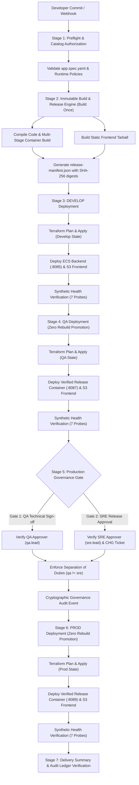

# UNIVERSAL ENTERPRISE DEVOPS AUTOMATION PLATFORM
## Non-AI Requirements & Architecture Blueprint Followed by the AI-Enhanced DevOps Roadmap

**Document Identifier:** `NERO-ARCH-BP-001`  
**Document Type:** Product Requirements, System Architecture and Engineering Roadmap  
**Programme:** Universal Enterprise DevOps Automation Platform (`nero_devops_standard`)  
**Architecture Strategy:** Deterministic Automation First, AI Intelligence Second  
**Deployment Model:** Hybrid — Local / On-Premises / Cloud  
**Primary Orchestrator:** Jenkins  
**Initial Execution Environment:** Floci-First Local Platform  
**Production Governance:** Human approval required for high-risk production changes  
**Current Development Status:** Planning and Architecture  
**Implementation Status:** Not authorized by this document  

---

# PART I — PRODUCT VISION AND SCOPE

## 1. Product Vision

Build a universal enterprise DevOps automation platform that automates the complete software delivery and operational lifecycle.

The platform allows an organization to register applications, build software, provision infrastructure, test releases, deploy applications, monitor workloads, manage incidents, recover failed services, and maintain operational compliance through a centralized automation system.

The primary goal is to eliminate repetitive manual DevOps work while maintaining security, governance, reliability, and traceability.

### 1.1 Product Principle

> **"Build the platform once. Register applications through configuration. Automate their delivery and operations through reusable, policy-controlled workflows."**

The platform must not require a separate manually maintained CI/CD implementation for every application.

### 1.2 Two-Programme Strategy

1. **Programme 1 — Deterministic DevOps Automation**  
   All automation is driven by:
   - Explicit rules and schema constraints.
   - Declarative configuration (`app.spec.yaml`, `platform_config.yaml`).
   - Workflow definitions (Jenkins declarative pipelines).
   - Events (SCM webhooks, lifecycle events).
   - Typed APIs and adapter contracts.
   - Idempotent scripts and Terraform modules.
   - Deterministic policies (least privilege, separation of duties).
   - Verified runbooks and health checks.
   - Tested recovery procedures.  
   *No LLM, AI agent, or machine-learning dependency is permitted in this programme.*

2. **Programme 2 — AI-Enhanced DevOps**  
   AI capabilities are added only after the deterministic platform has achieved sufficient operational maturity.  
   AI will initially observe, analyze, and recommend. Execution capabilities will be introduced incrementally with explicit authorization boundaries, schema validation, and human sign-off gates.

---

## 2. Business and Engineering Objectives

The platform achieves the following fifteen core objectives:

1. **Reduce Onboarding Effort**: Onboard new applications via declarative configuration rather than custom pipeline coding.
2. **Standardize Builds & Releases**: Establish standard compile, build, package, and release processes across all teams.
3. **Automate Infrastructure**: Derive and provision infrastructure via version-controlled Terraform modules with state isolation.
4. **Reusable Workflows**: Provide golden path deployment pipelines supporting rolling, canary, blue-green, static, and worker topologies.
5. **Eliminate Mutable Releases**: Enforce the immutable release pattern ("Build Once, Promote Everywhere").
6. **Automate Routine Testing**: Orchestrate unit, integration, API, UI, contract, and performance testing automatically.
7. **Automate Verification**: Execute synthetic health checks, dependency pinging, and deep-link routing verification post-deployment.
8. **Controlled Promotion & Rollback**: Support multi-environment promotion (`develop` ➔ `qa` ➔ `prod`) and zero-rebuild rollback to qualified manifests.
9. **Centralize Observability**: Collect logs, metrics, traces, and deployment audit events into centralized sinks.
10. **Automate Routine Recovery**: Execute predefined deterministic recovery runbooks for common failures (service restart, circuit breaker, failover).
11. **Shift-Left Security & Governance**: Integrate SAST, secret detection, container scanning, SBOM, provenance, and two-person approval into the delivery path.
12. **Local-Cloud Workflow Parity**: Provide consistent deployment mechanics across local simulation (Floci) and real cloud (AWS, Azure, GCP).
13. **Polyglot & Poly-Architecture Support**: Support Java, Node.js, Python, static frontends, background workers, and custom containers seamlessly.
14. **FinOps & Resource Governance**: Attribute costs per application/environment, enforce idle shutdowns, and prevent orphaned resource sprawl.
15. **Trusted Operational Foundation for AI**: Establish clean data models, event logs, and typed tool boundaries to safely host future AI agents.

---

## 3. Scope

### 3.1 Hosting Environments

| Environment Type | Scope & Description | Execution Targets |
|---|---|---|
| **Local / On-Premises** | Development environments, private container platforms, local cloud simulators, and private data centers. | Floci 2.4.0 (`http://floci:4566`), Local Docker Engine, Local PostgreSQL/SQS. |
| **Cloud** | Public-cloud environments and managed infrastructure services. | AWS (ap-south-1 / us-east-1), Amazon ECR, Amazon ECS Fargate, ALB, S3, RDS. |
| **Hybrid** | Polyglot applications whose components operate across local testing and cloud infrastructure. | Hybrid adapters bridging on-premises agents to cloud endpoints. |

*Note: The primary execution target is the Floci-first environment. Real cloud adapters must be independently qualified and certified before being designated production-ready.*

### 3.2 Application Technology Matrix

| Technology | Representative Runtimes | Required Automation |
|---|---|---|
| **Java** | Spring Boot 3.x, Maven 3.9+, Gradle 8.x | Multi-stage Dockerfile packaging, JDK 17/21 runtime validation, Spring profile binding, Actuator health verification. |
| **Node.js** | Express, NestJS, Next.js (Node 20/22) | `npm ci` lockfile installation, unit/lint testing, containerization, port mapping, REST contract verification. |
| **Python** | FastAPI, Django, Flask, Workers (Python 3.10-3.12) | Virtualenv / `uv` dependency locking, pytest execution, worker queue consumer loop validation. |
| **Frontend** | React, Vite, Angular, Vue, Svelte | Static build, chunk optimization, tarball packaging, S3 static website sync, SPA routing checks. |
| **Databases** | PostgreSQL 15+, MySQL, MongoDB, Redis | Infrastructure lifecycle, credentials injection via Secrets Manager, backward-compatible migration execution (no automatic destroys). |
| **Workers** | SQS Consumers, Celery, Scheduled Cron | SQS queue provisioning, concurrency tuning, dead-letter queue (DLQ) binding, worker heartbeat verification. |
| **Custom Containers**| Any compliant OCI Image / Dockerfile | Linting (`hadolint`), multi-stage builder execution, non-root user enforcement, vulnerability scanning. |

---

# PART II — FUNCTIONAL REQUIREMENTS

## 4. Application Onboarding Automation (`APP`)

- **APP-001**: Central Application Catalog must maintain a registry of approved applications, permitted environments, and authorized topologies.
- **APP-002**: Every application must have a unique identifier (`app_id`) conforming to lowercase alphanumeric hyphenated format (`^[a-z0-9-]+$`).
- **APP-003**: Every application must provide a declarative, version-controlled `app.spec.yaml`.
- **APP-004**: Application specifications must be validated against a formal Pydantic schema before any pipeline execution.
- **APP-005**: The platform must automatically identify declared components (`backend`, `frontend`, `worker`, `database`, `queue`).
- **APP-006**: Build and deployment adapters must be dynamically selected based on component specification.
- **APP-007**: Specifications must declare ports, health endpoints, runtime dependencies, and environment variable requirements.
- **APP-008**: Invalid or unauthorized specifications must fail immediately during the preflight phase.
- **APP-009**: Only authorized repositories and branch patterns may trigger deployment workflows.
- **APP-010**: Onboarding an application must automatically link logging, testing, and governance policies.

---

## 5. Source Control and Continuous Integration (`CI`)

- **CI-001**: Receive and authenticate repository webhook events (GitHub, GitLab, Bitbucket).
- **CI-002**: Validate repository identity, commit signatures, and branch protections.
- **CI-003**: Trigger the Universal Pipeline with sanitized parameters.
- **CI-004**: Retrieve and parse the application specification from the commit workspace.
- **CI-005**: Validate dependencies and runtime prerequisites deterministically.
- **CI-006**: Execute dependency installation strictly using lockfiles (`package-lock.json`, `pom.xml`, `poetry.lock`).
- **CI-007**: Compile and package application components inside isolated build environments.
- **CI-008**: Execute automated unit tests and capture execution metrics (JUnit XML).
- **CI-009**: Execute automated integration tests against containerized mocks.
- **CI-010**: Perform code-quality analysis (SonarQube/SpotBugs/ESLint) with blocking quality gates.
- **CI-011**: Execute mandatory security scanning (SAST, secret detection).
- **CI-012**: Produce immutable build artifacts tagged with unique release identifiers.
- **CI-013**: Archive test evidence, build logs, and cryptographic hashes as immutable pipeline artifacts.
- **CI-014**: Terminate pipeline execution immediately upon any validation failure.

---

## 6. Build and Packaging Automation (`BLD`)

- **BLD-001**: Detect and enforce supported runtime versions (JDK 17/21, Node 20/22, Python 3.10-3.12).
- **BLD-002**: Enforce approved hardened base images (Distroless, Alpine, Chainguard, Ubuntu LTS).
- **BLD-003**: Require lockfiles for all dependency resolutions; prohibit open-ended package ranges.
- **BLD-004**: Cache build dependencies securely using content-addressable cache keys.
- **BLD-005**: Produce reproducible container images by stripping volatile timestamps where supported.
- **BLD-006**: Build container images using Docker BuildKit with build secrets and non-root execution (`USER 10001:10001`).
- **BLD-007**: Generate immutable artifacts referenced by immutable tags and SHA-256 digests.
- **BLD-008**: Calculate cryptographic checksums for all binary tarballs and static bundles.
- **BLD-009**: Automatically generate CycloneDX / SPDX Software Bill of Materials (SBOM).
- **BLD-010**: Generate SLSA-compliant build provenance linking source commit, builder, and output digest.
- **BLD-011**: Scan generated images for CVEs (Trivy/Clair); block artifacts containing critical unpatched vulnerabilities.
- **BLD-012**: Retain build logs and container inspection metadata in the platform manifest registry.

---

## 7. Artifact and Release Management (`REL`)

- **REL-001**: Every release must be assigned a unique immutable identifier (e.g., `rel-YYYYMMDDHHMMSS`).
- **REL-002**: Container artifacts must be referenced by full 64-character SHA-256 digests (`image@sha256:...`).
- **REL-003**: Frontend static bundles must have SHA-256 checksums recorded in the release manifest.
- **REL-004**: Release manifests (`release-manifest.json`) must strictly adhere to the platform release schema.
- **REL-005**: Build provenance must link commit SHA, repository URL, builder identity, and timestamps.
- **REL-006**: Link SBOM references directly to the release manifest.
- **REL-007**: Release manifests must NEVER contain plaintext secrets or credentials.
- **REL-008**: Artifact registries must enforce authenticated role-based access control.
- **REL-009**: Promotion across environments (`develop` ➔ `qa` ➔ `prod`) must reuse the identical immutable release artifact (Zero Rebuild).
- **REL-010**: Prior to deployment, the platform must verify artifact digests against the stored manifest.

---

## 8. Infrastructure as Code Automation (`IAC`)

- **IAC-001**: Derive infrastructure topology (compute, storage, network) directly from the application specification.
- **IAC-002**: Maintain modular, reusable Terraform modules (`vpc`, `ecs`, `s3`, `rds`, `dynamodb`, `sqs`).
- **IAC-003**: All infrastructure modules must be strictly version-controlled.
- **IAC-004**: Execute `terraform plan` and store the plan file (`tfplan.<env>`) before any apply.
- **IAC-005**: Enforce complete state isolation: separate `.tfstate` files per environment and per application.
- **IAC-006**: Enforce state locking via DynamoDB / backend storage to prevent concurrent mutations.
- **IAC-007**: Run drift detection queries to detect out-of-band infrastructure mutations.
- **IAC-008**: Destructive actions (resource deletion/recreation) must be blocked unless explicitly authorized.
- **IAC-009**: Enforce mandatory tagging (`Application`, `Environment`, `ManagedBy`, `ReleaseId`).
- **IAC-010**: Export infrastructure outputs (`infra-outputs.<env>.json`) as structured, validated JSON for workload deployment.

---

## 9. Deployment Automation (`DEP`)

- **DEP-001**: Validate target environment and platform readiness prior to workload placement.
- **DEP-002**: Authorize target deployment environment against the central application catalog.
- **DEP-003**: Verify immutable release manifest and checksum integrity before dispatch.
- **DEP-004**: Verify infrastructure prerequisites (cluster active, database reachable, secret provisioned).
- **DEP-005**: Inject runtime configuration and secrets dynamically via environment variables or secret provider references.
- **DEP-006**: Execute deployment using the designated adapter (Docker, Floci ECS, AWS ECS, S3).
- **DEP-007**: Execute automated health checks against `/actuator/health` or `/health`.
- **DEP-008**: Execute synthetic functional smoke tests against API contracts and static assets.
- **DEP-009**: Record complete deployment evidence and container runtime IDs.
- **DEP-010**: Automatically halt promotion and trigger recovery if health checks fail.
- **DEP-011**: Provide automated zero-rebuild rollback to any previously verified release ID.
- **DEP-012**: Ensure database schema and state remain intact during rollback (no automatic schema dropping).

---

## 10. Environment and Release Promotion (`PROMO`)

The platform defines three standard delivery environments:
1. **Develop (`develop`)**: Rapid integration and functional validation. Automatically triggered upon commit.
2. **QA / Staging (`qa`)**: Comprehensive regression testing, performance validation, and security verification. Reuses the identical immutable release.
3. **Production (`prod`)**: Hardened high-availability live environment. Requires authenticated Two-Person Governance approval prior to deployment.

### Promotion Rules
- **Zero Rebuild**: Once built in Stage 2, artifacts are immutable. QA and Production deploy the exact digest validated in Develop.
- **Isolated State**: Each environment runs in its own network namespace, with its own dedicated database and configuration.
- **Audited Chain**: Every promotion step creates a cryptographically chained event in the audit ledger.

---

## 11. Automated Testing and Quality Engineering (`TST`)

- **TST-001**: Automatically select test suites based on component type and declared test profiles.
- **TST-002**: Enforce strict pass requirements; any failing test halts pipeline progression.
- **TST-003**: Archive test execution reports (JUnit XML, coverage HTML) with pipeline artifacts.
- **TST-004**: Flag and report flaky tests without masking real regression failures.
- **TST-005**: Measure code coverage independently; enforce coverage thresholds (e.g., minimum 80% line coverage).
- **TST-006**: Isolate destructive or performance tests to dedicated test environments.
- **TST-007**: Correlate all test evidence directly with the immutable release identifier.

---

## 12. Security and DevSecOps Automation (`SEC`)

- **SEC-001**: Scan all source code using SAST tools (Semgrep/Sonar) before compilation.
- **SEC-002**: Scan third-party dependencies for known CVEs (OWASP Dependency-Check / Trivy).
- **SEC-003**: Scan commits and pull requests for exposed secrets (Gitleaks / Trufflehog).
- **SEC-004**: Scan container images for vulnerabilities; block CRITICAL and HIGH severity findings.
- **SEC-005**: Generate and sign SBOMs for all released software components.
- **SEC-006**: Cryptographically sign container images and verify signatures before deployment.
- **SEC-007**: Enforce Infrastructure as Code security checks (tfsec / checkov) on all Terraform plans.
- **SEC-008**: Maintain least-privilege IAM policies; prohibit wildcard resource actions (`*`).
- **SEC-009**: Automate secret rotation and invalidate leaked credentials immediately.
- **SEC-010**: Mask all sensitive tokens, passwords, and keys in Jenkins console logs.
- **SEC-011**: Maintain an append-only, SHA-256 cryptographically chained audit log for all deployment actions.
- **SEC-012**: Plan isolation for Jenkins Docker build workers to eliminate unrestricted host Docker socket access.

---

## 13. Secrets and Configuration Automation (`SEC-CFG`)

- **SEC-CFG-001**: Decouple configuration from code; inject configuration via environment variables.
- **SEC-CFG-002**: Store secrets strictly in dedicated secret providers (AWS Secrets Manager / Vault / Floci Secrets Manager).
- **SEC-CFG-003**: Inject secrets at container startup; never bake secrets into images or Git repositories.
- **SEC-CFG-004**: Support automated secret rotation workflows with zero downtime.
- **SEC-CFG-005**: Audit all secret access requests and link them to deployment audit records.

---

## 14. Monitoring, Logging and Observability Automation (`OBS`)

- **OBS-001**: Collect runtime container metrics (CPU, Memory, Network I/O, Disk usage).
- **OBS-002**: Collect application metrics (HTTP request rate, response latency, error rate 5xx/4xx).
- **OBS-003**: Centralize container logs with structured JSON formatting and contextual correlation IDs.
- **OBS-004**: Collect distributed traces (OpenTelemetry / Jaeger) for cross-service call analysis.
- **OBS-005**: Define alerting rules with explicit severity thresholds (WARNING, CRITICAL).
- **OBS-006**: Correlate alerts with active deployment events to detect release-induced anomalies.

---

## 15. Incident Management and Recovery Automation (`OPS`)

- **OPS-001**: Detect service degradation automatically via continuous health polling.
- **OPS-002**: Classify failure modes using deterministic rule tables (connection refused, OOMKilled, timeout).
- **OPS-003**: Execute predefined deterministic recovery runbooks (restart container, failover endpoint).
- **OPS-004**: Trigger automated zero-rebuild rollback if post-deployment health verification fails.
- **OPS-005**: Record complete diagnostic bundles (logs, thread dumps, network states) before taking recovery actions.
- **OPS-006**: Require human authorization for destructive recovery actions (database restoration, data purge).

---

## 16. Database and Data Lifecycle Automation (`DATA`)

- **DATA-001**: Manage database infrastructure exclusively via Terraform; isolate database lifecycle from application deployment.
- **DATA-002**: Execute schema migrations using versioned migration tools (Liquibase / Flyway) under backward-compatible patterns.
- **DATA-003**: Prohibit automatic schema dropping or destructive column removals during application rollback.
- **DATA-004**: Schedule automated daily database backups and verify backup completion.
- **DATA-005**: Conduct periodic automated restore exercises in isolated environments to verify recovery point objectives (RPO).

---

## 17. FinOps and Resource Optimization Automation (`FINOPS`)

- **FINOPS-001**: Tag every provisioned cloud resource with `Application`, `Environment`, and `CostCenter`.
- **FINOPS-002**: Generate pre-apply cost estimates for Terraform infrastructure plans.
- **FINOPS-003**: Implement scheduled automated shutdown for non-production environments during off-hours.
- **FINOPS-004**: Identify and report orphaned resources (unattached EBS volumes, empty S3 buckets, unused EIPs).
- **FINOPS-005**: Prohibit automated deletion of production resources based on cost heuristics alone.

---

## 18. Compliance and Audit Automation (`AUDIT`)

- **AUDIT-001**: Log every platform action to an append-only JSONL ledger (`audit_log.jsonl`).
- **AUDIT-002**: Calculate canonical JSON representation and SHA-256 hash for every record.
- **AUDIT-003**: Link each audit record cryptographically to the hash of the preceding record (`previous_hash`).
- **AUDIT-004**: Generate HMAC-signed checkpoints to prevent unauthorized ledger truncation or tampering.
- **AUDIT-005**: Provide automated CLI verification (`verify_audit_ledger`) to certify ledger integrity during compliance audits.

---

# PART III — TARGET SYSTEM ARCHITECTURE

## 19. Architecture Principles

1. **Centralized Control Plane**: Unified catalog, policy, and governance engine.
2. **Distributed Execution Plane**: Language-specific build workers and isolated deployment agents.
3. **Declarative Configuration**: All application topology declared in `app.spec.yaml`.
4. **Event-Driven Workflows**: Triggered by SCM webhooks, schedule timers, or manual approval gates.
5. **Reusable Typed Adapters**: Well-defined contracts for builds, infrastructure, and deployment targets.
6. **Immutable Releases**: Build once in develop; promote identical artifacts to QA and Production.
7. **Policy as Code**: Security, compliance, and governance enforced programmatically before execution.
8. **Least Privilege**: Minimal IAM permissions, non-root containers, masked secrets.
9. **Idempotent Automation**: All scripts, plans, and deployments are safely re-runnable.
10. **Environment Isolation**: Dedicated state, databases, and network boundaries per environment.
11. **Complete Auditability**: Cryptographic hash chaining on all operational events.
12. **Provider Independence**: Core platform engine contains zero cloud vendor lock-in.
13. **Explicit Failure Handling**: Fail closed on security violations; provide deterministic rollback.
14. **Human in the Loop**: Mandatory authenticated Two-Person Governance for production deployments.
15. **Deterministic Foundation First**: Zero AI dependency for core continuous delivery.

---

## 20. Architecture Layers (1 to 10)

```
+-----------------------------------------------------------------------------------+
| LAYER 1: DEVELOPER & OPERATOR INTERFACE                                           |
| - Git Repositories (app.spec.yaml)     - Jenkins Self-Service Pipeline UI        |
| - Platform CLI (platform_core.engine)  - Operational Dashboards                  |
+-----------------------------------------------------------------------------------+
| LAYER 2: PLATFORM CONTROL PLANE                                                   |
| - Central Application Catalog          - Environment & Topology Registry          |
| - Spec Parser & Schema Validator       - Release Manifest Repository              |
+-----------------------------------------------------------------------------------+
| LAYER 3: WORKFLOW ORCHESTRATION                                                   |
| - Jenkins Declarative Universal Engine - Stage Sequencing & Parameter Binding     |
| - Two-Person Governance Gate           - Pipeline Evidence Archival               |
+-----------------------------------------------------------------------------------+
| LAYER 4: PLATFORM CORE ENGINE (Python)                                            |
| - CLI Controller (`cli.py`)            - Context Resolver (`resolver.py`)         |
| - Spec Validation (`spec_validator.py`)- Policy Validator (`policy.py`)          |
| - Universal Orchestrator (`orchestrator.py`)                                      |
+-----------------------------------------------------------------------------------+
| LAYER 5: BUILD & RELEASE ENGINE                                                   |
| - Dockerfile Multi-Stage Adapter       - Node.js Frontend Static Build Adapter    |
| - Maven/Gradle Java Build Adapter      - Python Worker Build Adapter              |
| - SBOM & Provenance Generator          - OCI Image Tagger & Digest Extractor      |
+-----------------------------------------------------------------------------------+
| LAYER 6: INFRASTRUCTURE ENGINE                                                    |
| - Terraform Adapter (`terraform_adapter.py`)                                      |
| - State Isolation (`develop`, `qa`, `prod`, `local`)                              |
| - Plan Validator & Output Extractor    - Modular Infrastructure Definitions       |
+-----------------------------------------------------------------------------------+
| LAYER 7: DEPLOYMENT ENGINE                                                        |
| - ECS Container Adapter (`ecs_adapter.py`) - S3 Static Adapter (`s3_adapter.py`)  |
| - Dynamic Port & Conflict Manager      - Zero-Rebuild Promotion Coordinator       |
| - Emergency Rollback Dispatcher        - Health Verifier (`health_verifier.py`)   |
+-----------------------------------------------------------------------------------+
| LAYER 8: OPERATIONS & RECOVERY ENGINE                                             |
| - Synthetic Health & Deep-Link Verifier- Deterministic Runbook Executor           |
| - Container Auto-Restart & Port Freeing- Diagnostic Log & Metric Harvester        |
+-----------------------------------------------------------------------------------+
| LAYER 9: SECURITY, GOVERNANCE & AUDIT                                             |
| - Two-Person Approval Verifier        - Cryptographic Audit Logger (`audit_logger`)|
| - Chained Hash Verifier (`audit_verifier`)- Secret Masker & KMS Provider Link     |
+-----------------------------------------------------------------------------------+
| LAYER 10: EXECUTION INFRASTRUCTURE                                                |
| [LOCAL SIMULATION (Floci 2.4.0)]             [REAL AWS CLOUD (Production)]        |
| - Floci Core Container (:4566)               - Amazon ECS Fargate                 |
| - Host Docker Daemon Engine                  - Application Load Balancers (ALB)   |
| - Host Port Mappings (8085, 8087, 8089)      - Amazon S3 + CloudFront CDN         |
| - Floci RDS PostgreSQL (7002, 7003, 7004)    - Amazon RDS PostgreSQL Multi-AZ     |
| - Floci SQS & Secrets Manager                - AWS Secrets Manager & STS          |
+-----------------------------------------------------------------------------------+
```

---

## 21. Core Platform Modules

The `platform_core` package inside `nero_devops_standard` implements these discrete modules:

| Module Path | Primary Class / Component | Responsibilities |
|---|---|---|
| `platform_core.engine.catalog` | `ApplicationCatalog` | Application authorization, environment permissions, platform enablement. |
| `platform_core.engine.models` | `ApplicationSpec`, `ComponentSpec` | Strongly typed Pydantic models for declarative application specifications. |
| `platform_core.engine.spec_validator` | `ApplicationSpecValidator` | Formal schema validation, port validation, duplicate check, path verification. |
| `platform_core.engine.resolver` | `EnvironmentResolver` | Maps `(app_id, env, platform, topology)` to concrete account IDs, ports, endpoints, and dirs. |
| `platform_core.engine.orchestrator` | `build_release`, `deploy_workload`, `rollback` | Coordinates build once, immutable release creation, promotion, and zero-rebuild rollback. |
| `platform_core.engine.cli` | Platform CLI entrypoint | Unified CLI interface invoked by Jenkins and local developers (`check-catalog`, `validate`, `build-release`, `tf-plan`, `tf-apply`, `deploy-container`, `deploy-frontend`, `verify`, `record-governance`). |
| `platform_core.adapters.build.docker_adapter` | `DockerfileBuildAdapter` | Executes container image builds, extracts SHA-256 digests, enforces BuildKit. |
| `platform_core.adapters.build.node_adapter` | `NodeFrontendBuildAdapter` | Installs frontend dependencies, builds production Vite bundle, produces compressed tarballs with SHA-256 checksums. |
| `platform_core.adapters.infrastructure.terraform_adapter` | `TerraformAdapter` | Formats, validates, plans, and applies Terraform infrastructure per environment with isolated state. |
| `platform_core.adapters.deployment.ecs_adapter` | `ECSDeploymentAdapter` | Dispatches container workloads to ECS (or Floci local emulation), manages port bindings, and cleans conflicting containers. |
| `platform_core.adapters.deployment.s3_adapter` | `S3StaticDeploymentAdapter` | Extracts static tarballs and synchronizes web assets to S3 buckets with correct MIME types. |
| `platform_core.adapters.verification.health_verifier` | `SyntheticHealthVerifier` | Executes resilient HTTP health checks, asset verification, and deep-link routing validation. |
| `platform_core.audit.audit_logger` | `record_audit_event` | Writes canonical JSON records to `audit_log.jsonl` with cryptographically chained SHA-256 hashes. |
| `platform_core.audit.audit_verifier` | `verify_audit_ledger` | Verifies the entire audit hash chain and validates signed checkpoints. |

---

## 22. Adapter Contracts

Every adapter implements a standardized, typed abstract interface:

```python
class BasePlatformAdapter(ABC):
    @property
    @abstractmethod
    def adapter_name(self) -> str:
        """Unique adapter name identifier."""
        pass

    @abstractmethod
    def validate_prerequisites(self, context: Dict[str, Any]) -> bool:
        """Validates local environment tools, binaries, and credentials."""
        pass

    @abstractmethod
    def execute(self, request: AdapterRequest) -> AdapterResult:
        """Executes the operational action and returns normalized results."""
        pass
```

---

# PART IV — AUTOMATED END-TO-END LIFECYCLE

## 23. Universal Application Delivery Lifecycle



---

# PART V — PRODUCTION SECURITY AND GOVERNANCE

## 24. Two-Person Production Governance Model

Production deployments require explicit, authenticated Two-Person Governance:
1. **Gate 1 — QA Technical Sign-off**:
   - Approver: QA Lead / Automation Lead (`qa.lead`).
   - Parameter: `QA_VERIFICATION_REFERENCE` (e.g., `QA-TEST-AUTOMATION-PASSED`).
   - Assertion: Test suites, regression runs, and synthetic checks passed in QA.
2. **Gate 2 — Operations / SRE Release Window Approval**:
   - Approver: SRE / Operations Lead (`sre.lead`).
   - Parameter: `CHANGE_TICKET_ID` (Strictly validated to match `CHG-*`).
   - Assertion: Release is authorized by Change Advisory Board (CAB) within the maintenance window.
3. **Separation of Duties**:
   - The platform strictly enforces `qa_approver != ops_approver`. If the same identity attempts to sign both gates, the pipeline halts with `[GOVERNANCE_VIOLATION]`.
4. **Cryptographic Audit Event**:
   - The approval event is signed and written to `audit_log.jsonl` before any production infrastructure change occurs.

---

## 25. Failure and Deterministic Recovery Matrix

| Failure Mode | Detection Point | Automated Recovery Response | Escalation Boundary |
|---|---|---|---|
| **Invalid Spec / Schema Error** | Preflight Stage | Fail closed; reject build; zero mutation. | Developer remediation required. |
| **Build / Test Failure** | Build Stage | Fail closed; release manifest not produced. | Developer remediation required. |
| **Port Binding Collision** | Deploy Stage | ECS adapter scans host ports and terminates conflicting stale container. | Automated self-healing. |
| **Post-Deploy Health Failure** | Synthetic Verification | Mark stage FAILED; trigger zero-rebuild rollback to previous manifest. | SRE alert dispatched. |
| **Database Connection Failure** | Health Verification | Inspect container logs; check DB endpoint; retry 25x with backoff. | Database admin notified. |
| **Governance Approval Timeout** | Governance Gate | 30-minute timeout expires; pipeline aborts cleanly without deploying. | Requester re-triggers when ready. |

---

# PART VI — NON-FUNCTIONAL REQUIREMENTS

- **Reliability**: All pipeline stages must be idempotent and restartable without manual state cleanup.
- **Scalability**: Support polyglot microservices, multiple environments, and concurrent application delivery pipelines.
- **Availability & DR**: Terraform state files, application manifests, and audit ledgers must be backed up to durable storage.
- **Performance**: Preflight validation under 3s; container deploy under 15s; synthetic verification under 15s.
- **Maintainability**: Typed adapter contracts; modular Python platform core; zero code duplication.
- **Security**: Non-root containers, secret masking, cryptographic hash chaining, strict separation of duties.

---

# PART VII — IMPLEMENTATION ROADMAP: NON-AI PROGRAMME 1

## 26. Programme 1 Phases (`A0` to `A9`)

### Phase A0: Product Requirements & Architecture Freeze (CURRENT MILESTONE)
- **Objectives**: Formally document requirements, freeze system architecture, define adapter contracts, and establish governance policies.
- **Deliverables**: Architectural Blueprint (`UNIVERSAL_ENTERPRISE_DEVOPS_AUTOMATION_PLATFORM_BLUEPRINT.md`), ADR Index and initial ADRs (ADR-001 through ADR-005), DevSecOps Threat Model (`THREAT_MODEL.md`), Phase Roadmaps.
- **Status**: Completed under `nero_devops_standard`.

### Phase A1: Platform Foundation & Floci Qualification
- **Objectives**: Solidify Floci-first local simulation, verify local registry, ensure Terraform state isolation (`infrastructure/terraform/environments/local`).
- **Deliverables**: Verified multi-account simulation, isolated state files, resilient health verifier.

### Phase A2: Universal Application Onboarding
- **Objectives**: Expand `app.spec.yaml` schema, formalize Pydantic models, support multi-component applications (Node.js, Java, Python).
- **Deliverables**: Central catalog validator, multi-application test suite.

### Phase A3: Complete CI Automation
- **Objectives**: SCM webhook receivers, automated unit/integration test runners, code-quality gates.
- **Deliverables**: End-to-end pull-request validation pipelines.

### Phase A4: Build, Registry & Immutable Release Automation
- **Objectives**: Hardened multi-stage Docker builds, SBOM generation (CycloneDX), artifact provenance tracking.
- **Deliverables**: Immutable release manifests, local OCI registry integration.

### Phase A5: Infrastructure Lifecycle Automation
- **Objectives**: Modular Terraform modules, pre-apply policy checks (`checkov`/`tfsec`), drift detection.
- **Deliverables**: Versioned Terraform infrastructure templates for develop, qa, prod.

### Phase A6: Universal Deployment & Promotion
- **Objectives**: Automated promotion across `develop` ➔ `qa` ➔ `prod`, zero-rebuild promotion, automated rollback.
- **Deliverables**: Multi-environment Jenkins pipeline, emergency rollback CLI.

### Phase A7: Testing & DevSecOps Automation
- **Objectives**: SAST, DAST, dependency scanning, container vulnerability scanning, quality gates.
- **Deliverables**: Integrated security gates in Jenkins pipeline.

### Phase A8: Observability, Recovery & Operations
- **Objectives**: Centralized metrics, log aggregation, automated incident detection, deterministic recovery runbooks.
- **Deliverables**: Resilient health verification, self-healing port cleanup.

### Phase A9: Enterprise Qualification & Governance
- **Objectives**: Two-person production governance gate, cryptographic audit ledger verification, enterprise certification.
- **Deliverables**: 100% verified multi-environment qualification across all standard applications.

---

# PART VIII — AI-ENHANCED DEVOPS ROADMAP: PROGRAMME 2

## 27. Programme 2 Architecture & Philosophy

The AI intelligence layer is strictly additive. It observes, analyzes, and recommends, but **never bypasses deterministic platform policies, security gates, or human governance approvals**.

```
+-----------------------------------------------------------------------------------+
|                           AI INTELLIGENCE LAYER                                   |
|                                                                                   |
|   +-------------------+  +-------------------+  +-----------------------------+   |
|   |   DevOps Copilot  |  |  Troubleshooter   |  | Release Intelligence Engine |   |
|   |  - Query platform |  |  - Analyze logs   |  | - Assess deployment risk    |   |
|   |  - Explain specs  |  |  - Identify root  |  | - Recommend rollout plan    |   |
|   |    & runbooks     |  |    causes         |  | - Predict regressions       |   |
|   +---------+---------+  +---------+---------+  +--------------+--------------+   |
+-------------|----------------------|---------------------------|------------------+
              |                      |                           |
              v                      v                           v
+-----------------------------------------------------------------------------------+
|                         AI GUARDRAILS & ACTION GATEWAY                            |
|  - Schema Validation of Proposals          - Strict Policy Enforcement            |
|  - Risk Classification (Low / High)        - Human Authorization Required for Prod|
|  - Read-Only Boundary Enforcement          - Audit Trail of AI Invocations        |
+-----------------------------------------------------------------------------------+
              |
              v
+-----------------------------------------------------------------------------------+
|               DETERMINISTIC PLATFORM CORE (Programme 1 System of Record)           |
|  - Jenkins Orchestrator     - Platform CLI Engine        - Terraform Adapter       |
|  - ECS & S3 Adapters        - Cryptographic Audit Ledger - Two-Person Governance  |
+-----------------------------------------------------------------------------------+
```

---

## 28. AI Capability Phases (`B0` to `B6`)

### Phase B0: AI Readiness and Data Foundation
- Standardize log schemas, structured metric events, and machine-readable runbooks.
- Establish read-only API interfaces with strict authorization boundaries.

### Phase B1: AI DevOps Copilot (Read-Only)
- Natural language interface to explain pipeline failures, query application status, and look up operational runbooks.
- Autonomy Level: **Level 1 (Read-Only)**.

### Phase B2: AI Troubleshooting Agent (Diagnostic)
- Ingest build and deployment logs, correlate metrics, and diagnose root causes of failures (e.g., placeholder resolution, port conflict).
- Autonomy Level: **Level 2 (Analyze & Recommend)**.

### Phase B3: AI Testing & Security Assistant (Advisory)
- Analyze code diffs to suggest missing unit/integration tests and prioritize discovered CVEs.
- Autonomy Level: **Level 2 (Proposals Only)**.

### Phase B4: AI Release & Deployment Intelligence (Predictive)
- Analyze commit velocity, test coverage changes, and infrastructure diffs to score deployment risk.
- Autonomy Level: **Level 2 (Risk Scoring)**.

### Phase B5: Bounded Autonomous Operations (Controlled Execution)
- Autonomously trigger predefined, non-destructive recovery runbooks (restart container, clear transient cache) within strict rate limits.
- Autonomy Level: **Level 4 (Bounded Runbooks)**.

### Phase B6: Adaptive DevOps Optimization (Continuous Improvement)
- Analyze long-term operational trends to recommend resource rightsizing and pipeline caching optimizations.
- Autonomy Level: **Level 5 (Continuous Analysis with Human-Approved Changes)**.

---

# PART IX — AI SAFETY, GOVERNANCE & AUTONOMY TIERS

## 29. Autonomy Tiers

| Level | Classification | Permissions | Human Oversight |
|---|---|---|---|
| **Level 1** | Informational | Read pipeline logs, manifests, and documentation. | None required for read operations. |
| **Level 2** | Advisory | Generate failure analysis, suggest test cases, propose config edits. | Proposals reviewed by human engineers. |
| **Level 3** | Prepared Action | Stage PRs, draft Terraform modifications, prepare rollback requests. | Requires explicit human approval to execute. |
| **Level 4** | Bounded Automation | Execute pre-approved deterministic runbooks on non-prod environments. | Monitored; alerts on unexpected deviations. |
| **Level 5** | Production Adaptive | Execute approved self-healing actions on production workloads. | Restricted to whitelisted non-destructive actions; CAB sign-off for policy updates. |

---

# PART X — ACCEPTANCE CRITERIA & PLATFORM KPIS

## 30. Programme 1 Acceptance Criteria

1. **Universal Onboarding**: Any supported microservice can be onboarded solely by providing `app.spec.yaml`.
2. **Immutable Build Once**: Zero recompilation across `develop`, `qa`, and `prod`.
3. **Infrastructure State Isolation**: Complete isolation of Terraform `.tfstate` per environment.
4. **Resilient Port & Process Management**: No port collision failures; automatic conflict resolution.
5. **Two-Person Governance Gate**: Enforced separation of duties between QA and SRE leads.
6. **Synthetic Health Verification**: 100% pass on all 7 synthetic verification probes.
7. **Tamper-Evident Audit Ledger**: 100% validity of SHA-256 cryptographic hash chain.
8. **Emergency Rollback**: Verified ability to roll back to any previous release within 30 seconds.

---

# PART XI — DEVELOPMENT GOVERNANCE & CURRENT STATUS

## 31. Existing Platform Preservation

The existing baseline must be preserved with zero disruption:
- **Floci Container**: `floci` running on `http://localhost:4566`.
- **Jenkins Container**: `jenkins` running on `http://localhost:8080`.
- **Local Terraform Baseline State**: `infrastructure/terraform/environments/local/terraform.tfstate` (Serial: 23, Managed Resources: 15).
- **Audit Ledger**: `platform_core/audit/audit_log.jsonl` (43 verified chained events).

## 32. Status of Phase 4 Stage 1.4

**Phase 4 — Stage 1.4: Enterprise Qualification Gap Remediation & Platform Hardening**  
Status: **PAUSED — AWAITING EXPLICIT APPROVAL**

*This blueprint document authorizes planning and architecture specification inside `nero_devops_standard/`. It does NOT authorize destructive infrastructure modification or live AWS resource creation.*
